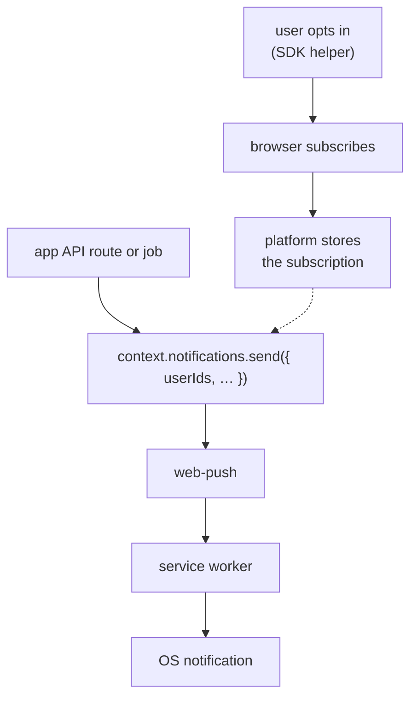

# Notifications (Web Push)

## Overview

Apps can send **Web Push** notifications — OS-level notifications delivered through a background service worker, so they reach a user even when no MixOS tab is focused (or open) — by setting `"notifications": true` in `app.json`. This gives the app a `context.notifications` client in its API routes and scheduled jobs.

```json
// app.json
{
  "name": "My App",
  "notifications": true
}
```

Push is **platform-native infrastructure**: subscriptions are stored once per user (not per app), the VAPID keys and service worker are managed by the platform, and any app can reach a user by id. You don't manage keys, endpoints, or a service worker yourself.

## How it works



1. A user opts in once (per browser) via the SDK helper — this grants permission and registers a subscription.
2. From an **API route** or a **scheduled job**, the app calls `context.notifications.send(...)` with the recipient user ids.
3. The platform looks up each recipient's stored subscriptions and delivers the push. The platform service worker shows the notification and routes clicks.

## Opting a user in (client)

A user must grant notification permission and subscribe before they can receive anything. Trigger this from a **user gesture** (e.g. a button click) using the apps SDK — never call the `Notification`, `ServiceWorker`, or `PushManager` browser APIs directly.

```tsx
"use client";
import { Button } from "@/components/ui/button";
import {
  enablePushNotifications,
  getPushPermission,
  isPushSupported,
} from "@/lib/apps/sdk";
import { useClientValue } from "@/lib/use-client-value";

function EnableAlertsButton() {
  // Browser-only checks, read without a hydration mismatch.
  const canAsk = useClientValue(
    () => isPushSupported() && getPushPermission() === "default",
    false,
  );
  if (!canAsk) return null;
  return <Button onClick={() => enablePushNotifications()}>Enable notifications</Button>;
}
```

`enablePushNotifications()` resolves to a status: `"subscribed" | "denied" | "unsupported" | "not-configured" | "error"`. The service worker is auto-registered for every signed-in user, so a previously-subscribed user keeps receiving pushes without re-enabling. Use `disablePushNotifications()` to opt out.

## Sending (server)

Send from an API route or a scheduled job via `context.notifications`. Guard for the capability the same way you guard `context.db`.

```ts
// apps/my-app/api/lunch/route.ts
import { z } from "zod";
import { defineRoute, AppError } from "@/lib/apps/route";

export const POST = defineRoute({
  summary: "Tell people lunch has arrived.",
  output: z.object({ sent: z.number() }),
  handler: async (context) => {
    if (!context.notifications) throw AppError.unavailable("Notifications are not enabled.");

    const { sent } = await context.notifications.send({
      userIds: ["<user-uuid>", "..."], // who to notify
      title: "Lunch has arrived!",
      body: "Lunch is here — head to the kitchen!",
      url: "/apps/my-app",              // opened/focused on click
      tag: "lunch",                     // optional: coalesces in the OS tray
      // icon: "/icon-192.png" (optional)
    });

    return { sent };
  },
});
```

### Payload fields

| Field | Required | Description |
| --- | --- | --- |
| `userIds` | ✓ | Recipient user ids. Automatically filtered (see below). |
| `title` | ✓ | Notification title. |
| `body` | ✓ | Notification body text. |
| `url` |  | In-app path focused/opened when the notification is clicked. Defaults to `/`. |
| `tag` |  | Notifications sharing a tag replace each other in the OS tray. |
| `icon` |  | Icon URL; defaults to the MixOS app icon. |

`send()` returns `{ sent }` — the number of subscriptions the push service accepted (a user with no/expired subscription simply contributes 0). Dead endpoints are pruned automatically.

## Recipient scoping

`send()` only delivers to users who actually have your app — global apps reach everyone; otherwise recipients are filtered to users with an explicit grant. You can't push to a user who doesn't have your app, even if you pass their id. Send from **API routes and scheduled jobs**: a request that resolves to the `public`, `password` or `key` tier gets no `context.notifications`, and neither do service handlers or MCP tools.

## Limits

- Delivery needs a registered subscription with granted permission — a user who never opted in, or who revoked permission, receives nothing.
- **Browser support:** desktop Chrome/Edge/Firefox deliver in the background reliably; on iOS, Web Push only works for a PWA **installed to the Home Screen** (iOS 16.4+).
- **Push services:** the platform sends only to the browser vendors' push services — Google's (Chrome and other Chromium browsers), Mozilla's, Apple's and Microsoft's — because the server POSTs to whatever endpoint a browser hands it. A browser using any other push service can't subscribe; the list is in `src/lib/push/endpoint.ts`.
- **HTTPS** is required in production (localhost is exempt for local dev).
- This is not email/SMS — it reaches browsers, not people who have never opened MixOS. For broader reach, use a connector (e.g. Slack/email) instead.

## Configuration (platform operators)

Web Push requires VAPID keys. Generate a pair with `npx web-push generate-vapid-keys` and set `VAPID_PUBLIC_KEY`, `VAPID_PRIVATE_KEY`, and `VAPID_SUBJECT` (a `mailto:`/`https:` contact) in your host's environment variables for production (see [Hosting](../hosting/README.md#environment)), or in `.env.docker` for the local Docker stack (compose loads it into every service — see [docs/local-docker.md](../local-docker.md)). A host `.env.local` reaches the dev container only through the bind mount and never reaches the production image, since `.dockerignore` excludes `.env*` from the build context. If they're unset, the opt-in returns `"not-configured"`, and `context.notifications.send()` throws whenever a recipient has your app, so catch it where a missing push shouldn't fail the request or job.
