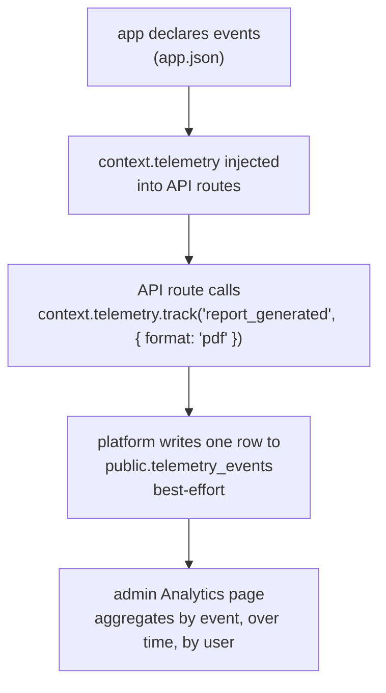

# Telemetry (Usage Tracking)

## Overview

Telemetry lets an app record **its own key-usage events** — "a report was generated", "a record was imported", "the wizard was completed" — so app authors can see how their app is actually used. It is a first-party, platform-owned capability: no third-party analytics SDK, no keys to manage. Events land in a platform table and surface on the admin **Analytics** page.

Telemetry is **developer-provided and opt-in**. You declare the events you care about in `app.json`; an app that declares nothing records nothing. The platform supplies the mechanism — you decide what "key usage" means for your app.

```json
// app.json
{
  "name": "My App",
  "telemetry": [
    { "name": "report_generated", "description": "User exported a report" },
    { "name": "record_imported", "description": "A record was imported from a connector" }
  ]
}
```

Each declared event is validated at registry-build time (like `widgets`, `schedules`, and `roles`). Recording an event name that isn't declared is a no-op — declare it first.

## How it works



1. The app declares its events in `app.json`.
2. Because the manifest declares telemetry, the platform injects a `context.telemetry` client into the app's **API routes** and **`jobs/` (system) context**.
3. The app calls `context.telemetry.track(name, properties?)` at the moment a key usage happens.
4. The platform records one best-effort row, scoped to the app's slug. Failures never block the request.

## Recording an event (server)

Record from an **API route** or a scheduled **job** via `context.telemetry`. Guard for the capability the same way you guard `context.db` / `context.notifications`.

```ts
export async function POST(request: Request, { context }: { context: AppContext }) {
  // ... do the work ...

  // Best-effort: never throws, never blocks the response.
  await context.telemetry?.track("report_generated", {
    format: "pdf",
    pageCount: 12,
  });

  return NextResponse.json({ ok: true });
}
```

- **First arg** — the event name. Must be one of the events declared in `app.json`; an undeclared name is dropped.
- **Second arg (optional)** — a small JSON `properties` bag for dimensions you want to break down by (e.g. `format`, `source`). Keep it low-cardinality; do **not** put PII, secrets, or free-text user input here.
- `track()` resolves whether or not the write succeeds — telemetry is non-critical, so a DB hiccup never surfaces to the user.
- The client is **scoped to your app's slug**: you can only write your own app's events.

## Recording usage from the browser (client)

For usage that only happens client-side (a widget interaction, a page view within the app), use the `track()` helper from the apps SDK — the same place as `enablePushNotifications()`. It POSTs to a platform ingest route that validates your session and checks the event against your manifest. Widgets and pages must **never** write telemetry directly to the database or import server modules; they go through the SDK helper, exactly as they call their own API routes via `createAppClient(appSlug)`.

```tsx
"use client";
import { track } from "@/lib/apps/sdk";
import type { WidgetProps } from "@/lib/hooks/types";

function ExportButton({ appSlug }: WidgetProps) {
  // Pass your appSlug (widgets/pages receive it in props). Fire-and-forget.
  return (
    <button onClick={() => track(appSlug, "report_generated", { format: "pdf" })}>
      Export
    </button>
  );
}
```

Like the server client, an undeclared event name is rejected (and dropped) — declare it in `app.json` first.

## Where it shows up

Events are visible to admins under **Administration → Analytics**. Selecting your app shows:

- event counts broken down by event name,
- a trend over a selectable time range,
- top users.

If your app also declares [MCP tools](mcp.md), the same view adds an MCP section
(per-tool request counts, trend, by-client, and top users). Those rows are
recorded for you — MCP calls are **not** declared like events are, because an app
doesn't choose to be read by a model. An app with `mcp` and no `telemetry` still
appears in the selector, showing only the MCP section.

## Storage

Events are recorded in a platform-owned table, `public.telemetry_events`:

| Column | Notes |
| --- | --- |
| `id` | uuid |
| `source_type` | `'app'` \| `'connector'` |
| `source_slug` | the app slug (for app events) |
| `caller_app_slug` | null for app events (used by connector telemetry) |
| `event_name` | the declared event name |
| `user_id` | nullable (null for system/job and public-surface events) |
| `properties` | `jsonb` — your dimensions bag |
| `created_at` | timestamptz |

There is intentionally **no foreign key** to `apps` — events stay attributed to the slug whatever happens to the app's `apps` row, matching the existing `app_open_events` design.

## Limits

- **Declared events only.** Undeclared names are dropped silently — this is deliberate, to prevent typos and cardinality sprawl. Add the event to `app.json` first.
- **Best-effort.** Telemetry never blocks or fails a request; treat missing data as possible, not impossible.
- **Not for PII or secrets.** `properties` is for low-cardinality dimensions, not user content or credentials.
- **Public/password surfaces** have no user; those events record `user_id = null`.

## How it's wired (platform internals)

You don't need this to use telemetry, but for reference: the manifest field lives on `AppManifest` ([`src/lib/apps/types.ts`](../../src/lib/apps/types.ts), validated in [`scripts/manifest-schemas.ts`](../../scripts/manifest-schemas.ts)); events land in `public.telemetry_events` ([the platform schema](../../supabase/migrations/0001_initial.sql)); the server client is [`src/lib/apps/telemetry.ts`](../../src/lib/apps/telemetry.ts), injected as `context.telemetry` in [`src/lib/apps/context.ts`](../../src/lib/apps/context.ts); the browser helper and ingest route are [`src/lib/apps/sdk.ts`](../../src/lib/apps/sdk.ts) `track()` → `/api/analytics/track`; and the admin views come from [`src/lib/analytics/queries.ts`](../../src/lib/analytics/queries.ts).

Connector-side telemetry is documented in [`docs/connectors/telemetry.md`](../connectors/telemetry.md).
