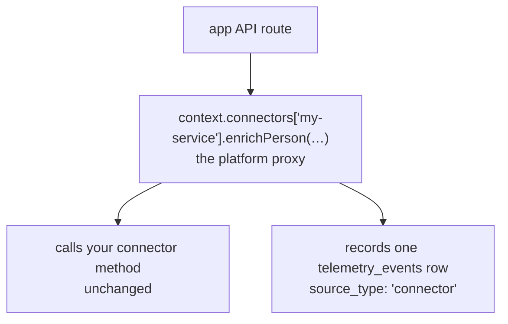

# Telemetry (Usage Tracking)

## Overview

Telemetry lets you see **how a connector is actually used** — which operations get called, how often, and **which apps** are driving them. It is developer-provided and opt-in: you declare the methods you want counted in `connector.json`, and the platform does the rest. A connector that declares nothing is never instrumented.

```json
// connector.json
{
  "name": "my-service",
  "telemetry": [
    { "method": "enrichPerson",  "description": "Enriched a person record" },
    { "method": "enrichCompany", "description": "Enriched a company record" }
  ]
}
```

## Connectors write no telemetry code

This is the key rule and it is deliberate. **You do not import anything, and you do not call `track()` from `index.ts`.** Connectors stay exactly as they are today — stateless, server-side-only, no platform-internal imports, no logging of secrets. Telemetry is declared in the manifest and applied by the platform.

The reason: apps never touch a connector directly — they reach it through the platform proxy `context.connectors.<name>`. That proxy is where instrumentation lives. When you declare a method in `telemetry`, the proxy wraps that method and records one event per call. Your connector class is untouched.



Only the method name and the declared, non-sensitive metadata are recorded — **never** call arguments, response bodies, credentials, or tokens.

## Caller-app attribution

Because every call flows through an app's `context.connectors.<name>` proxy, the platform always knows **which app** made the call. Every connector telemetry row records that app's slug as `caller_app_slug` alongside the connector's own `source_slug`. This answers the question connector authors care about most: *which apps use my connector, and how heavily?* The admin Analytics page surfaces this as a per-connector breakdown by calling app.

## Where it shows up

Events are visible to admins under **Administration → Analytics**. Selecting your connector shows:

- call counts broken down by declared method,
- a trend over a selectable time range,
- a breakdown **by calling app** (`caller_app_slug`).

## Why the manifest, not the class

The **manifest is the visible spec** and the **platform is the operative
behavior**. Declaring `telemetry` opts specific methods into instrumentation
without the connector class changing — no tracker import, no call site, nothing
for a connector author to forget. The registry generator validates that each
declared `method` actually exists on the class at build time.

## Limits

- **Declared methods only.** A method not listed in `telemetry` is never counted. Method names must match the public methods on your class.
- **The list also decides what an MCP tool can call.** A tool reaches a connector only through the methods listed here, and one marked `"mutates": true` throws when a tool calls it — so mark every method that changes anything upstream. See [MCP tools](../apps/mcp.md#read-only-is-enforced-not-requested).
- **No custom/domain events.** Connector telemetry counts method *calls* — it is auto-instrumented, not a general `track(event, props)` API. If you need arbitrary custom events, emit them from the **app** that calls the connector, using [app telemetry](../apps/telemetry.md).
- **Best-effort.** Recording never blocks or fails a connector call.
- **Never sensitive.** Arguments, results, and credentials are never recorded — only the method name and declared metadata.

## How it's wired (platform internals)

You don't need this to use telemetry, but for reference: the manifest field lives on `ConnectorManifest` ([`src/lib/connectors/types.ts`](../../src/lib/connectors/types.ts), validated in [`scripts/manifest-schemas.ts`](../../scripts/manifest-schemas.ts)); the auto-instrumentation proxy is `instrumentConnector` in [`src/lib/apps/telemetry.ts`](../../src/lib/apps/telemetry.ts), applied where `context.connectors` is assembled in [`src/lib/apps/context.ts`](../../src/lib/apps/context.ts) (this is where `caller_app_slug` is captured); calls land in the shared `public.telemetry_events` table (see [app telemetry storage](../apps/telemetry.md#storage)); and the admin connector view + by-caller-app breakdown come from [`src/lib/analytics/queries.ts`](../../src/lib/analytics/queries.ts).

App-side telemetry is documented in [`docs/apps/telemetry.md`](../apps/telemetry.md).
