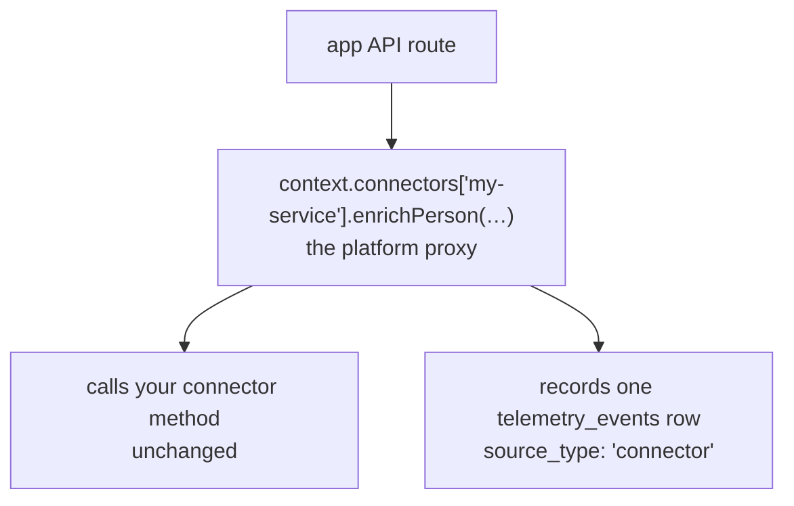

# Telemetry (Usage Tracking)

## Overview

Telemetry lets you see **how a connector is actually used** — which operations get called, how often, and **which apps** are driving them. You list the connector's methods in `connector.json`, and the platform does the rest.

The list is required, not opt-in: **every public method on the class must be in it**, or the build fails. The exceptions are `initialize`, `testConnection` and `handleWebhook`, which only the platform calls. Make a helper `private` if apps should not call it, give each method the provider `operation` it calls, and mark each method that changes anything upstream `"mutates": true`.

```json
// connector.json
{
  "name": "my-service",
  "telemetry": [
    { "method": "enrichPerson",  "operation": "POST /people/enrich",    "description": "Enriched a person record" },
    { "method": "enrichCompany", "operation": "POST /companies/enrich", "description": "Enriched a company record" },
    { "method": "updatePerson",  "operation": "PATCH /people/{id}",     "description": "Updated a person record", "mutates": true }
  ]
}
```

`operation` is the provider operation as its reference names it: a path, an RPC
method, a GraphQL operation. No two methods may name the same one, so the list
reads as a map of what the connector covers of the provider's API, and the
Connector Registry shows it on the connector's Details tab.

## Connectors write no telemetry code

This is the key rule and it is deliberate. **You do not import anything, and you do not call `track()` from `index.ts`.** Connectors stay exactly as they are today — stateless, server-side-only, no platform-internal imports, no logging of secrets. Telemetry is declared in the manifest and applied by the platform.

The reason: apps never touch a connector directly — they reach it through the platform proxy `context.connectors.<name>`. That proxy is where instrumentation lives. When you declare a method in `telemetry`, the proxy wraps that method and records one event per call. Your connector class is untouched.



Each row records the connector, the method, the calling app, **the user whose request made the call** (none for a scheduled job or a public route), and whether the call succeeded, with its error category if it did not. **Never** call arguments, response bodies, credentials, or tokens.

## Caller-app attribution

Because every call flows through an app's `context.connectors.<name>` proxy, the platform always knows **which app** made the call. Every connector telemetry row records that app's slug as `caller_app_slug` alongside the connector's own `source_slug`. This answers the question connector authors care about most: *which apps use my connector, and how heavily?* The admin Analytics page surfaces this as a per-connector breakdown by calling app.

## Where it shows up

Events are visible to admins under **Administration → Analytics**. Selecting your connector shows:

- call counts broken down by declared method,
- a trend over a selectable time range,
- a breakdown **by calling app** (`caller_app_slug`).

The connector's **Usage Logs** tab, under **Administration → Connectors**, lists its last 100 calls: when, which app, which user by name, which method, and the result.

## Why the manifest, not the class

The **manifest is the visible spec** and the **platform is the operative
behavior**. Declaring `telemetry` instruments the methods without the
connector class changing — no tracker import, no call site, nothing for a
connector author to forget. The registry generator checks the list against the
class at build time, both ways: every public method must be declared, and every
declared `method` must be a public method on the class.

## Limits

- **Every public method, and nothing else.** The build fails on a public method missing from `telemetry`, and on a listed method the class doesn't have as a public method.
- **The list also decides what an app and an MCP tool can call.** Each reaches a connector only through the methods listed here: an app's write needs `"access": "write"` on its entry and an admin's Allow changes, and a tool's always throws — so mark every method that changes anything upstream. See [Changing data](architecture.md#changing-data) and [MCP tools](../apps/mcp.md#read-only-is-enforced-not-requested).
- **No custom/domain events.** Connector telemetry counts method *calls* — it is auto-instrumented, not a general `track(event, props)` API. If you need arbitrary custom events, emit them from the **app** that calls the connector, using [app telemetry](../apps/telemetry.md).
- **Best-effort.** Recording never blocks or fails a connector call.
- **No payloads.** Arguments, results, and credentials are never recorded. The calling user is: admins see their name beside each call on the Usage Logs tab.

## How it's wired (platform internals)

You don't need this to use telemetry, but for reference: the manifest field lives on `ConnectorManifest` ([`src/lib/connectors/types.ts`](../../src/lib/connectors/types.ts), validated in [`scripts/manifest-schemas.ts`](../../scripts/manifest-schemas.ts)); the auto-instrumentation proxy is `instrumentConnector` in [`src/lib/apps/telemetry.ts`](../../src/lib/apps/telemetry.ts), applied where `context.connectors` is assembled in [`src/lib/apps/context.ts`](../../src/lib/apps/context.ts) (this is where `caller_app_slug` is captured); calls land in the shared `public.telemetry_events` table (see [app telemetry storage](../apps/telemetry.md#storage)); and the admin connector view + by-caller-app breakdown come from [`src/lib/analytics/queries.ts`](../../src/lib/analytics/queries.ts).

App-side telemetry is documented in [`docs/apps/telemetry.md`](../apps/telemetry.md).
