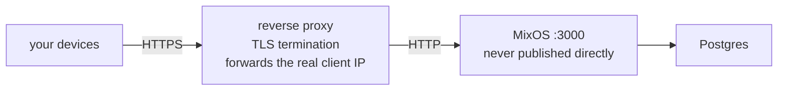

# Securing your install

Once MixOS is online, a few things keep it safe: an encrypted address, a
deliberate choice of who can reach it, and sign-in limited to the people you
mean. Most of it is a setting or two. Do this before anyone else can reach it.

## The short version

- **Always use HTTPS.** Every host page sets it up; never serve MixOS over plain
  `http://`. Session cookies only get the `__Secure-` prefix and the `secure`
  flag over TLS, and MixOS sends an HSTS header regardless.
- **Never put a development copy online.** Its keys are public, shared by
  everyone with the code. The dev container listens only on `127.0.0.1:3000` on
  purpose: its `.env.docker` is committed, including an `AUTH_SECRET` that lets
  anyone with a clone forge a session, and the `CONNECTOR_ENCRYPTION_KEY` that
  decrypts the API keys pasted into Admin > Connectors. Host MixOS properly, with
  keys of its own.
- **Only people you add can sign in.** There's no sign-up page: an admin creates
  each account at Admin > Users. Email and password is the only way in, and
  sign-in only succeeds for an account that already exists. To limit which
  addresses can be given an account at all, set
  `ALLOWED_EMAIL_DOMAINS=yourcompany.com`; it's checked when an admin creates an
  account, and again at sign-in.
- **Keep the keys safe.** Three of them unlock stored data: see
  [Back it up](README.md#back-it-up).
- **Decide who can reach it at all.** The fewer people who can reach it, the
  less there is to defend.

## Who can reach it

Three ways to expose MixOS, from most private to most open:

- **A private network.** The safest, and usually the least work. Your devices
  join a private network, with a tool like [Tailscale](https://tailscale.com) or
  WireGuard, and only that network can reach MixOS. It's never on the public
  internet, so there's no public surface to defend.
- **Public, with sign-in.** Standard, and workable. MixOS has a public address,
  and signing in is the gate. A few things answer without signing in, by design:
  the scheduler endpoint, `/api/cron`, which needs its secret; the OAuth
  endpoints, and connectors' inbound webhooks; and any app route its author
  declared `public` or `password`.
  [The exposed surface](../../security-architecture.md#18-the-unauthenticated-surface)
  lists everything that answers without a session; read it before choosing
  this.
- **Public app pages.** On purpose, per app. Some apps publish pages at
  `/p/<slug>`, or accept API keys for other machines. That's a feature, but every
  route reachable that way is one an app's author declared, so review those
  declarations rather than assume them.

## Taking access away

**One person:** revoke their sessions, when they leave or lose a laptop.
**Everyone:** change `AUTH_SECRET`, which signs everyone out. Sessions are JWTs,
so there's no session row to delete, but each user has a session counter that's
checked on every request. Revoking bumps it, and so does a password change.
Removing someone's access to an app needs neither: app grants are read again on
every request.

## If a release you run is withdrawn

When a publisher withdraws a release of an extension you installed from
mixos.org, for a security problem say, a notice at the top of Admin > Apps,
Connectors and Themes says so within about a day, with their reason: the
[daily check for updates](README.md#release-and-update-notices) finds it.
Nothing is switched off or updated for you. Each withdrawn release is also
logged on the server as a warning starting `[update-check]`, for an alert to
catch.

**Deactivate is the incident response.** On a withdrawn app's notice, it turns
the app off for everyone on the instance: from the next request or tick, none of
its code runs, with no restart, and its data and grants stay. For a connector,
**Disable** on its tile in Admin > Connectors turns it off for the whole
instance: no app can call it until an admin enables it again. Then update to a
release that isn't withdrawn and turn it back on once you've checked it, or
remove the extension. See
[Updating an extension](README.md#updating-an-extension).

## What to watch

- **`401` responses on `/api/cron`.** Your scheduler lost its secret, or
  something is calling the endpoint without it.
- **Fewer rate-limit responses than you'd expect.** When the database has
  trouble, each server limits on its own count in memory, so a sudden absence of
  `429`s under load is worth checking.
- **The admin audit trail.** Admin actions are recorded; see
  [The audit trail](../../security-architecture.md#28-admin-audit-trail).

## If you run your own proxy

Every host page puts HTTPS in front of MixOS for you. Only if you run your own
proxy, such as nginx or Traefik, does it need these settings:

| It must | Why |
| --- | --- |
| Terminate TLS | Session cookie flags, and the HSTS header MixOS already sends |
| Forward the real client address, in `X-Forwarded-For` or `X-Real-IP` | The rate limiter counts by address; a proxy that presents itself as every client puts everyone in one bucket |
| **Not** set a `Content-Security-Policy` | MixOS sets one per request, with a nonce. Two policies are *intersected*, not merged, so a second one breaks MixOS without a word |
| Pass the `Authorization` header through | App API keys and the MCP endpoint need it |
| Allow request bodies up to 27 MB | MixOS's own limit. A lower proxy limit turns a valid upload into a proxy error |

Make MixOS reachable only through the proxy: publish its port on loopback or a
private interface, never on `0.0.0.0`. The Docker Compose setup already publishes
it on `127.0.0.1` only.

On a custom domain, set `NEXTAUTH_URL` to the public address, exactly. Signing in
sends people on to `NEXTAUTH_URL`, and the session cookie belongs to the address
they signed in at, so a mismatch shows up as an endless sign-in loop rather than
an error.

## Before going public

Read the [security architecture](../../security-architecture.md): the trust
boundaries, the key inventory and the row-level security coverage. Then read the
[secure edge gateway](../../secure-edge-gateway-architecture.md), for the request
path in front of it.
