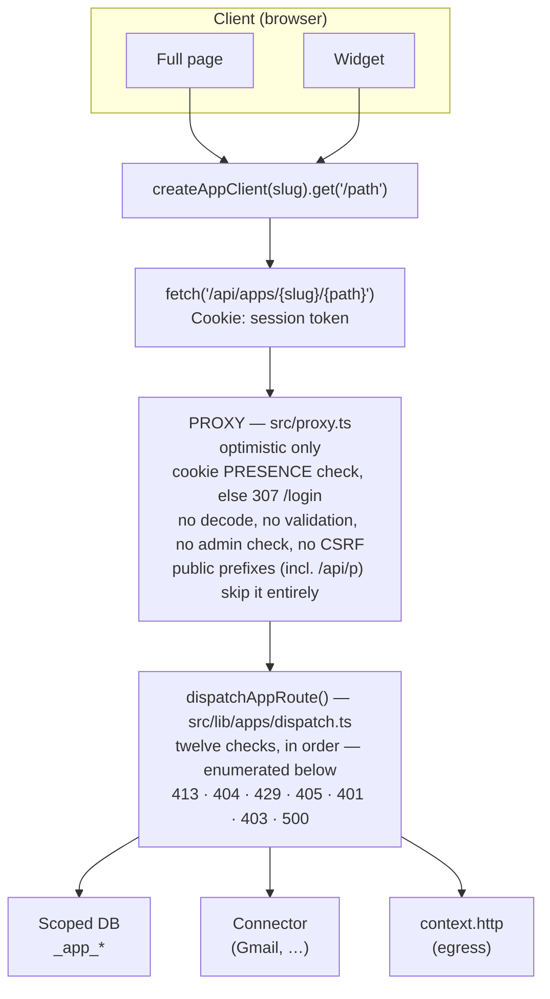

# Secure Edge Gateway Architecture

How MixOS routes, authenticates, and executes app requests. This is a reference
of the *current* system — a description, not a proposal.

Its companion is [`security-architecture.md`](security-architecture.md), which
covers the same machinery from a threat and audit angle. This document is the
one to read to understand the request path; that one is the one to read to review
it. Where they overlap, the authority is the code.

## Goal

All database and connector access from app code goes through one authenticated
pipeline. Credentials never reach the browser. Apps cannot reach across the
boundary into other apps' data. Every app inherits the same security and
operational posture by construction.

---

## Two mounts, one pipeline

There are two HTTP entry points, and they are thin bindings over the same
function:

| Mount | Path | Serves tiers | Caller |
|---|---|---|---|
| authenticated | `/api/apps/<slug>/<path>` | `session`, `signed-in`, `public` | a signed-in browser, via `createAppClient` |
| public | `/api/p/<slug>/<path>` | `password`, `key`, `public` | an anonymous visitor, or a machine with an API key |

Both files ([`/api/apps/[...slug]/route.ts`](../src/app/api/apps/%5B...slug%5D/route.ts),
[`/api/p/[appSlug]/[[...slug]]/route.ts`](../src/app/api/p/%5BappSlug%5D/%5B%5B...slug%5D%5D/route.ts))
do nothing but call `dispatchAppRoute({ ..., mount })` and re-export it under the
five HTTP methods. **All the logic lives in
[`src/lib/apps/dispatch.ts`](../src/lib/apps/dispatch.ts).**

They were parallel implementations once. That is how the public mount acquired a
gate the authenticated one never had, and the authenticated one ended up checking
the wrong table. Keeping them as bindings is what stops them drifting again.



---

## The dispatcher, step by step

| # | Step | Fails with |
|---|------|------------|
| 1 | Body cap — `content-length` compared against `MAX_BODY_BYTES` (27 MB) **before the body is read** | 413 |
| 2 | `appRegistry` lookup for the slug | 404 |
| 3 | Per-IP token bucket (60 burst, 10/s). IP is the **rightmost** `x-forwarded-for` entry | 429 + `Retry-After` |
| 4 | `resolveRoutePath()` maps URL segments to an on-disk pattern; `[]` → `api/index/route.ts` | 404 |
| 5 | Does this mount serve any tier the route declares? Decided from the **hoisted registry contract**, so no app module is imported for a caller the route would refuse | 404 |
| 6 | Dynamic `import()`, then method lookup. Import and dispatch are **separate**, so a module that throws at load is not reported as missing | 404 / 405 / 500 |
| 7 | The live declaration must match what step 5 was decided on. A gate decided from one source and enforced from another is not a gate | 404 |
| 8 | `resolveAuthTier()` — which tier has the caller earned? | 401 / 403 / 404 |
| 9 | CSRF double-submit token — **authenticated mount, identity tiers, mutating methods only** | 403 `CSRF_FAILED` |
| 10 | Identity-aware limits: per user+app (120 burst, 4/s) and per route (90 burst, 3/s). Subject is the user where there is one, the IP where there is not | 429 |
| 11 | `buildAppContext(appSlug, dbUser)` or `buildPublicAppContext(appSlug)`, in a try-catch | 500, generic body |
| 12 | `runRoute()` — role gate, input schema, connector/wall-clock budget, output schema | 403 / 400 / 429 / 504 / 500 |

Step 8 fails **closed**: an authorization decision the platform could not make is
not a decision it skips.

Step 8 also answers differently per mount. On the public mount an identity
challenge would confirm the route exists, so an unauthenticated caller gets 404.
On the authenticated mount the caller is already known to be a browser with a
cookie, so 401 is the useful answer.

---

## Auth tiers

A route declares which tiers it accepts. `resolveAuthTier`
([`auth-tier.ts`](../src/lib/apps/auth-tier.ts)) intersects that set with what
the mount can serve and walks it **strongest-first**, stopping at the first match:

```
session  >  signed-in  >  password  >  key  >  public
```

| Tier | Requires | `context.user` |
|---|---|---|
| `session` | a session **and** `hasAppGrant` for this app | populated, with app roles |
| `signed-in` | a session only; app roles are stripped | populated, no roles |
| `password` | the app's unlock cookie (public mount only) | `null` |
| `key` | a scoped app API key (public mount only) | `null` |
| `public` | nothing | `null` |

A route declaring `["session", "public"]` therefore serves a granted user their
own data and a stranger the public view, from one handler, with `context.user`
typed nullable so the compiler forces both branches to exist.

**Authorization is `hasAppGrant`, not `hasAppAccess`.** The former reads
`user_app_grants` and short-circuits true for a `global` app. The latter reads
`user_apps`, which records that a user *installed* the app on their dashboard — a
layout preference, not a permission. `hasAppAccess` has no callers and should not
acquire any.

**The `key` tier is implemented** ([`api-keys.ts`](../src/lib/apps/api-keys.ts)):
keys are `mosk_`-prefixed random strings stored as HMAC-SHA256 digests, bound to
one app, and scope-checked per method and route pattern — a key minted for one
endpoint does not become a key for the whole app. It is served on the public
mount only, because `/api/apps` sits behind the proxy's cookie check and a
machine caller has no cookie.

---

## The route contract: `defineRoute`

A route is a **declaration, not a bare function**. This is the shape:

```ts
// apps/my-app/api/hello/route.ts
import { z } from "zod";
import { defineRoute } from "@/lib/apps/route";

export const GET = defineRoute({
  summary: "Greet the signed-in user.",
  auth: ["session"],
  input: z.object({ shout: z.boolean().default(false) }),
  output: z.object({ message: z.string() }),
  handler: async (context, input) => {
    const message = `Hello, ${context.user.displayName}!`;
    return { message: input.shout ? message.toUpperCase() : message };
  },
});
```

`export async function GET(request, { context })` is a **build failure** —
[`generate-project-registry.ts`](../scripts/generate-project-registry.ts) throws
`FatalManifestError` on a bare handler, and an unbranded export is a 500 at
runtime. The reason is that everything above `handler` has to be readable by
something other than the handler: the build checks roles against the manifest,
the dispatcher enforces `auth` before any app code runs, and the generated client
types itself from the schemas.

Rules:

- **Folder path = URL path.** `api/items/[id]/route.ts` → `/api/apps/<slug>/items/<id>`.
- **One `defineRoute` per method.** Missing methods are 405.
- **Handler signature is `(context, input)`** — and `(context, input, request)` for
  `raw: true` routes, which own their own `Response`.
- **`output` is required** unless `raw: true`. It is validated on the way out, so
  a route cannot quietly return a shape its widget does not expect.
- **Roles are default-deny and do not bow to `isAdmin`.** A platform admin without
  the app role gets 403. Roles are only valid on `auth: ["session"]`, enforced at
  build *and* runtime.
- **You return plain data.** The platform serializes it, picks the status, and
  turns a thrown `AppError` into the right code — no hand-written 404, and no
  chance of leaking a driver message.
- **`budget` caps connector calls and wall clock**, so a route that turns into an
  N+1 fails loudly rather than costing thirty seconds.

---

## AppContext

[`context.ts`](../src/lib/apps/context.ts) builds a fresh context per request.
Three shapes exist — `AppContext` (identity tiers), `PublicAppContext`
(`user: null`), and `SystemAppContext` (scheduled jobs, no user but a trusted
server context):

```ts
interface AppContext {
  user: AppContextUser;                      // id, email, displayName, isAdmin, roles, hasRole()
  connectors: Record<string, BaseConnector>; // from manifest.connectors
  db: ScopedClient | null;                   // manifest.database
  notifications: NotificationsClient | null; // manifest.notifications
  telemetry: TelemetryClient | null;         // manifest.telemetry
  services: ServicesClient | null;           // manifest.consumes
  env: AppEnv;                               // manifest.env, admin-filled
  http: AppHttpClient | null;                // manifest.egress
  manifest: AppManifest;
  hooks: HookRegistrar;
}
```

Each capability field is `null` unless the manifest asks for it. That is the
grant model: an app gets what it declared and nothing else.

### Connectors

For each name in `manifest.connectors`, the builder imports
`@connectors/<name>/index`, instantiates it, and calls `initialize()` with
decrypted credentials. Credentials are decrypted **only** here, server-side, and
never serialized into a response.

Two credential models:

- **Tenant-scoped** (the default) — one credential set in `connector_configs`,
  configured once by an admin, shared by everyone. Any response the connector
  returns is the same response any user would have received.
- **User-scoped** (`userScoped: true`) — the client id and secret still come from
  the tenant row, but the OAuth *grant* is the caller's own, from
  `user_connector_oauth` keyed `(user_id, connector_name)`. Only three-legged
  OAuth may be user-scoped, and a user-scoped connector cannot be used by a
  scheduled job — both build-enforced.

Once a connector answers differently per user, **every cache key must include the
user**. That is the cost of the model, and it is the thing to get right.

If a connector is missing, its constructor throws, `initialize()` throws, or a
user-scoped connector has no grant for this caller, it is **omitted from the
context entirely** — never present in a half-initialized state. Handlers check
`context.connectors.gmail?.configured` before calling.

### Scoped DB

`context.db` is a `ScopedClient` pinned to the app's `_app_<slug>_` tables. It
exposes only `.table(name)`, which prepends the prefix; app code never sees or
constructs a raw table name. MCP tool handlers get a `ReadOnlyScopedClient`
instead — a `Proxy` that throws on `insert`/`update`/`upsert`/`delete` and
re-wraps itself across chained calls, so `as any` does not defeat it.

### Egress (`context.http`)

Outbound HTTP for app code, bounded by the manifest's `egress` hostname
allowlist ([`http.ts`](../src/lib/apps/http.ts)). It checks the scheme and
hostname, resolves the name, re-checks **every returned address** against
private/loopback/link-local/CGNAT/multicast ranges, and follows redirects
manually so each hop repeats both checks. Raw `fetch` is lint-banned in `apps/**`
so this is the only door.

---

## Calling a route from a server component

Pages under `apps/<slug>/pages/` do **not** build a context themselves.
`buildAppContext()` is platform-internal — it performs no auth check of its own,
and `@/lib/apps/context` is not on the app import list, so no app code can
import it. Use the app's own route:

```ts
import { callAppRoute } from "@/lib/apps/call";

const { items } = await callAppRoute<Result>("my-app", "GET /items", { limit: 20 });
```

Same pipeline as the wire: the same auth-tier resolution against the page's own
session, the same role gate, the same input and output validation, the same
budget, the same telemetry row. What it skips is the network, the JSON round
trip, and **the rate limiters** — deliberately, because the page render is already
bounded by the request that triggered it. It throws `AppError` rather than
returning a `Response`.

The first argument is the app's own slug, as a string literal. The build
refuses any other, and any use of `callAppRoute` but a direct call: with
another app's slug it would run that app's routes as the current user, around
App Services. See
[`security-architecture.md` §25](security-architecture.md#25-in-process-route-calls).

---

## Client calls (SDK)

Widgets and client pages reach their app through
[`sdk.ts`](../src/lib/apps/sdk.ts):

```ts
const client = createAppClient("my-app");
const { message } = await client.get<{ message: string }>("/hello");
await client.post("/items", { body: { name: "Widget" } });
```

The SDK prefixes every path with `/api/apps/<slug>/`, sends JSON (or passes
`FormData` through untouched), supports `AbortSignal`, and throws
`AppClientError` carrying the status and parsed body. On mutating methods it
attaches an `X-CSRF-Token` header, which the dispatcher verifies at step 9; on a
403 it clears the cached token, refetches, and retries once, which is what
recovers a token that went stale mid-session. See
[`security-architecture.md` §7](security-architecture.md#7-csrf-protection).

Widgets receive only `{ appSlug, config, size }`. There is no `context` prop and
no way to receive a connector or a DB handle in client code.

---

## Enforcement

The boundary holds in five places:

1. **Runtime.** Every HTTP request to either mount goes through the dispatcher.
   The one other entry point into a handler, `callAppRoute`, re-runs the same
   auth, role, and validation stages.
2. **Types.** Widgets get `WidgetProps`. There is no shape through which client
   code can receive a context.
3. **The import list** ([`import-policy.mjs`](../src/lib/apps/import-policy.mjs)).
   App code imports its own files, a published list of platform modules and a
   few packages, and nothing else. In every tier, that rules out `@/lib/db*`,
   constructing a scoped DB client, a connector or another app's code at
   runtime, the services broker, the context builder and the hook system; and a
   page or widget may not import its own app's `lib/server/**`. App API routes
   are *not* a free pass to the raw database client.

   An import is judged by the file it resolves to, so neither a relative path
   into `src/` nor `@/lib/db/../db/client` gets round it. Types may come from
   anywhere: a handler needs `import type { ScopedClient }` to type
   `context.db`, and a type cannot construct a client for another app's prefix.

   This replaced three ESLint `no-restricted-imports` blocks, a denylist of
   spellings that had to restate itself in every tier because flat config
   *replaces* a rule's options rather than merging them. One omission had made
   pages and widgets the only tier able to import the server context builder.
   ESLint now runs the policy's own code (`mos-apps/app-imports`), so the editor
   and the build give the same answer.
4. **The registry generator.** Lint runs on pull requests to this repository
   and nowhere else, so for an extension installed from the Registry it is
   advice. The generator runs on every build and on every install, and before
   it loads any of an app's code it reads the app's syntax tree
   ([`scripts/app-containment.ts`](../scripts/app-containment.ts)): a reference
   to `process`, a network constructor or module, an HTML sink, `eval` or
   `Function`, an import off the list, or any other way of loading code skips
   the app, and on the install path a skip is a rejection,
   rolled back. It reads syntax, so it is not a sandbox — it makes accidental
   and naive use impossible to ship, and evasion conspicuous in review. See
   [`security-architecture.md` §24](security-architecture.md#24-environment-containment).
5. **Manifest `escapes`.** `app.json` may name rules from a closed set with one
   member, `raw-response`, each with a written reason of at least a sentence. A
   route with `raw: true` registers only when the manifest declares it, so the
   declaration is the switch rather than a label beside one. Naming a rule
   outside the set is a build failure, because a typo'd escape reads as
   "declared" to a reviewer while enforcing nothing. The set once held four
   more — `process-env`, `raw-fetch` and `raw-html`, which disclaimed the
   environment boundary, the egress containment and the injection boundary,
   and `output-validate-dev-only` — removed in
   [`plans/20261005_2150-app-escapes.md`](plans/20261005_2150-app-escapes.md).
   Declared escapes appear in the generated registry and in the app's details
   in admin.

---

## App visibility

`manifest.hasPages` is computed at registry-generation time: true when
`apps/<slug>/pages/` exists and is non-empty. Apps with no `pages/` are still
valid — their widgets appear on the dashboard — but they do not show in the Apps
dropdown, because there is nowhere to navigate to.

Directories starting with `_` (e.g. `apps/_template/`) are scaffolds and are
excluded from the registry entirely. The same applies under `connectors/` and
`themes/`; one generator,
[`generate-project-registry.ts`](../scripts/generate-project-registry.ts),
produces all three registries.

---

## What this buys you

- **Credentials never hit the browser.** Decrypted in the context builder,
  injected into connector instances; the response carries only what the handler
  returns.
- **Auth is done once, in one place.** Apps cannot forget to check.
- **Connector reuse.** Configure Gmail once; any app declaring it gets a
  ready-to-call instance, tenant-wide or per-user.
- **Per-app DB isolation** by construction, via the prefix.
- **Declared capability.** `db`, `notifications`, `services`, `env`, `http` are
  each null unless asked for — the manifest is the grant.
- **Platform features are free.** Rate limiting, telemetry, budgets, schema
  validation and audit apply to every app at once, because every handler speaks
  the same declaration.

---

## Reference files

| File | Responsibility |
|------|----------------|
| [`src/lib/apps/dispatch.ts`](../src/lib/apps/dispatch.ts) | **The pipeline** — every step above |
| [`src/app/api/apps/[...slug]/route.ts`](../src/app/api/apps/%5B...slug%5D/route.ts) | Authenticated mount binding |
| [`src/app/api/p/[appSlug]/[[...slug]]/route.ts`](../src/app/api/p/%5BappSlug%5D/%5B%5B...slug%5D%5D/route.ts) | Public mount binding |
| [`src/lib/apps/auth-tier.ts`](../src/lib/apps/auth-tier.ts) | Tier resolution, mount eligibility |
| [`src/lib/apps/route.ts`](../src/lib/apps/route.ts) | `defineRoute`, `runRoute`, roles, schemas, budget |
| [`src/lib/apps/api-router.ts`](../src/lib/apps/api-router.ts) | URL → on-disk route pattern |
| [`src/lib/apps/context.ts`](../src/lib/apps/context.ts) | The three context builders |
| [`src/lib/apps/call.ts`](../src/lib/apps/call.ts) | `callAppRoute` — in-process invocation |
| [`src/lib/apps/scoped-db.ts`](../src/lib/apps/scoped-db.ts) | `ScopedClient`, `ReadOnlyScopedClient` |
| [`src/lib/apps/http.ts`](../src/lib/apps/http.ts) | Egress allowlist, SSRF containment |
| [`src/lib/apps/api-keys.ts`](../src/lib/apps/api-keys.ts) | The `key` tier |
| [`src/lib/apps/csrf.ts`](../src/lib/apps/csrf.ts) | Double-submit CSRF verification |
| [`src/lib/apps/sdk.ts`](../src/lib/apps/sdk.ts) | Client-side `createAppClient` |
| [`src/lib/connectors/config.ts`](../src/lib/connectors/config.ts) | Tenant credential encryption |
| [`src/lib/connectors/user-config.ts`](../src/lib/connectors/user-config.ts) | Per-user OAuth grants |
| [`src/lib/hooks/types.ts`](../src/lib/hooks/types.ts) | `AppContext`, `PublicAppContext`, `WidgetProps` |
| [`src/lib/rate-limit.ts`](../src/lib/rate-limit.ts) | Token-bucket limiter |
| [`src/lib/apps/import-policy.mjs`](../src/lib/apps/import-policy.mjs) | What app code may import, read by the build and by ESLint |
| [`scripts/app-containment.ts`](../scripts/app-containment.ts) | The containment scan the registry generator runs on every app |
| [`eslint.config.mjs`](../eslint.config.mjs) | The editor's copy of the containment rules |
| [`apps/_template/api/hello/route.ts`](../apps/_template/api/hello/route.ts) | Canonical handler |
| [`apps/_template/widgets/hello-mix.tsx`](../apps/_template/widgets/hello-mix.tsx) | Canonical widget |
