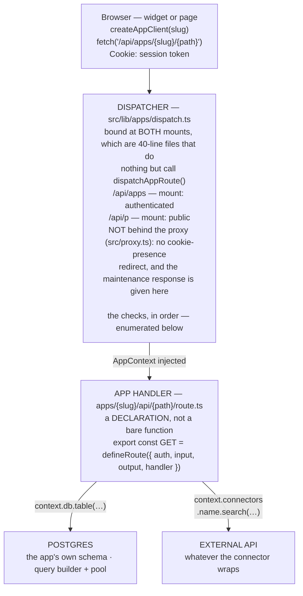
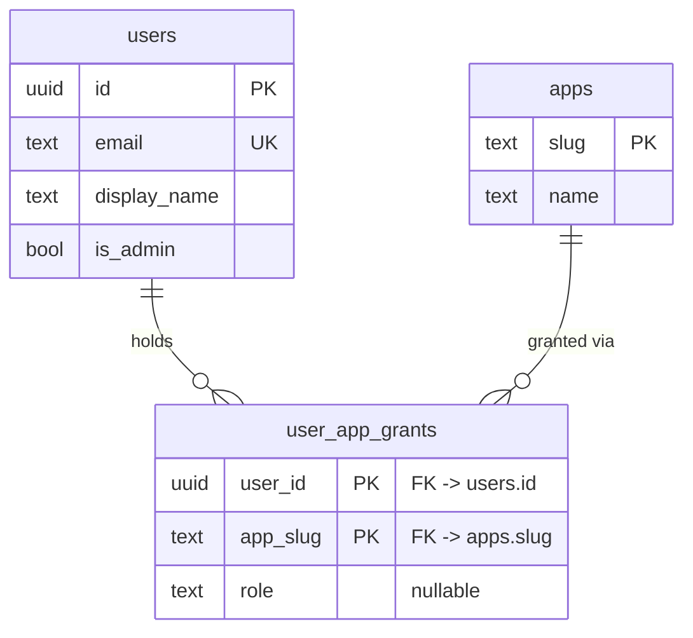
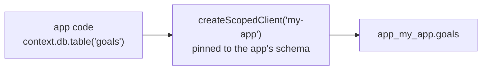
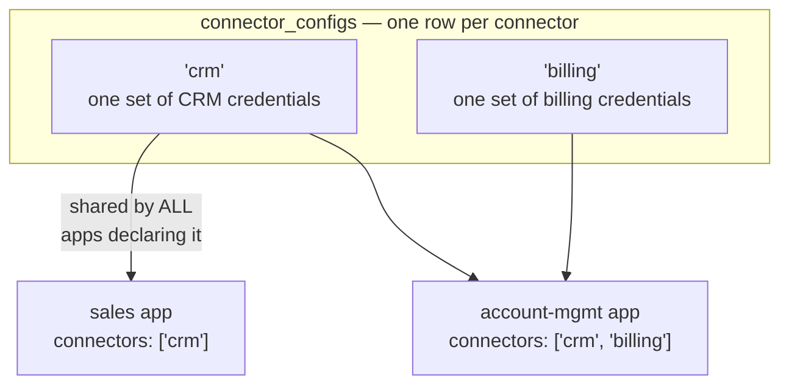
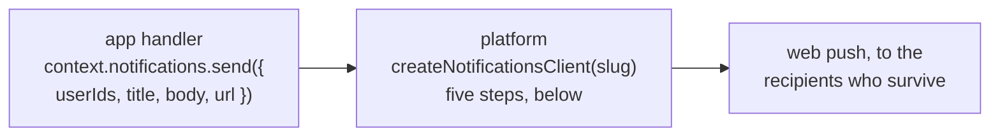

# Security Architecture: Apps & Connectors

This document describes the security model, data flow, and isolation boundaries
of the MixOS platform. It is intended for security reviewers and auditors.

**Key source files referenced throughout:**

| Component            | Path                                          |
|----------------------|-----------------------------------------------|
| Proxy (optimistic)   | `src/proxy.ts`                                |
| Auth configuration   | `src/lib/auth/config.ts`                      |
| Session helpers      | `src/lib/auth/session.ts`                     |
| Dispatcher (the pipeline) | `src/lib/apps/dispatch.ts`               |
| Mount bindings       | `src/app/api/apps/[...slug]/route.ts`, `src/app/api/p/[appSlug]/[[...slug]]/route.ts` |
| Request body cap     | `src/lib/apps/request-body.ts`                |
| Auth tier resolution | `src/lib/apps/auth-tier.ts`                   |
| Route contract       | `src/lib/apps/route.ts` (`defineRoute`)       |
| App API keys         | `src/lib/apps/api-keys.ts`                    |
| Egress / SSRF        | `src/lib/apps/http.ts`                        |
| Access control       | `src/lib/apps/access.ts`                      |
| Context builder      | `src/lib/apps/context.ts`                     |
| Scoped DB client     | `src/lib/apps/scoped-db.ts`                   |
| App schema and role names | `src/lib/apps/app-identifiers.ts`        |
| App migrations       | `scripts/app-migrations.ts`, `scripts/app-sql-policy.ts` |
| Notifications client | `src/lib/apps/notifications.ts`               |
| Web Push sender      | `src/lib/push/server.ts`                      |
| Push subscribe API   | `src/app/api/push/*/route.ts`                 |
| Client SDK           | `src/lib/apps/sdk.ts`                         |
| Credential config    | `src/lib/connectors/config.ts`                |
| Connector switch     | `src/lib/connectors/switch.ts`                |
| Registry update check | `src/lib/repository/update-check.ts`, `src/lib/repository/updates.ts` |
| MixOS release check  | `src/lib/platform/release-check.ts`, `src/lib/platform/releases.ts`, `src/components/admin/release-notes.tsx` |
| GitHub App link      | `src/lib/github/` (§32)                        |
| Encryption module    | `src/lib/connectors/encryption.ts`            |
| Rate limiter         | `src/lib/rate-limit.ts`                       |
| Sign-in limit        | `src/lib/auth/sign-in-limit.ts`               |
| Password re-check limit | `src/lib/auth/recheck-limit.ts`            |
| Safe error helper    | `src/lib/safe-error.ts`                       |
| Security headers     | `next.config.ts`                              |
| Content-Security-Policy | `src/lib/csp.ts`                           |
| App import policy    | `src/lib/apps/import-policy.mjs`              |
| App containment scan | `scripts/app-containment.ts`                  |
| ESLint restrictions  | `eslint.config.mjs`                           |
| MCP endpoint         | `src/app/api/mcp/route.ts`                    |
| MCP bearer-check limit | `src/lib/mcp/bearer-limit.ts`               |
| MCP tool broker      | `src/lib/mcp/broker.ts`                       |
| MCP tool discovery   | `src/lib/mcp/tools.ts`                        |
| OAuth AS crypto      | `src/lib/mcp/oauth.ts`                        |
| OAuth token store    | `src/lib/mcp/store.ts`                        |
| OAuth endpoints      | `src/app/api/oauth/{register,token,revoke}/route.ts` |
| MCP consent screen   | `src/app/(main)/oauth/authorize/`             |

---

## 1. Request Lifecycle

Every request from client code to an app's API traverses the same secured path.
No alternative entry points exist for app logic.



The context that handler is called with:

| Field | Is |
|---|---|
| `context.user` | The caller. `null` on non-identity tiers |
| `context.connectors` | Initialized connector instances |
| `context.db` | Scoped DB client, or `null` |
| `context.notifications` | Web Push sender, or `null` |
| `context.telemetry` | Usage tracking, or `null` |
| `context.services` | Cross-app broker, or `null` |
| `context.env` | Declared app settings |
| `context.http` | Egress-bounded fetch, or `null` |
| `context.manifest` | App metadata |
| `context.hooks` | App-scoped hook registrar |

### Security checkpoints in order

Both HTTP mounts — `/api/apps/<slug>/…` and `/api/p/<slug>/…` — are the same
pipeline (`src/lib/apps/dispatch.ts`) with a different `mount` argument. They
were parallel implementations until this was unified, which is how the public one
acquired a gate the authenticated one never had, and the authenticated one ended
up checking the wrong table.

| Step | Check                          | Failure | Where enforced                       |
|------|--------------------------------|---------|--------------------------------------|
| 0    | Platform schema not behind     | 503     | Dispatcher (`maintenanceGate`), before anything reads the database. Neither mount is behind the proxy, so no cookie-presence check comes first (§18) |
| 1    | Body under size cap            | 413     | Dispatcher (`content-length`, before any body read; a body without one is counted as the route reads it, §15) |
| 2    | App slug exists                | 404     | Dispatcher (registry lookup)         |
| 3    | Rate limit (IP), pre-auth      | 429     | Dispatcher (`src/lib/rate-limit.ts`) |
| 4    | URL resolves to a route pattern| 404     | Dispatcher (`resolveRoutePath`)      |
| 5    | This mount serves the route    | 404     | Dispatcher, from the **hoisted contract** — so no app module is imported for a route this mount doesn't serve. The checks on the caller come after the import, from step 8 |
| 6    | App is active and not being updated, then the route module loads; method exported | 404 / 503 / 405 / 500 | Dispatcher. The app gate (`src/lib/apps/app-gate.ts`) runs before the import, so neither a deactivated app's module-scope code (404) nor that of an app whose own migrations are behind this build (503, §3.1) runs. Import and dispatch are separated, so a module that throws at load is logged as a load failure rather than as a missing route; the caller gets 404 either way |
| 7    | Live declaration matches the registry | 404 | Dispatcher — a gate decided from one source and enforced from another is not a gate |
| 8    | Auth tier the caller earned    | 401 / 403 / 404 | `src/lib/apps/auth-tier.ts` |
| 9    | CSRF token, cookie-authenticated mutations only | 403 | `src/lib/apps/csrf.ts` — authenticated mount, identity tiers, mutating methods |
| 10   | Rate limit (user+app, route)   | 429     | Dispatcher, now that the caller is known |
| 11   | Context build succeeds         | 500     | Dispatcher (try-catch, generic message) |
| 12   | Required roles                 | 403     | `runRoute` — one place every caller passes through |
| 13   | Input matches the declared schema | 400  | `runRoute`                           |
| 14   | Connector-call and wall-clock budget | 429 / 504 | `runRoute`                    |
| 15   | Output matches the declared schema | 500  | `runRoute`                           |

**Authorization is `hasAppGrant`, not `hasAppAccess`.** The former reads
`user_app_grants` and short-circuits true for a `global` app; the latter reads
`user_apps`, which records that a user *installed* the app on their dashboard — a
layout preference. The gateway used the second until this was corrected, which
403'd every user of every global app.

**Tier resolution is strongest-first**: `session` > `signed-in` > `password` >
`key` > `public`, intersected with what the mount can serve. A route declaring
`["session", "public"]` therefore serves a granted user their own data and a
stranger the public view, from one handler, with `context.user` typed nullable so
the compiler forces both branches to exist.

**The `key` tier is implemented** (`src/lib/apps/api-keys.ts`), and is served on
the **public mount only**. `/api/p` is the non-cookie surface an integration
needs; `/api/apps` is the mount the browser SDK calls with its session cookie,
and does not read a key.

A key is `mosk_` + 32 random bytes, shown once and stored only as an
HMAC-SHA256 digest, keyed with `APP_API_KEY_SECRET` (§5). It is bound to one
app — presenting app A's key on app B's route resolves to nothing — and
**scope-checked per method and route pattern**, so a key minted for one endpoint
does not become a key for the whole app.

---

## 2. Credential Security

Connector credentials (API keys, tokens, secrets) are encrypted at rest
and only decrypted server-side, per-request. They never reach the browser.

### 2.1 Encryption scheme

```
Algorithm:  AES-256-GCM (authenticated encryption)
Key:        CONNECTOR_ENCRYPTION_KEY env var (32 bytes, as hex or base64)
IV:         12 random bytes, generated per encrypt() call
Output:     base64(IV) : base64(AuthTag) : base64(Ciphertext)
```

### 2.2 Credential lifecycle

```
  Admin UI (browser)
  ==================
  | Submits plaintext credentials for a connector
  | configureConnector server action (/admin/connectors)
  |
  v
+--------------------------------------------------+
| saveConnectorConfig()                            |
| (src/lib/connectors/config.ts)                   |
|                                                  |
|  1. Take the connector's advisory lock, read and |
|     decrypt the stored set, and merge the new    |
|     fields over it (a blank field keeps the      |
|     stored value)                                |
|  2. encrypt(JSON.stringify(merged))              |
|     - Generate random 12-byte IV                 |
|     - AES-256-GCM encrypt with CONNECTOR_        |
|       ENCRYPTION_KEY                             |
|     - Produce: IV:AuthTag:Ciphertext (base64)    |
|  3. Write the connector_configs row              |
|     - PK: connector_name (one row per connector) |
|     - Stores: encrypted_credentials,             |
|       configured_by (userId), updated_at         |
+--------------------------------------------------+
  |
  | Encrypted blob stored in Postgres
  v
+--------------------------------------------------+
| connector_configs table                          |
|                                                  |
|  connector_name  | encrypted_credentials | ...   |
|  "crm"           | "abc123:def456:..."   | ...   |
|  "billing"       | "xyz789:uvw012:..."   | ...   |
|                                                  |
|  Scope: org-wide (NOT per-user or per-app)       |
|  Access: trusted server code only                |
+--------------------------------------------------+

  NOTE: this is one of THREE write paths into connector
  credentials. The others are the admin-only OAuth consent
  flow (section 27), which lands a tenant grant here, and
  the per-user OAuth flow (section 3.4), which lands a
  personal grant in `user_connector_oauth` instead.
  |
  | On each app API request:
  v
+--------------------------------------------------+
| buildAppContext() --> getDecryptedConfig()        |
| (src/lib/apps/context.ts)                        |
|                                                  |
|  For each connector declared in app.json:        |
|   1. Query connector_configs for encrypted blob  |
|   2. decrypt(blob)                               |
|      - Split IV:AuthTag:Ciphertext               |
|      - AES-256-GCM decrypt with env key          |
|      - Verify authentication tag (tamper check)  |
|   3. JSON.parse --> credential object             |
|   4. new ConnectorClass()                        |
|   5. instance.initialize(credentials)            |
|      - Credentials stored as private fields      |
|   6. Inject into context.connectors              |
|                                                  |
|  Instance is STATELESS and REQUEST-SCOPED:       |
|   - Created fresh per request                    |
|   - Never cached or shared across requests       |
|   - Garbage collected after response              |
+--------------------------------------------------+
```

### 2.3 What prevents credential exposure

| Threat                         | Mitigation                                             |
|--------------------------------|--------------------------------------------------------|
| Credentials in browser JS      | No app code imports a connector at runtime; the build refuses it (§24) |
| Credentials in API responses   | Connectors are server-only; SDK returns app data only  |
| Credentials leaked via caching | Connector instances are stateless, never cached        |
| Credentials at rest in DB      | AES-256-GCM with per-record random IV                  |
| Tampered ciphertext            | GCM authentication tag verified on every decrypt       |
| Key in source code             | Key loaded from env var at runtime, not committed      |

---

## 3. Tenant and App Isolation

### 3.1 User-to-app access control



The check itself, run on every request:

```text
hasAppGrant(userId, appSlug):
  if the app's manifest says `global`      --> true
  SELECT app_slug FROM user_app_grants
  WHERE user_id = $1 AND app_slug = $2

Result: boolean --> 403 if false
```

The `session` tier serves only users who hold a grant for the app. This is
checked on **every request**, inside `resolveAuthTier`, before the handler runs.
The other tiers don't read grants: `signed-in` serves any signed-in user,
without the app's roles, and `password`, `key` and `public` serve callers with
no account (§1).

**The app has to be active, and in the running build.** `resolveAuthTier` and
`hasAppGrant` refuse an app an admin has deactivated, or one the running build
doesn't carry, before they read a grant (`isAppActive()` in
[`src/lib/apps/access.ts`](../src/lib/apps/access.ts)). The app gate
([`src/lib/apps/app-gate.ts`](../src/lib/apps/app-gate.ts)) asks the same
before any of the app's modules is imported, so a deactivated app's code does
not run at all: not its routes, jobs, syncs, services or `hooks.ts` (§20, §23,
§25). Deactivating is the incident response: from the next request or tick,
none of the app's code is started, with no restart. The second half matters
because the release step keeps an app's row, and the grants, installs and
widgets that hang off it, when the app leaves the build
([`scripts/sync-app-registry.ts`](../scripts/sync-app-registry.ts)): a rollback
or a build that skips an app no longer deletes them. A kept row could hand an
old activation, and with it the old grants, to different code that comes back
under the same slug, so the release step records a hash of each app's files.
An app that returns with different files comes back inactive and flagged on
Admin > Apps until an admin activates it; one that returns with the same files
comes back as it left. Both are audited (§28). The row and everything that
hangs off it stay until an admin deletes them with Delete data (§31), after
which an app that arrives under the slug starts with nothing.

**A different extension under the same slug starts off, and without the old
one's API keys.** Every release step also records each app's identity
([`src/lib/repository/identity.ts`](../src/lib/repository/identity.ts)): for
one installed from a Registry, the catalogue, kind, slug and GitHub repository
from its install record (§31); for anything else, `local`. It compares them
for every app in the build, not only for one that returns. A new version or
commit from the same repository is the same app, so updating one changes
nothing. Any other change means a different extension now has the slug: a
local app reinstalled from the Registry, a release from another repository,
or an installed app whose record was deleted. The release step switches it
off, revokes its API keys, which were given out for the extension before it,
and flags it **Replaces a different extension** on Admin > Apps. Its grants,
settings and data stay. Activating it needs its slug typed, which the server
checks (`setAppActive()` in `src/lib/apps/access.ts`); only that clears the
flag. An app that returns as a different extension gets this flag alone,
since it asks more of the admin than "back with different code". Migration
0011 recorded every app the database already knew as `local`, so a local app
reinstalled from the Registry is caught at the first release step that
carries it.

**The app's own migrations have to be applied, too.** The app gate's second
reason, asked only of an active app: when the build carries a migration of the
app's that the ledger (`public._migrations`) lacks, as readiness reports
(§18), its code was written for tables the database doesn't have yet, so none
of it runs, and the rest of the instance serves as usual. Its API routes and
pages answer 503 with `Retry-After: 30` and "This app is being updated. Try
again shortly.", `callAppRoute()` throws `UNAVAILABLE` (§25), its jobs stay
due (§20), a consumer gets `PROVIDER_UPDATING` (§23), its hook listeners don't
run, and its MCP tools refuse (§17). The answer comes from the same check as
the maintenance response (§18), kept for 15 seconds, so the app serves again
within 30 seconds of the release step, with no restart. A check that can't
tell counts as not behind. An app that is also switched off answers as a
switched-off app does, so the 503 never gives a switched-off app away.

**Do not confuse this with `user_apps`.** That table records which apps a user has
*installed* on their dashboard — a layout preference, not a permission. The
function that reads it, `hasAppAccess()`, has **no callers** and should not
acquire any; the gateway used it once, which 403'd every user of every global
app.

### 3.2 Database table isolation

Apps that declare `"database": true` in their manifest get a schema of their
own, and a scoped database client pinned to it.



The schema, and the role that owns it, are derived from the slug by one
encoding (`src/lib/apps/app-identifiers.ts`), so two apps asking for the same
table name never reach the same rows:

| App | Writes | Actually reads |
|---|---|---|
| `my-app` | `context.db.table("goals")` | `app_my_app.goals` |
| `my_app` | `context.db.table("goals")` | `app_my__app.goals` |
| `reports` | `context.db.table("renewals")` | `app_reports.renewals` |

The encoding writes `-` as `_` and `_` as `__`, and a slug may not start or end
with a separator or put two side by side, so every encoded name reads back to
exactly one slug. The build fails on a slug outside that form, and on any two
apps whose schema or role names would be the same.

**Isolation guarantees:**

```
+-----------------------------------+
| Postgres (shared database)        |
|                                   |
|  public: platform tables (27, all |
|  RLS enabled, zero policies):     |
|    users, apps                    |
|    user_apps, user_app_grants     |
|    app_passwords                  |
|    app_api_keys                   |
|    app_settings                   |
|    connector_configs              |
|    user_connector_oauth           |
|    connector_scope_status         |
|    connector_webhook_events       |
|    app_unlock_failures            |
|    dashboard_layouts/_widgets     |
|    push_subscriptions             |
|    app_scheduled_jobs             |
|    app_job_runs                   |
|    platform_settings              |
|    app_open_events                |
|    telemetry_events               |
|    oauth_clients                  |
|    oauth_authorization_codes      |
|    oauth_tokens                   |
|    rate_buckets                   |
|    admin_audit_log                |
|    _migrations, _platform_locks   |
|                                   |
|  app_my_app    (mixos_app_my_app) |
|    goals                          |
|    quotes                         |
|  app_reports   (mixos_app_reports)|
|    renewals                       |
|    history                        |
|  ...                              |
|                                   |
|  Each app reaches only its own    |
|  schema, via createScopedClient() |
+-----------------------------------+
```

- The `ScopedClient` only exposes a `.table(name)` method, on the query builder
  pinned to the app's schema. A name cannot carry a quote, a dot or another
  schema out of it (§8).
- App code never sees or constructs another schema's name.
- Apps without `"database": true` receive `context.db = null`, and may not ship
  `migrations/`: the build fails, and so does the release step.

**What an app's migrations can do.** The release step runs each app's
`migrations/*.sql` as the app's own role, `mixos_app_<slug>`: NOLOGIN, a member of
nothing, owner of its schema and of nothing else. Each file runs through a
`SECURITY DEFINER` function owned by that role, with the schema first on its
search path, created and dropped inside the file's own transaction
(`scripts/app-migrations.ts`). Postgres refuses `SET ROLE` and `SET SESSION
AUTHORIZATION` inside such a function, so the file cannot step back out to the
platform's role, and the app role's privileges keep it off every table but its
own. Only apps the registry accepted run any SQL.

That bounds what a migration does while it runs, not what it leaves behind. A
trigger, rule, column default, check, index expression or view on an app's table
runs later, when the platform reads or writes the table, and runs as the
platform's role. So before anything is applied, every statement is parsed with
Postgres's own parser (libpg_query) and checked against an allowlist
(`scripts/app-sql-policy.ts`). It allows tables, indexes, views, sequences and
enum types in the app's schema, and the rows in them. It refuses triggers,
rules, functions, `DO`, policies, grants, role and session statements,
extensions, any reference to anything outside the schema, and any function call,
in any expression, outside a short list of pure built-ins such as `now()` and
`gen_random_uuid()`. The build runs the same check, so a refused statement fails
the build before it can fail a deploy.

The one trigger apps asked for, an `updated_at` that keeps itself current,
belongs to the platform: an app lists the column under `updatedAt` in its
manifest, and the release step installs `public.mixos_touch_updated_at()` on it
(`supabase/migrations/0009_app_schemas.sql`). That function sets the one column
to `now()` and reads nothing else.

### 3.3 Client-server boundary enforcement

Three layers prevent client-side code from bypassing the gateway:

```
+------------------------------------------------------------------+
| LAYER 1: SDK Design (src/lib/apps/sdk.ts)                        |
|                                                                  |
|  createAppClient(slug) routes ALL requests through               |
|  /api/apps/<slug>/<path> -- no direct DB or connector access     |
|  possible from client code                                       |
+------------------------------------------------------------------+

+------------------------------------------------------------------+
| LAYER 2: The import list (src/lib/apps/import-policy.mjs)        |
|                                                                  |
|  App code imports its own files, a published list of platform    |
|  modules and a few packages, and nothing else. So no app code,   |
|  in any tier, can import:                                        |
|    - @/lib/db*, or construct a scoped DB client                  |
|    - @connectors/*, @/lib/connectors/* (types are fine)          |
|    - the context builder, the services broker, the hook system   |
|    - another app's code                                          |
|  and a page or widget cannot import its own app's lib/server.    |
|                                                                  |
|  Judged by the file an import resolves to, so no spelling gets   |
|  round it. Enforced by the registry generator on every build     |
|  and every Registry install (§24); ESLint runs the same code     |
|  as feedback in an editor.                                       |
+------------------------------------------------------------------+

+------------------------------------------------------------------+
| LAYER 3: Runtime Context (src/lib/apps/context.ts)               |
|                                                                  |
|  AppContext (with connectors, db, user) is only constructed      |
|  inside the gateway and passed to server-side route handlers.    |
|  Widget/page components receive only: { appSlug, config, size }  |
+------------------------------------------------------------------+
```

### 3.4 Connector credential scope

There are **two** credential models. Which one applies is declared per connector.

**Tenant-scoped (the default).** One credential set in `connector_configs`,
configured once by an admin, shared by every app and every user:



Access control is therefore at the **external service** level: the CRM's token
scopes, the billing key's permissions, and so on. MixOS decides *which apps may
use a connector*, never what that connector's credentials are allowed to do.

The property this buys is worth naming: because there is exactly one credential
set, **any response the connector returns is the same response any user would
have received**. That is what makes caching, logging and sharing safe to reason
about without thinking about identity.

**User-scoped (`userScoped: true`).** For connectors where one shared account is
the wrong answer — a person's own mailbox cannot be a single inbox the whole
deployment reads. The client id and secret still live in `connector_configs`; an
admin registers the application once. Only the **grant** is personal, stored
encrypted in `user_connector_oauth` keyed `(user_id, connector_name)`.

```
  connector_configs           user_connector_oauth
  (client id + secret,        (per-user OAuth grant,
   admin-registered)           encrypted, ON DELETE CASCADE)
         \                        /
          \                      /
           v                    v
      context.connectors.gmail resolves against
      the CALLING user's grant — or is OMITTED
```

Constraints, all build-enforced:

- **Only three-legged OAuth may be user-scoped.** An API-key connector has one key
  an admin pastes; a "user-scoped" API key would be the tenant key wearing a
  different label.
- **A user-scoped connector cannot be used by a scheduled job.** A job runs with
  no user, so there is no grant to resolve — the connector would be silently
  absent at 3am and present in a page request.
- **Absent, not broken.** No user in context, a user who has never connected, or
  a grant the provider will no longer renew omits the connector rather than
  handing over an unusable one. That is the same shape an app already handles
  for a connector an admin has not configured.

**What this model costs.** Once a connector answers differently per user, every
place a response is cached, logged, or shared becomes a place it can reach the
wrong person. **Cache keys must include the user.** The platform enforces this
where it owns the key; an app that caches a user-scoped response itself owns that
correctness.

A departing user's tokens cascade-delete with their row: they are not history
worth keeping, they are live access to a third-party account.

### 3.5 Notification (Web Push) scope

Apps that declare `"notifications": true` receive a `context.notifications`
client (gated exactly like `context.db`; `null` otherwise). It exposes a single
method — `send({ userIds, title, body, url, tag, icon })` — and is the only way
app code can dispatch a push.



What the platform does between those two boxes, in order:

1. **Dedupe** `userIds`.
2. **Filter to recipients who actually have THIS app** — `hasAppGrant`: a
   `global` app resolves to everyone, otherwise an explicit `user_app_grants`
   row is required. **This step is the security boundary.**
3. **Load** each surviving recipient's subscriptions.
4. **Send** via `web-push.sendNotification`, VAPID-signed.
5. **Prune** dead endpoints (404/410).

**Isolation guarantees:**

- **Recipient gating.** `send()` drops any `userId` that lacks access to the
  calling app, so one app cannot push to users of another even if it guesses
  their ids. Enforced in `src/lib/apps/notifications.ts` via `hasAppGrant`.
- **Server-only dispatch.** `context.notifications` is built in the gateway and
  injected into route handlers only. The public surface sets it to `null`
  (`PublicAppContext.notifications: null`), so unauthenticated routes cannot send.
- **Subscriptions are platform-owned.** `push_subscriptions` is a `public.*`
  table written only by the session-gated subscribe/unsubscribe routes
  (`src/app/api/push/*`), each pinning `user_id` from `requireReadOnlySession()`.
  App code never reads or writes it, and the `ScopedClient` cannot reach it:
  it is in `public`, not the app's schema.
- **Endpoints are push services only.** The server POSTs to every stored
  endpoint, so one is accepted only on a browser vendor's push service (§13),
  at subscribe time and again before each send.
- **No client-side push API.** Widgets/pages opt in only through the SDK helper
  `enablePushNotifications()` (`src/lib/apps/sdk.ts`), which posts the browser
  subscription to the platform route. The VAPID **private** key never leaves the
  server; only the public key is handed to the client to subscribe.
- **Payload exposure.** A push payload reaches a recipient's device, so apps
  must treat `title`/`body` as user-visible and must not include another user's
  private data beyond what the recipient is entitled to see.

---

## 4. Security Boundaries Summary

| Layer               | What it protects              | Mechanism                                    | Enforced at                  |
|---------------------|-------------------------------|----------------------------------------------|------------------------------|
| Proxy (optimistic)   | Unauthenticated browsing      | Cookie-PRESENCE check, redirect to /login    | `src/proxy.ts`               |
| Authoritative auth   | Forged / stale session        | JWT verified per request in route handlers   | `requireReadOnlySession()`   |
| CSRF protection      | Cross-site request forgery    | `SameSite=Lax` cookie, plus double-submit token on cookie-authenticated app-API mutations | `csrf.ts`, Auth.js, Next.js (see §7) |
| Admin authorization  | Admin-only pages and actions  | `requireAdmin()` re-reads `is_admin` per call | `access.ts` (see §9)         |
| Server-side admin    | Admin action bypass           | `requireAdmin()` in pages + server actions   | `access.ts`, admin pages     |
| Rate limiting        | Abuse / DoS, password guessing | Postgres token-bucket, memory pre-filter    | `rate-limit.ts`, gateway, sign-in and password re-checks (§6), MCP (§17), webhooks (§19) |
| Tier resolution      | Per-request auth decision     | `resolveAuthTier()`, strongest-first, fails closed | `auth-tier.ts`          |
| App access control   | Unauthorized app access       | `hasAppGrant()` checks `user_app_grants`     | `auth-tier.ts` via `access.ts` |
| Email domain gate    | Unauthorized user provisioning| `ALLOWED_EMAIL_DOMAINS` env var check        | `access.ts` (`ensureUser`)   |
| Encryption at rest   | Credential exposure in DB     | AES-256-GCM with random IV per record        | `encryption.ts`              |
| Per-request decrypt  | Credential caching/leakage   | Stateless connectors, fresh per request      | `context.ts`                 |
| Per-app schemas      | Cross-app data access         | A schema and role per app; `ScopedClient` pinned to it | `scoped-db.ts`, `app-identifiers.ts` |
| App migration checks | App SQL reaching past its app | Parsed against an allowlist, run as the app's role | `app-sql-policy.ts`, `app-migrations.ts` |
| Notification scope   | Cross-app push spam           | `send()` filters recipients to users with the app | `notifications.ts` (`hasAppGrant`) |
| App import list      | Capabilities past the manifest | Default-deny, by resolved file; a finding skips the app | `import-policy.mjs` (see §24) |
| App containment scan | Secrets, egress, injection    | Syntax-tree scan; a finding skips the app    | `app-containment.ts` (see §24) |
| SDK routing          | Direct DB/connector access    | All client calls go through `/api/apps/...`  | `sdk.ts`                     |
| Safe error responses | Internal detail leakage       | `safeErrorMessage()` strips details in prod  | `safe-error.ts`, all routes  |
| Request body limit   | Memory-exhaustion DoS         | 27 MB cap, `content-length` checked first; 5 MiB on webhooks, read no further than the cap | `dispatch.ts` (`MAX_BODY_BYTES`), `webhook.ts` (`MAX_WEBHOOK_BODY_BYTES`) |
| Enumeration answers  | User, app and route enumeration | On the public mount, a caller without the sign-in or grant a route needs gets 404, as if there were no route; a sign-in attempt runs one bcrypt hash whether or not the email has an account (§6) | `dispatch.ts`, `password.ts` |
| Security headers     | Clickjacking, MIME sniffing   | CSP `frame-ancestors 'self'`, `nosniff`, etc | `csp.ts`, set by the proxy or the gateway (§14); `next.config.ts` |
| Session cookies      | Session hijacking / forgery   | Auth.js JWT, httpOnly, secure, sameSite=lax  | `next-auth` (Auth.js v5)     |
| Read-only image      | The server changing its own code | Image files owned by root; a read-only root filesystem under Compose (see §31) | `Dockerfile`, `deploy/docker-compose.yml` |

---

## 5. Environment Secrets

| Variable                    | Purpose                              | Exposure risk if leaked                          |
|-----------------------------|--------------------------------------|--------------------------------------------------|
| `AUTH_SECRET`               | Signs/encrypts Auth.js session JWTs  | Attacker can forge a session for any user        |
| `DATABASE_URL`              | Postgres connection; owns every table, so RLS does not apply | Full read/write to every table |
| `CONNECTOR_ENCRYPTION_KEY`  | AES-256-GCM for **tenant** connector credentials and the connector OAuth flow-state cookie | Exposes every shared third-party API key |
| `USER_OAUTH_ENCRYPTION_KEY` | AES-256-GCM for **per-user** OAuth grants (`user_connector_oauth`) | Exposes every person's third-party account tokens |
| `MCP_TOKEN_KEY`             | HMAC digests for MCP tokens and authorization codes | Lets an attacker mint MCP tokens |
| `APP_API_KEY_SECRET`        | HMAC digests for app API keys (the `key` tier) | Lets an attacker mint app API keys |
| `APP_SETTINGS_ENCRYPTION_KEY` | AES-256-GCM for `password`-typed app settings (`context.env`) | Exposes every app-scoped secret an admin entered |
| `APP_UNLOCK_SECRET`         | Signs app password-unlock cookies    | Bypass of every app password |
| `GITHUB_APP_ENCRYPTION_KEY` | AES-256-GCM for the GitHub App's private key (§32). Optional: unset, the App is off | With the database, lets an attacker sign as the App, which writes to the linked repository's contents and pull requests |
| `CRON_SECRET`               | Authenticates the scheduler tick -> /api/cron | Attacker can trigger every app background job  |
| `VAPID_PRIVATE_KEY`         | Signs Web Push messages              | Attacker could send push to existing subscribers; no data read access |
| `VAPID_PUBLIC_KEY` / `VAPID_SUBJECT` | Client subscribe key / contact URL | Not secret; public key is handed to the browser to subscribe |
| `ALLOWED_EMAIL_DOMAINS`     | Restricts user provisioning          | Not secret, but removing it lets any email domain sign in |

Everything above except `ALLOWED_EMAIL_DOMAINS` and the VAPID public/subject
values must be kept out of client bundles, source control, and logs. Note that
none of them carry a `NEXT_PUBLIC_` prefix, which is what stops Next.js inlining
them into browser bundles — do not add one.

### The key inventory, and why there are six

Five of those six used to be one secret, or derived from it: `MCP_TOKEN_KEY`,
`APP_API_KEY_SECRET`, `APP_SETTINGS_ENCRYPTION_KEY` and `APP_UNLOCK_SECRET` were
all `HMAC(CONNECTOR_ENCRYPTION_KEY, label)`, and per-user OAuth grants were
encrypted with the base key directly.

The PRF separation was sound — leaking a derivative could not recover the base
key — but it made the base key **un-rotatable in practice**. Changing it
simultaneously made every stored connector credential undecryptable, invalidated
every MCP token, every app API key and every unlock cookie. A key that cannot be
rotated is a key whose compromise is unrecoverable, so "no new environment
secret" was buying the wrong thing.

Each key is now independent, declared in
[`src/lib/env/keys.ts`](../src/lib/env/keys.ts) with its purpose and its
**rotation blast radius** stated next to it. There is **no derivation fallback**:
a missing key fails closed naming the variable, because a fallback would mean
nobody sets the others and the single point of failure quietly survives.

```
npm run keys:generate     # all six, plus AUTH_SECRET and CRON_SECRET, paste-ready, with rotation notes
npm run keys:check        # exits non-zero naming anything missing or malformed
```

The generator enumerates the inventory rather than listing names, so a key added
there is generated without anyone remembering to update it — that drift is
exactly what produced the RLS gap in §8.

One more key is optional. `GITHUB_APP_ENCRYPTION_KEY` turns on the GitHub App
(§32), and follows the same rules: 32 random bytes, independent, and a
malformed value is an error, never a quiet "off". `npm run keys:generate`
leaves it out unless asked (`-- --github-app`), and `npm run keys:check`
checks it when it is set. Rotating it doesn't lose the App:
`npm run keys:rotate-github-app` takes the old and the new key and
re-encrypts the stored App key.

**Do not point two keys at the same value, and do not derive one from another.**

In production these are the host's environment variables
([hosting](hosting/README.md)).

---

## 6. Rate Limiting

The API gateway applies a per-IP token-bucket rate limiter before
authentication checks. This protects against brute-force and DoS attacks.

```
Algorithm:  Token bucket
Authority:  public.rate_buckets (Postgres), one atomic upsert per charge
Pre-filter: a per-instance in-memory bucket (see below)
Key:        <limiter name>::<identity>, scoped to one of
            ip | user_app | route | api_key
Burst:      60 requests      (the app gateway; other limiters differ)
Refill:     10 tokens/second
Response:   429 Too Many Requests + Retry-After header
```

### Why it is not in-memory

It used to be, with a comment saying that was "suitable for single-process
deployments". The deployment is serverless: every function instance held its own
Map, so the documented burst was **per instance** and, across a fleet that scales
with the very traffic being limited, close to no limit at all. A control that
reads as enforced and is not is worse than an absent one.

The authority is now a Postgres table. The refill arithmetic lives inside the
`ON CONFLICT DO UPDATE SET` expression, which Postgres evaluates against the
locked current row — a CTE or an `UPDATE ... FROM (SELECT ...)` reads the
statement snapshot instead and is silently racy under concurrency.

### The two tiers

The in-memory bucket survives as a pre-filter, and the asymmetry is what makes
that sound. A per-instance bucket sees only a fraction of the traffic, so it
drains more slowly than the global one and is therefore strictly **more
permissive**:

- memory says DENY → the global bucket is at least as empty. Short-circuit.
- memory says ALLOW → proves nothing. Consult Postgres.

A cold instance starts full, so it can only ever be too generous. It can never
lock anyone out on its own.

### Failing open, deliberately

If Postgres is unreachable the limiter logs a warning and falls back to the
in-memory result. This is a security control failing open, which is worth stating
plainly. The alternative is a database blip taking the product down, and the
fallback degrades to exactly the behaviour this module had before — a rarer
exposure, not a new one.

### Garbage collection

The cron tick deletes buckets untouched for an hour. The invariant: that TTL must
exceed `maxTokens / refillRatePerSecond` for **every** configured limiter, or GC
forgives an abuser mid-penalty. The slowest limiter today is the password
re-check at 5 tokens / one every 300 seconds = 1,500 seconds, leaving ~2.4x
headroom. A slower limiter than that needs a longer TTL or per-row budget
columns.

### IP extraction hardening

The gateway extracts the client IP from the **rightmost** entry in the
`x-forwarded-for` header (the one appended by the trusted reverse proxy),
falling back to `x-real-ip`. This resists client-side header spoofing where
an attacker prepends fake IPs to bypass rate limiting.

```
x-forwarded-for: <attacker-spoofed>, <real-client-ip>
                                      ^^^^^^^^^^^^^^^^ used
```

Every per-IP limit keys on this rule (`getClientIp`,
`src/lib/apps/public-access.ts`), which is why MixOS is served behind a proxy
or platform that sets these headers ([hosting](hosting/README.md)).

The pre-filter's in-memory store (`src/lib/rate-limit.ts`) evicts stale entries
automatically; the Postgres authority is pruned from the cron tick.

### Sign-in attempts

Password sign-in has its own per-IP bucket, `login-credentials`: a burst of 10
attempts, then one more every 10 seconds, right or wrong. It is charged inside
the password check itself, the credentials provider's `authorize()`
(`src/lib/auth/config.ts`, with the limit in `src/lib/auth/sign-in-limit.ts`),
not in front of a route. So every route that reaches that check draws on one
budget: the login page's server action, and Auth.js's own
`POST /api/auth/callback/credentials`, which any client can call with a token
from `/api/auth/csrf`.

The key is the client IP by the rule above. Auth.js passes `authorize()` a
request with the client's headers on both routes. On the server-action path,
`signIn()` copies them from the action's request.

The charge comes first. A refused attempt reads no account and runs no hash, so
it is cheap and answers the same for a known and an unknown email. The login
page shows "Too many sign-in attempts. Please try again shortly." Auth.js's
route answers in its usual error form: a redirect to
`/login?error=CredentialsSignin&code=rate_limited`.

An attempt that is let through runs exactly one bcrypt hash, whether or not the
email has an account. With no account, or an account with no password, the
password is compared against `DUMMY_PASSWORD_HASH` (`src/lib/auth/password.ts`),
a hash of the same cost and format whose password nobody has, and the attempt
is refused whatever the comparison says. So the time a wrong password takes
doesn't say which emails have accounts.

### Password re-checks

Two server actions ask a signed-in person for their own password:

- "Change my password" (`updatePassword`, `src/lib/account/actions.ts`) checks
  the current password.
- Setting another user's password (`adminSetPassword`,
  `src/lib/admin/user-actions.ts`) checks the acting admin's, which is what
  keeps someone at an admin's unlocked laptop from taking over another account.

Both draw on one bucket per user, `password-recheck`
(`src/lib/auth/recheck-limit.ts`): 5 attempts in a burst, then one more every 5
minutes, right or wrong. One bucket, because both re-check the same password.

The key is the user id from the session, not the IP: the session says whose
password is being checked, wherever it is used from. The charge comes before
the hash, so a refused attempt runs none, and both actions answer "Too many
attempts. Please try again shortly." whatever the password was.

---

## 7. CSRF Protection

CSRF is handled in two distinct places, and neither is the proxy — `src/proxy.ts`
performs no CSRF validation at all.

**Auth.js routes.** `next-auth` protects its own sign-in/sign-out endpoints with
the standard double-submit cookie: a CSRF token is stored in the
`authjs.csrf-token` cookie and must be echoed in the request body.

**Everything else.** App API routes and server actions rely on the session
cookie being `SameSite=Lax`, which stops a cross-site form or `fetch` from
attaching it to a state-changing request. Next.js server actions additionally
verify the `Origin` header against the `Host` on every invocation.

The practical consequence for app authors: do not lower `sameSite` on the
session cookie, and do not accept state-changing requests on `GET` — `Lax`
permits cross-site `GET` navigation, so a mutating `GET` handler is reachable
cross-site.

**App API routes: double-submit token.** `src/lib/apps/sdk.ts` fetches a token
from `/api/auth/csrf` and attaches it as `X-CSRF-Token` on every
POST/PUT/PATCH/DELETE, retrying once on a 403 with a refreshed token. The
dispatcher verifies it in `src/lib/apps/csrf.ts` (step 9 of §1).

Auth.js sets the cookie `authjs.csrf-token` (`__Host-` prefixed over HTTPS) to
`"<token>|<sha256(token + AUTH_SECRET)>"`. Verification is two steps, and the
first is the one that matters:

1. **Recompute the hash.** This proves the pair was minted by this server. An
   attacker who can write cookies otherwise chooses *both* halves, and a
   double-submit that only checks "header equals cookie" accepts them.
2. **Compare the header to the token half**, constant-time. This is the half a
   cross-origin attacker cannot read.

It fails closed on a missing header, missing or malformed cookie, or an unset
`AUTH_SECRET`, and returns `403 { code: "CSRF_FAILED" }`.

**Where it deliberately does not apply.** The public mount (`/api/p/`), the
`password` / `key` / `public` tiers, and `callAppRoute`. None of those carry an
ambient cookie a cross-site request could borrow, so requiring a token would
break API-key integrations and server-component calls to defend against nothing.

**This is defence in depth, not the primary control.** `SameSite=Lax` is still
what stops the request being made with credentials at all. The token exists
because Lax is browser-enforced — it does nothing on a client that ignores it,
and its exemption for top-level navigations is exactly why a mutating `GET`
handler stays reachable cross-site.

---

## 8. Database Access Model

The platform reaches Postgres two ways, both server-side only and both over
the one pool configured from `DATABASE_URL`:

| Client | Module | Used for |
|--------|--------|----------|
| The query builder (`createServiceClient()`) | [`src/lib/db/query.ts`](../src/lib/db/query.ts), from [`src/lib/db/server.ts`](../src/lib/db/server.ts) | Essentially everything, including the app-facing `context.db` |
| Raw `postgres.js` pool (`sql`) | [`src/lib/db/client.ts`](../src/lib/db/client.ts), options in [`src/lib/db/pg-options.ts`](../src/lib/db/pg-options.ts) | About twenty platform modules, for what needs a transaction, a lock, an atomic upsert or SQL the builder cannot express: connector credentials and per-user OAuth grants, the MCP token store, rate limits and unlock failures, the admin audit log, analytics and telemetry, the scheduler's job claim, webhook replay markers, and the platform's locks and schema checks. Values are always bind parameters (tagged templates) |

**Both connect as the role that owns every platform table and is a member of
every app's role, and Row-Level Security does not apply to a table's owner or to
a member of the role that owns it.** That is the single most important fact in
this section, and everything below follows from it. (On Supabase this role is
`postgres`; until the builder replaced supabase-js the app also went through
the `service_role`, which bypasses RLS outright. The consequence is the same.)

The builder is also where SQL injection would live if it lived anywhere, so it
is built not to have any: every schema, table, column, alias and conflict target
must be a plain identifier and is quoted, and every value is a bind parameter. A
name that is not a plain identifier is refused before any SQL is written. That
rule is what keeps `context.db` inside the app's schema: an app's table name
cannot carry a quote, a dot or another schema out of it.

### What RLS does and does not do here

RLS is **enabled on every table, with zero policies** (see the header of
[`supabase/migrations/0001_initial.sql`](../supabase/migrations/0001_initial.sql)).
That combination is deny-all for the `anon` and `authenticated` roles while the
owning role — the one MixOS connects as — passes straight through.

**How that is enforced matters, because it failed once already.** It used to be a
hand-maintained `foreach t in array array['users', 'apps', ...]` list. A list has
to be edited every time a table is added, and it was not: `connector_webhook_events`
shipped without RLS, and after that was fixed three more tables were added
without being transcribed into it — `user_connector_oauth` (which holds per-user
OAuth grants), `connector_scope_docs`, and `connector_scope_status`. All were
readable through PostgREST by anyone holding the publishable anon key.

The list is now a **catalog sweep**: the migration enables RLS on every ordinary
table in `public` that lacks it, skipping extension-owned tables. A rule that
says "every table in `public`" is enforced by asking for every table in `public`.
Adding a table cannot miss it, and there is nothing to remember.

**App tables are swept too.** Each app's tables are in its own schema, which
PostgREST does not publish unless someone configures it to, and belong to the
app's role. The release step (`scripts/app-migrations.ts`) runs the same sweep
over every app schema as well as `public`, after applying app migrations, so an
app's tables are hardened by the run that creates them.

This is load-bearing on Supabase and would not be on a plain Postgres instance.
Every Supabase project publishes the `public` schema through PostgREST,
reachable with the project's publishable (anon) key — whether or not MixOS uses
that API, and it no longer does. A table with RLS switched off is therefore
readable by anyone who has that key, which is not a secret. Enabling RLS with no
policies is what closes that door. Off Supabase there is no such API, the lock
costs nothing, and it is kept so that moving a database onto Supabase never
opens one.

The flip side is a deployment rule: **migrations must run as the role the
application connects as.** A table owned by some other role is invisible to the
app — RLS with no policies denies everyone but the owner. App tables are the one
deliberate exception, and they follow the same rule one step removed: each
belongs to its app's role, and the release step makes the role it runs as, the
one the application connects as, a member of it.

What it is **not**:

- It is **not** an isolation boundary between users. The application connects as
  one role for every request; the database cannot tell one signed-in user from
  another.
- It is **not** an isolation boundary between apps. See below.
- It is **not** defence-in-depth behind the application's own checks. A bug that
  makes the platform query the wrong row will be served, because the owning role
  is permitted to read every row.

**A table added in a later migration is not covered by the sweep at the bottom
of `0001_initial.sql`**, which ran once, when `0001` was applied. A migration
that *adds* a table enables RLS on it directly, as `0002`, `0003`, `0004` and
`0007` do. The sweep the release step and `npm run migrate:apps` run over
`public` afterwards is a backstop, not the rule: `npm run db:migrate` and the
Supabase CLI apply the platform schema without it. Adding a *policy* is what
would open a table up; there are none, and there should stay none.

### Where authorization actually happens

Entirely at the application layer:

- Sensitive tables (`connector_configs`, `dashboard_widgets`,
  `dashboard_layouts`, `user_apps`, `user_app_grants`, `push_subscriptions`,
  `app_passwords`, `oauth_tokens`, …) are read and written only by trusted
  server code, never from a browser bundle.
- Helpers in [`src/lib/connectors/config.ts`](../src/lib/connectors/config.ts),
  [`src/lib/apps/access.ts`](../src/lib/apps/access.ts), and the dashboard
  `actions.ts` files require a `userId` derived from `requireServerSession()`
  (or `requireAdmin()` on admin paths) before issuing a query. The session pins
  the userId, so a caller cannot read or write another user's row.
- App tables live in a schema per app, `app_<slug>`, owned by a role per app
  (§3.2). At runtime the boundary is the `ScopedClient`
  ([`src/lib/apps/scoped-db.ts`](../src/lib/apps/scoped-db.ts)), the query
  builder pinned to the app's schema: an app cannot name another app's table,
  and cannot name a platform table. It connects as the platform's role, like
  every other query, so at runtime the boundary is held in application code.
  The other half is settled before anything runs: an app's migrations run as
  the app's own role, and what they may leave behind for the platform's role
  to run is checked first (§3.2).

  **The schema bounds the table name, not the app.** `createScopedClient(slug)`
  accepts *any* slug and builds its own full-access client for that app's
  schema, so the guarantee rests entirely on app code never calling it —
  `context.db` is the client the dispatcher pins to the calling app. That
  factory used to be importable from every app tier, including widgets, with no
  lint error; an app could have written
  `createScopedClient("other-app").table("secrets")` and read or written another
  app's data. `@/lib/apps/scoped-db` is not on the app import list (§24), so no
  app code can import it at runtime, while `import type { ScopedClient }`, how a
  handler types the client it is given, still works: a type may come from
  anywhere.
- The same list stops app code importing the raw client at all, by any
  spelling, so an app cannot hand-write SQL at runtime that would sidestep its
  schema. The registry generator enforces it on every build and every install.

### Deleting an app's schema and role

The release step creates an app's schema and role and never drops them: an app
that leaves the build keeps both (§3.1). Only **Delete data**, by an admin,
drops them ([`src/lib/repository/delete-data.ts`](../src/lib/repository/delete-data.ts),
§31), and only by name, `app_<slug>` and `mixos_app_<slug>`, never by a prefix,
so `notes_archive` is not part of `notes`. The schema has to belong to the role,
and the role has to be one the release step could have made: no powers, no
memberships, no use in another database. Dropping the schema must take nothing
outside it, and the role must hold nothing else afterwards; otherwise the
transaction rolls back and nothing is deleted. The app's row goes too, with its
activation, grants, API keys and identity, so a later app under the slug
arrives inactive with nothing (§3.1).

### Reachability of the database credential

`DATABASE_URL` carries no `NEXT_PUBLIC_` prefix, which is what prevents Next.js
inlining it into a client bundle. The pool connects lazily and only inside
server modules. Adding a `NEXT_PUBLIC_` prefix to it, or importing `@/lib/db/*`
from a `"use client"` component, would be a full database compromise.

---

## 9. Admin Authorization

Admin pages and server actions enforce authorization in one place, each for
itself:

```
  THERE IS NO PROXY-LEVEL ADMIN GATE.
  src/proxy.ts only checks that a session cookie exists. It does not
  know whether the user is an admin, and /admin/* is not special to it.

  THE ONLY CHECK: src/lib/apps/access.ts
  - requireAdmin(session) re-reads the user from the database and
    verifies the `is_admin` column
  - Applied in every admin page component and every admin server action
  - Throws "Admin access required" if the user is not an admin
```

This is a single layer by design, not by omission: an admin flag carried in the
session JWT could go stale after a demotion, so `requireAdmin()` reads
`is_admin` from the database on every call rather than trusting the token.

Because server actions are directly invocable POST endpoints, each admin action
(`configureConnector`, `toggleUserGrant`, `setAppActiveAction`,
`getAppSchema`, `revokeUserSessionsAction`, …) calls `requireAdmin()` itself.
Nothing upstream does it for them, so an action that forgets the call is fully
exposed to any signed-in user.

**The review checklist item for any new admin action is now two lines**, not one:
call `requireAdmin()` (the gate, §9) *and* `recordAdminAction()` (the record,
§28). Nothing upstream does either for you.

---

## 10. User Provisioning Controls

The `ensureUser()` function (`src/lib/apps/access.ts`) creates a database record
the first time a user signs in. An optional email domain allowlist prevents
unauthorized users from being provisioned:

```
Env var:       ALLOWED_EMAIL_DOMAINS
Format:        Comma-separated (e.g. "mix.mysite.com,example.com")
Behaviour:
  - When set:   Only users whose email domain matches may sign in
  - When unset: Any email domain is accepted
  - Enforced in: src/lib/auth/config.ts (emailAllowed), applied in the
                 credentials provider — the only sign-in path
```

The allowlist is a provisioning control, not an authentication control. It
decides who may become a user; it says nothing about what an existing user may
then access — that is the grant model in section 3.

---

## 11. Error Response Sanitization

App API route handlers use `safeErrorMessage()` (`src/lib/safe-error.ts`)
to prevent internal details from leaking to clients:

```
Development:  Returns the original error message for debugging
Production:   Returns only a generic fallback (e.g. "Failed to fetch deals")
```

This prevents database error messages (which may contain table names, column
names, or constraint details) and connector errors (which may contain API
URLs or credential hints) from reaching the browser.

---

## 12. Session Cookie Security

Session cookies are left at Auth.js v5 defaults. Nothing embeds MixOS from
another origin, so there is no reason to loosen them below `SameSite=Lax`.

| Flag          | Value                       | Purpose                            |
|---------------|-----------------------------|------------------------------------|
| `httpOnly`    | `true`                      | Prevents JavaScript access (XSS)   |
| `secure`      | `true` over HTTPS           | HTTPS-only transmission            |
| `sameSite`    | `lax`                       | Blocks cross-site POST requests     |
| `__Secure-`   | prefix over HTTPS           | Cookie may only be set over TLS    |
| Contents      | Signed/encrypted JWT (JWE)  | `session: { strategy: "jwt" }` — no server-side session table |

Because the strategy is `jwt` there is no session row to delete — but sessions
**are** revocable, per user, through `users.session_version`.

The counter is minted into the token at sign-in and compared against the row on
**every** session resolution (`jwt` callback, `src/lib/auth/config.ts`). Bumping
it invalidates every token issued before that moment, for that user alone; the
callback returns `null` and the next request lands on `/login`.

| Lever | Scope | Use for |
|---|---|---|
| `revokeUserSessions(userId)` | one user | offboarding, a lost laptop, a password change |
| Rotate `AUTH_SECRET` | everyone | a suspected secret leak |

Bumped automatically on a **password change** — the credential the outstanding
tokens were minted from is gone — and on demand via the admin action
`revokeUserSessionsAction`, which is audited (§28). Granting or revoking an app
grant does *not* bump it: those are re-read live on every request (§3.1) and need
no session teardown.

The increment is a `security invoker` RPC (`bump_session_version`) doing
`set session_version = session_version + 1` against the locked row, so two
concurrent revocations cannot both read the same value and collapse into one.
`EXECUTE` is revoked from `anon` and `authenticated` and granted only to
`service_role` where those Supabase roles exist; MixOS itself calls it as the
function's owner.

**The cost, stated plainly.** This is one indexed read per session resolution
where the token was previously trusted for its whole lifetime. The same read
re-checks `is_admin`, so a demotion now takes effect everywhere rather than only
inside `requireAdmin()`. The dispatcher already reads the same row via
`getUserById` on identity tiers, so an authenticated API call reads it twice —
worth merging, but correctness came first. It fails **closed** on a missing row
(a deleted user's token stops working) and **open** on a query error, so a
database blip does not sign out the entire platform.

---

## 13. Server-Side Request Forgery (SSRF)

**Platform-level SSRF containment exists** and is exposed to app code as
`context.http` (`src/lib/apps/http.ts`). This section previously said the
opposite — that there was no defence because no platform code fetched a
user-supplied URL. That was wrong in both halves: app routes could already call
`fetch` on anything, and the containment below was built to close it.

`context.http` is non-null only when the app declares `egress` in `app.json`. It
implements **both** halves, and the second is the one people skip:

```
1. Check scheme and hostname
   - http: and https: only
   - hostname must match the manifest's `egress` allowlist
     (bare hostnames, or `*.example.com` for one level of subdomain)
   - IP literals are rejected by the manifest schema — an IP would bypass
     the resolve-and-recheck the allowlist depends on

2. Resolve, then re-check the ANSWER, then connect to it
   - Validating the string alone is defeated by DNS rebinding: an attacker
     registers a name that resolves public at validation time and private
     at fetch time.
   - Every returned address is checked against 0/8, 10/8, 127/8,
     172.16-31, 192.168/16, 169.254/16 (metadata), 100.64/10 (CGNAT),
     198.18-19, multicast, ::/96 (incl. ::1), fc00::/7, fe80::/10,
     fec0::/10, ff00::/8, Teredo, and any v6 form that carries an IPv4
     address (mapped, NAT64, 6to4), which is judged as that address.
   - The connection is PINNED to the addresses checked. The request goes
     out over node:http(s) with a `lookup` that answers with them, so the
     name is never resolved a second time; the URL's hostname still sets
     the Host header, the TLS server name and the certificate check.
     (`fetch` cannot be handed an address, which is why it is not used.)
   - Redirects are followed MANUALLY (max 3 hops) so every hop repeats
     both checks. A 302 to 169.254.169.254 would otherwise walk straight
     past them.
```

**Raw network access fails the build in `apps/**`**, which is what makes this the
only door: `fetch`, `WebSocket`, `EventSource`, `XMLHttpRequest`, the
`http`/`https`/`http2`/`net`/`tls`/`dgram` modules, and the common HTTP client
packages. Lint flags them in the editor, and the registry generator's containment
scan refuses the app on every build and every install (§24). Anything with a
fixed, admin-configured upstream belongs in a connector instead.

**There is no escape hatch.** The `raw-fetch` escape was removed: if
`context.http` cannot do something an app needs, that is a platform gap to fix,
not a rule for the app to disclaim.

**Platform code** fetches URLs it did not author in three places, and none goes
through `context.http`:

- **The connector OAuth token exchange** (§27). The token endpoint comes from the
  connector manifest — code, not user input — and the admin-supplied half is only
  the authorization code.
- **The repository install path** (§31). The tarball URL is chosen by
  mixos.org, which makes it the sharper of the two. It is confined by a fixed
  host allowlist rather than by resolve-and-recheck, for the reason given there.
- **Web Push delivery** (§3.5). Each notification is a POST to the endpoint a
  browser handed `/api/push/subscribe`, which any signed-in user can call. It is
  confined to the browser vendors' push services by a fixed host allowlist
  (`src/lib/push/endpoint.ts`), checked when a subscription is saved and again
  before each send — for the same reason as §31: the legitimate destinations
  are a handful of names, and an allowlist also refuses public hosts that
  resolve-and-recheck would let through.

## 14. Security Response Headers

Split between static config and per-request code, and the split matters: **the
CSP carries a per-request nonce, so it cannot be static header config.**

Built in [`src/lib/csp.ts`](../src/lib/csp.ts) and set per request by
[`src/proxy.ts`](../src/proxy.ts), or, on the two app API mounts the proxy
doesn't run on, by the gateway ([`src/lib/apps/dispatch.ts`](../src/lib/apps/dispatch.ts)).
Their paths don't overlap, so a response gets it once:

| Header | Value |
|---|---|
| `Content-Security-Policy` | see below |

Set statically in [`next.config.ts`](../next.config.ts):

| Header | Value | Purpose |
|---|---|---|
| `X-Content-Type-Options` | `nosniff` | No MIME sniffing |
| `Referrer-Policy` | `strict-origin-when-cross-origin` | Limits referrer leakage |
| `Permissions-Policy` | `camera=(), microphone=(), geolocation=(self)` | Restricts browser APIs |
| `Strict-Transport-Security` | `max-age=31536000; includeSubDomains` | HTTPS-only for a year |

**Never set the CSP in both places.** Two `Content-Security-Policy` headers are
**intersected** by the browser, not merged, so a leftover static one alongside the
per-request one silently produces a policy stricter than either and fails in ways
neither file explains.

### The policy

```
default-src 'self';
script-src  'self' 'nonce-<per-request>' 'strict-dynamic' [ 'unsafe-eval' in dev ];
style-src   'self' 'unsafe-inline';
img-src     'self' blob: data: https:;
font-src    'self' data:;
connect-src 'self';
worker-src  'self';
manifest-src 'self';
object-src  'none';
base-uri    'self';
form-action 'self';
frame-ancestors 'self';
upgrade-insecure-requests   [ production only ]
```

- **`script-src` is the point.** A fresh nonce per request, plus
  `'strict-dynamic'` so a nonced script may load further scripts and nothing else
  may. An injected `<script>` does not run, because the attacker cannot guess the
  nonce. Next reads the nonce out of the header during SSR and stamps it onto its
  own framework scripts and bundles, so no tag needs hand-annotating.
- **`frame-ancestors 'self'`** is the only clickjacking control here.
  `X-Frame-Options` is deliberately not set — `frame-ancestors` supersedes it.
- **`style-src` keeps `'unsafe-inline'`**, considered rather than overlooked.
  React writes `style={{…}}` attributes throughout the dashboard, a style
  attribute cannot execute script, and the XSS protection comes from `script-src`.
- **`connect-src 'self'`** reinforces the egress boundary (§13) from the browser
  side: app client code talks to its own routes and nowhere else.
- **`'unsafe-eval'` in development only** — React uses `eval` there to
  reconstruct server error stacks. It is absent in production.

### What a nonce costs

**Every page becomes dynamically rendered**, because the nonce only exists once a
request does. Static optimization, ISR and PPR are off. For a signed-in dashboard
that already reads a session cookie on every page this changes almost nothing;
the one surface that could have been cached is the public `/p/<slug>` view.

## 15. Request Body Size Limit

The API gateway caps request bodies to blunt memory-exhaustion denial of
service. It is an explicit check in `src/lib/apps/dispatch.ts` — step 1 of the
pipeline, after only the maintenance response — not route segment config:

```
Limit:     27 MB  (MAX_BODY_BYTES)
Mechanism: the `content-length` request header is compared BEFORE the body
           is read, so an oversized upload is rejected without buffering it.
           A body without one (chunked transfer encoding) is counted as the
           route reads it (src/lib/apps/request-body.ts): past the cap the
           read fails, the rest is read and dropped, and the caller gets the
           413 whatever the route made of the failed read
Scope:     All app API routes, both mounts (the check is in the dispatcher)
Response:  413 { "error": "Request body too large", "code": "PAYLOAD_TOO_LARGE" }
```

Under the cap, the route reads the body exactly as it was sent. That depends on
both mounts staying outside the proxy's matcher (`src/proxy.ts`, §18): on a
request the proxy runs for, Next buffers a copy of the body and keeps only the
first 10 MB (`proxyClientMaxBodySize`), so the route would get a truncated body
and no error. As a second line, a body that ends short of its declared
`content-length` fails the route's read rather than arriving cut.

The `content-length` check and the rate limiter both run before anything reads
the body (in the App Router, it is not read until the handler calls
`request.json()`). The check comes first, so a request it refuses is never
charged to the rate limiter.

Inbound webhooks have a cap of their own, 5 MiB (`MAX_WEBHOOK_BODY_BYTES`,
`src/lib/connectors/webhook.ts`), which holds without `content-length` too: the
route reads the body a chunk at a time and stops at the cap (§19).

---

## 16. Connector Initialization Safety

When the gateway builds the `AppContext`, each declared connector is loaded
and initialized with decrypted credentials. If `initialize()` throws:

- The connector is **excluded** from `context.connectors` (not added in a
  half-initialized state)
- The error is **not propagated** to the app handler — the handler simply
  sees `connector.configured === false` or the connector missing from context
- Nothing reaches the client: the failure is invisible except as an absent or
  unconfigured connector

This is enforced by a nested try-catch in `src/lib/apps/context.ts` that
catches initialization failures separately from module-loading failures, and
separately again for the per-user grant lookup on a `userScoped` connector.

**Caveat on logs.** The caught error is written to `console.error` in full. The
platform never *constructs* a log line containing a credential, but it does not
scrub the thrown object either — a connector whose `initialize()` throws an error
carrying the credential it just rejected will put that value in the server log.
Connector authors own this: invariant 18 in
[`connectors/AGENTS.md`](../connectors/AGENTS.md) is "never log or echo
credentials", and dropping the upstream error body is the base class's job.


---

## 17. MCP Server and OAuth Authorization Server

MixOS exposes a single MCP server at `POST /api/mcp` so an MCP client (claude.ai,
Claude Desktop, Claude Code) can read app data on a user's behalf. It is
authenticated by an OAuth **bearer token** rather than a session cookie, and it
is the only place MixOS acts as an OAuth **authorization server** rather than an
OAuth client.

### Authorization chain

A tool call succeeds only where three independent gates overlap. Each is checked
on **every** request; none is cached on the token.

| Gate | Source of truth | Effect of revoking |
| --- | --- | --- |
| App declares the tool | `mcp` in `app.json`, build-validated | Tool disappears at next deploy |
| User consented to the app for this client | `oauth_tokens.granted_apps` | User disconnects at `/account/mcp` |
| User still holds a grant for the app | `hasAppGrant()` — live DB read | Admin revokes; effective immediately |

Consent is a **ceiling**, the live grant is a **floor**. A refresh copies
`granted_apps` forward verbatim, so consent can never silently widen. `hasAppGrant`
(not `hasAppAccess`) is used deliberately — it is the authorization fact, and it
matches what the App Services broker already enforces for the same question.
Deleting an app's data (§31) takes its slug out of every token's and code's
`granted_apps`, so consent given to it never covers a later app with the same
slug.

The app gate (§3.1) is asked last, before a tool's module is imported. While
the app's own migrations are behind this build, `tools/list` leaves its tools
out, because describing one imports it, and `tools/call` refuses with
`[APP_UPDATING] This app is being updated. Try again shortly.`

The tool runs with the app's own `AppContext`, narrowed: same connectors, same
resolved app roles, same scoped data the user's own API-route requests get. There
is no second, subtly-different authorization surface to keep in step, and no
privilege escalation — a tool can never surface something the user couldn't
already reach in that app.

### Read-only enforcement

Layered, because a model-driven caller with a leaked token writing to app
tables is the worst outcome this feature could have:

1. **Type** — `McpToolContext.db` is a `ReadOnlyScopedClient` with no
   `insert`/`update`/`upsert`/`delete`.
2. **Runtime** — the client is a `Proxy` that throws on those verbs and re-wraps
   itself across chained calls, so `as any` doesn't defeat it.
3. **The import list** — no app code, `mcp/` included, can import `@/lib/db*`,
   the App Services broker, or the context builder. The build refuses it (§24).

4. **Connector declaration** — a connector marks each method `mutates: true` in
   its `telemetry` list, and the MCP context wraps `ctx.connectors` in a proxy
   (`src/lib/apps/read-only.ts`) through which a tool can call only the methods
   declared as reads. A `mutates` method throws, and so does anything the
   manifest does not declare — the base class's `request()` included, which is
   protected to the compiler but reachable with `as any`, and sends whatever
   verb it is handed. This used to be the acknowledged hole: the platform could
   not know which connector methods write, so it was reviewer-enforced.

   Two details make the declaration trustworthy rather than decorative. The
   generator parses the connector class **from the AST** and fails the build if
   any public method is missing from `telemetry` — a method written as an
   arrow-function property counts — because under-reporting is the one failure
   a permissions view cannot have. And the proxy does not *guess*: it refuses
   whatever is undeclared rather than reading intent from a method's name. What
   it does trust is the declaration itself — a method that writes but is not
   marked `mutates` runs.

5. **App Services** — a tool's `ctx.services` is a client that runs the
   provider's handler read-only: the provider gets the read-only scoped client
   and connectors narrowed as in (4), and `caller.readOnly` tells it so. Without
   this a tool could write by asking another app to.

### Token handling

- Tokens and authorization codes are **opaque** high-entropy random strings,
  never JWTs. Revocation must take effect on the next request, and that is worth
  one indexed lookup per call.
- Only `HMAC-SHA256(value, key)` digests are stored. The key is `MCP_TOKEN_KEY`,
  a variable of its own (§5), so a database leak alone yields nothing
  replayable, and rotating it revokes every MCP token and code and nothing else.
- HMAC rather than bcrypt: these are 256-bit random values with nothing to
  brute-force, and lookup must be by exact digest. (App *passwords* use bcrypt
  because those are low-entropy and human-chosen.)
- Access tokens live 1 hour; refresh tokens 30 days and **rotate** — the presented
  token is revoked in the same statement that reads it, so a replay fails.

### Authorization-code flow

- **PKCE S256 is mandatory.** `plain` is not accepted. Clients are public and no
  `client_secret` is ever issued; PKCE is the client authentication.
- Codes are **single-use with a 60-second TTL**, consumed by an `UPDATE ... WHERE
  consumed_at IS NULL` so two concurrent exchanges cannot both succeed. Rows are
  marked rather than deleted, so a replay is visible rather than looking unknown.
- Every code-exchange failure — unknown, expired, consumed, wrong client, wrong
  `redirect_uri`, bad verifier — returns an identical `invalid_grant`. A caller
  cannot probe which codes exist.
- `redirect_uri` is matched **exactly** against the set registered for that
  client. No prefix matching, no wildcards. A mismatch renders an error **on MixOS**
  and never redirects — redirecting an unvalidated URI is precisely the
  open-redirect an attacker is fishing for. A valid request the user *denies* does
  redirect, with `access_denied`.
- The origin for all issued URLs comes from `getAppOrigin()` (`NEXTAUTH_URL`),
  never the `Host` header, so host injection cannot steer a redirect target.
- The consent server action re-validates everything the page validated — client,
  redirect URI, PKCE, and every ticked app slug against both "declares MCP tools"
  and `hasAppGrant`. A server action is a public endpoint; "the page already
  checked" is not a security property.

### Open dynamic client registration

`POST /api/oauth/register` (RFC 7591) accepts registrations with no initial
access token. This is deliberate — it is what makes claude.ai's zero-config
connector flow work — and is safe because **registration grants nothing**. A
registered client can do exactly one thing: send a user to the consent screen. No
data moves until a logged-in MixOS user ticks specific apps there. Registration is
rate-limited per IP, redirect URIs must be `https`, `http` on loopback (RFC 8252),
or a native custom scheme, and only public clients are accepted.

### Transport and exposure

- `POST` only. `GET` (which would open a server→client SSE stream) and `DELETE`
  (session teardown) return 405 — MixOS is stateless and sends no server-initiated
  messages, so a single JSON response per request is the whole transport.
- Every 401 carries `WWW-Authenticate: Bearer ... resource_metadata="..."`. This
  is required for client bootstrap and is the single easiest header to omit and
  the hardest to debug from the client side.
- Rate limiting is **per token**, not per IP: claude.ai egresses from shared
  addresses, so an IP bucket would let one caller starve another.
- A token that **fails** the check is limited per IP instead
  (`src/lib/mcp/bearer-limit.ts`): 30 failures in a burst, then one every 2
  seconds. The bucket is read before the token is looked up and charged only
  on a failure, so a valid token never spends it. Past the budget, a request
  from that address is answered 429 with `Retry-After`, without a lookup.
- `Access-Control-Allow-Origin: *` is set on the two `.well-known` discovery
  documents **only**. They are public endpoint metadata with no user data. The
  token, authorize, and MCP endpoints get no CORS relaxation.
- `/api/mcp`, `/api/oauth`, `/.well-known` and `/api/well-known` are in
  `PUBLIC_ROUTE_PREFIXES` (`src/proxy.ts`) because "no session cookie" is the
  expected state. They are **not the whole list** — see §18 for the full
  unauthenticated surface. The consent screen at `/oauth/authorize` is
  deliberately **not** listed: it must require a session, and the redirect to
  `/login` is the intended behavior.

### Auditability

Every tool call writes a `telemetry_events` row with `source_type = 'mcp'`,
`source_slug` = the app, `event_name` = the tool, `caller_app_slug` = the OAuth
client id, and the acting user. Unlike app telemetry this is recorded whether or
not the app declares any events: the app didn't choose to be called, and an
operator needs to be able to see what a model has been reading.

---

## 18. The Unauthenticated Surface

`src/proxy.ts` redirects to `/login` when no session cookie is present, except on
`PUBLIC_ROUTE_PREFIXES`. That list is **twelve entries**, and each one is a
place where "no cookie" is the expected state and the route's own gate is the
real control. Listing them here because the proxy is the wrong place to look for
that control, and a reader who assumes a cookie check happened will misread every
one of these.

| Prefix | Real gate |
|---|---|
| `/login`, `/api/auth` | the sign-in flow itself, with one per-IP limit on password attempts (§6) |
| `/api/health` | none — see below |
| `/manifest.webmanifest` | none; static |
| `/p` | the public page route (`src/lib/apps/public-page.ts`): the page's own `pageVisibility`, the app gate (§3.1), and the unlock cookie for a `password` page |
| `/api/p` | the dispatcher's `password` / `key` / `public` tiers (§1) |
| `/api/mcp` | OAuth 2.1 bearer token (§17), with a per-IP limit on failed checks |
| `/api/oauth`, `/.well-known`, `/api/well-known` | the OAuth endpoints' own validation (§17) |
| `/api/webhooks` | HMAC signature over the raw body (§19), behind a per-IP limit and a body cap |
| `/api/cron` | timing-safe `CRON_SECRET` bearer compare (§20) |

The matcher additionally exempts `_next/static`, `_next/image`,
`themes/<id>/`, `connector-assets/`, `screenshots/`, `branding/`,
`favicon.ico` and the `icon*` / `apple-icon*` file-convention paths from the
proxy entirely, so neither the cookie check nor the maintenance response below
applies to them.

It also exempts three API mounts whose routes read their own bodies. Each runs
the maintenance gate itself, before anything else, so the maintenance response
below still applies to all three:

- `api/webhooks/`, so that a delivery's body is read only by the webhook route,
  which stops at its cap (§19).
- `api/apps/` and `api/p/`, the two app API mounts, because on a request the
  proxy runs for, Next keeps only the first 10 MB of the body (§15). No cookie
  check applies to either. The real gate on both is the dispatcher's auth tiers
  (§1): `session`, `signed-in` and `public` on `/api/apps`, and `password`,
  `key` and `public` on `/api/p`. A caller with no cookie on `/api/apps` gets
  the dispatcher's answer, 401 for a route that needs a session and 404 for no
  such route, rather than a redirect to `/login`. The proxy's check was
  presence-only, so any made-up cookie got past it anyway. The dispatcher also
  sets the CSP (§14).

`/api/p` and `/api/webhooks` stay on the list above anyway, so that if the
matcher stopped leaving them out, their callers would still not be sent to
`/login`.

**Maintenance response.** Before the public list or the cookie check, the proxy
asks whether the platform schema is behind this build
(`src/lib/platform/maintenance.ts`, answer kept for 15 seconds). It can,
because in Next 16 the proxy always runs on the Node.js runtime. While the
schema is behind, every path except `/api/health/live` and `/api/health/ready`
gets a 503 with `Retry-After: 30`: a static page for a page, and
`{ "error": "This instance is being updated. Try again shortly." }` for
`/api/*` and `/.well-known/*`. That includes `/api/cron` (the tick waits) and
`/api/mcp`. `/api/webhooks` (senders retry) and both app API mounts get it
too, from their own routes, which run the same gate first, since the proxy
leaves them out. The page comes from the proxy with no app code and no query,
under its own CSP, which allows no script.
Neither body names a version or says what to run; the server log does both. A
check that fails, or doesn't answer within 2 seconds, counts as not behind, as
it does in readiness.

**One app being updated.** App migrations behind don't close the instance. The
same answer lists the apps with a migration this build carries that the
database hasn't applied, and the app gate (§3.1) holds back each one's code
while everything else serves. Their pages get a 503 from the proxy, because a
page can't set its own status: a static "Being updated" page with
`Retry-After: 30`, the same headers and CSP as the maintenance page, and no app
code. The proxy asks the gate only for an app on that list. A `/p` page gets it
only where the route would serve it, so a switched-off app's page and a page
`pageVisibility` doesn't open are still a 404. An `/apps` page gets it once the
cookie check has passed, before the session is read, so anyone signed in sees
that the app is being updated. Its API routes get
`{ "error": "This app is being updated. Try again shortly.", "code": "UNAVAILABLE" }`
from the dispatcher (§1, step 6), before authentication, because
authenticating needs the route's declaration and loading it would run the
app's code. No body names a file or a number. The server log names the app and
its pending files, once each time the answer is refreshed, in a line starting
`Serving "being updated" for`.

**Why removing an entry does not harden it.** For `/api/cron`, and for
`/api/webhooks` were the matcher to stop leaving it out, the proxy would answer
`307 → /login`, which is a perfectly successful HTTP exchange. The cron
sidecar's `curl` has no `-L`, so it records the status and keeps ticking; a
webhook provider records the delivery as accepted and drops the event. Nothing throws, nothing retries, and the scheduler simply stops. The
route's own 401 is what an operator needs to see.

**Health endpoints.** `/api/health/live` returns a static `{ status: "ok" }` with
no database touch. `/api/health/ready` returns `{ status: "ok" }`, or a 503 with
`{ status: "unavailable" }` and, when the database is behind, a `reason`:
`schema-behind` or `app-migrations-behind`. It carries no number: not the
schema versions, not a count of migrations. The server log names the versions
and files, and a caught error goes to `console.error` and never into the
response body. Neither leaks version, commit, environment, or stack. Neither is
rate-limited. Both answer during the maintenance response. The MixOS version
and commit appear on the admin pages, to admins, and nowhere else.

---

## 19. Inbound Connector Webhooks

`POST /api/webhooks/<name>` accepts third-party deliveries. The caller is another
server, so there is no session — the gate is an HMAC signature, in
`src/lib/connectors/webhook.ts`.

Both halves are required, and the second is the one that gets skipped:

1. **Signature** — HMAC over the **raw bytes**, never a re-serialized object.
   `JSON.parse` → `JSON.stringify` does not round-trip key order or whitespace,
   and the signature is over bytes. The algorithm comes from the connector
   manifest (`hmac-sha1` → sha1, otherwise sha256); hex and base64 digests are
   both accepted, bare or after one `prefix=` such as `sha256=`. A header that
   carries several fields, such as `t=...,v1=...`, is not parsed, so it never
   verifies. Compared with `timingSafeEqual`.
2. **Timestamp** — a signature is valid forever, so without a freshness window an
   attacker who captured one delivery can replay it indefinitely. When the policy
   declares a timestamp header the signed payload is `${timestamp}.${rawBody}`
   and deliveries outside the tolerance are rejected as `stale`.

**Replay protection** is a separate table, `connector_webhook_events`, keyed by a
**digest of the MAC that verified** rather than the MAC itself — the row is a
dedupe marker that outlives the request, and there is no reason for a live
credential-adjacent value to sit in it. The key is never taken from the header
as sent: one MAC has several accepted spellings (hex or base64, bare or behind
any `prefix=`), and a key per spelling would let a captured delivery replay
under a new one.

Rows of a connector whose policy declares a timestamp header are pruned by the
cron sweep after a day, since beyond the freshness window the timestamp check
already rejects the replay. A policy without one has no window — the signature
is valid for as long as the secret is — so its rows are kept for **90 days**,
and that is the limit of the protection: for a connector that signs no
timestamp, a delivery captured more than 90 days ago could be accepted once.
Declaring the provider's timestamp header, where it signs one, removes that.

**Do not swallow errors in `handleWebhook()`.** Throw. A swallowed error loses the
delivery for good; a thrown one makes the provider retry.

### Limits before the signature

The proxy leaves `/api/webhooks/` out, so a delivery's body is read only by the
route, which runs the maintenance gate itself, first (§18). Then a per-IP limit
with the app gateway's budget, 60 deliveries in a burst and then 10 a second,
answers 429 with `Retry-After`. A body cap of 5 MiB answers 413: the route
refuses a declared length over it without reading the body, and reads a body
without one no further than the cap. Both come before the connector switch
below is read, the credentials are decrypted or anything is recorded, so a
provider's retry is processed as a first delivery.

### Turning a connector off

An admin can **Disable** a connector at Admin > Connectors and **Enable** it
again. The switch is a `platform_settings` row, `connector.disabled.<name>`,
whose value is when it was disabled
([`src/lib/connectors/switch.ts`](../src/lib/connectors/switch.ts)). It is
stored in the database rather than in `connector.json`, so whoever publishes a
connector cannot turn it back on.

While it is off, nothing reaches the connector:

| Where | What happens |
|---|---|
| The app context (`loadTenantConnectors` in `src/lib/apps/context.ts`): app routes, public routes, scheduled jobs and App Services | The connector is not imported or constructed. The app gets a stand-in whose every call fails with a `ConnectorError` saying an administrator disabled it, which a route returns in the usual envelope. |
| MCP tools | Their connectors come from the same context. The read-only wrapper (`src/lib/apps/read-only.ts`) passes the stand-in on unchanged, and the broker gives the model its message. |
| `POST /api/webhooks/<name>` | The same 401 as a connector with no signing secret, before anything is decrypted, claimed or run. |
| OAuth start and callback (`src/lib/connectors/oauth-flow.ts`) | Refused with `?oauth=disabled`. The callback refuses before the code is exchanged, so no grant is stored. |
| Test Connection (`src/lib/connectors/test-connection.ts`) | Refused without calling the provider. |

If the switch can't be read, none of these reaches the connector: the app
context loads no connectors at all, and the others fail instead of going ahead.

Activating an app does not check the switch. An app activated while a connector
it requires is disabled runs, and its calls to that connector fail as above.

**A different connector under the same name starts off.** A connector's
credentials, and every user's connection to it, are kept by its name, so a
different connector that takes the name would be handed them. The release
step records each connector's identity (§3.1) as `connector.identity.<name>`
([`scripts/sync-identities.ts`](../scripts/sync-identities.ts)). When the
build's differs from the recorded one, it turns the connector off with this
switch, keeping its credentials, and marks it `connector.replaced.<name>`.
Enable then needs the connector's name typed, which the server checks
(`setConnectorEnabled()` in `src/lib/connectors/switch-admin.ts`), and clears
the mark. A connector an admin had already disabled stays off from when they
did. Migration 0011 recorded every connector that held credentials then as
`local`. A theme's identity is recorded too, as `theme.identity.<slug>`, and a
change is only audited: a theme runs no code and holds no credentials, keys or
data, and the build checks everything it can change.

**Credentials are kept.** Disabling doesn't touch `connector_configs`, or
anyone's grant in `user_connector_oauth`, so enabling needs nothing entered
again. That also means disabling is not a response to a leaked credential: an
admin who suspects one revokes it at the provider and enters a new one. Disable
and Enable are audited (§28).

---

## 20. Scheduled Jobs

`GET /api/cron` drives the scheduler. In production the host's scheduler calls
it every 5 minutes: Vercel Cron, a Render cron job, a Railway cron service or
the Compose `cron` service ([hosting](hosting/README.md)). Locally, a compose
sidecar does.

- **Auth** is a bearer comparison against `CRON_SECRET`, length-checked first then
  `timingSafeEqual` (the function throws on length mismatch). It **fails closed**
  when `CRON_SECRET` is unset: the route refuses to run rather than defaulting
  open.
- **Job context** is `buildSystemAppContext(slug, signal)` — `user: null`, but
  unlike the public surface it is a trusted server context, so it keeps a real
  `notifications` client. A **user-scoped connector is unavailable here** and
  declaring one on a job is a build error (§3.4).
- **Claim atomicity**: a single `UPDATE ... SET running_since = now() WHERE ...
  RETURNING id` row-locks the match, so two overlapping ticks cannot both run the
  same job. A lease older than `STALE_LEASE_MINUTES` is reclaimable, so a job
  whose process died does not stay claimed forever.
- **An inactive app's jobs do not run, not even by Run now.** The claim
  requires the app to be active, for the tick and for an admin's **Run now**
  alike, so the server refuses Run now on an inactive app, not only the
  disabled button. The app gate (§3.1) is asked again before a job's or sync's
  module is imported, so an app switched off after the claim runs nothing
  either, and its job stays due. Run now, a job's Enable and Disable, and Start
  and Stop tick are audited (§28).
- **An app being updated runs no jobs either** (§3.1). The tick still claims
  its due jobs, since the claim asks only for activation; the app gate then
  refuses them, and the claim is released with `next_run_at` unchanged, so they
  run on the first tick after the release step. Run now is refused, and
  Scheduled Jobs shows the jobs as **App updating**.
- **Apps not in the build** keep their job rows, with each job's enabled switch,
  for when they come back (§3.1). A tick runs only jobs of active apps the
  running build carries.
- The tick also performs GC: `rate_buckets` older than an hour, route telemetry,
  expired webhook replay markers, and `app_unlock_failures` older than twice the
  lockout window (§21).

---

## 21. App Passwords and the Public Unlock Flow

The `password` tier (§1) gates a public app behind a shared password.

- **Storage**: bcrypt, cost 12, minimum 8 characters, one row per app in
  `app_passwords`. Absence of a row is **fail-closed** — no password configured
  means no unlock, not open access.
- **Cookie**: not a JWT. `b64url(JSON{s,iat,exp}) + "." + b64url(HMAC-SHA256)`,
  verified with `timingSafeEqual`, signed with `APP_UNLOCK_SECRET`, a key of
  its own (§5). The app slug is bound **inside** the signed payload as well
  as in the cookie path, so one app's cookie cannot unlock another.
- **Path scoping**: two cookies, scoped to `/p/<slug>` and `/api/p/<slug>`. This
  is also why the `password` tier is not served on `/api/apps` — a browser would
  never send the cookie there, so a password route declared on the authenticated
  mount would silently never match.
- **Brute force**: 5 wrong passwords within 15 minutes locks that IP+app pair for
  an hour, checked **before** bcrypt is invoked — so a locked-out attacker cannot
  pin CPU on cost-12 hashing or read timing signal off the comparison. Only
  *failures* count; a correct password clears the row.

**Storage is `public.app_unlock_failures`, not memory.** This counter used to be
an in-process `Map`, which is the control §6 argues is close to worthless on a
serverless deployment: every instance holds its own, so the real allowance was
five failures *per instance* across a fleet that scales with the attack.

It is deliberately **not** a `rate_buckets` limiter. A token bucket charges every
call and refills continuously; this charges only failures, resets on success, and
ends in a cliff rather than a slope.

The two-tier shape is the same as §6, and sound for the same reason: the
in-process map survives as a pre-filter, and a cold instance knows nothing, so it
can only ever be too permissive.

- memory says LOCKED → this instance alone saw the threshold, so the shared
  count is at least that. Short-circuit, no round trip.
- memory says OK → proves nothing; consult Postgres.

The window arithmetic lives inside the `on conflict do update set` expressions,
which Postgres evaluates against the locked current row — the same constraint
§6's limiter documents. Its three branches (already locked / window rolled /
counting) hold a live lockout steady, so hammering can neither extend a lockout
nor inflate the counter past the threshold.

**Failing open**, as in §6: if Postgres is unreachable the check falls back to the
in-memory result, which is the behaviour this control had *entirely* until now —
a rarer exposure, not a new one. And bcrypt at cost 12 still costs the attacker
~250ms per guess regardless.

GC runs on the cron tick and keeps rows for twice the lockout duration, so the
retention exceeds the penalty with a full lockout of headroom.

---

## 22. App API Keys

The `key` tier (§1), for machine-to-machine callers. Public mount only.

- Format `mosk_` + 32 random bytes, base64url. Shown **once** at mint time.
- Stored as `HMAC-SHA256(key, k)` in `app_api_keys`, where `k` is
  `APP_API_KEY_SECRET`, a key of its own (§5). HMAC rather than bcrypt because
  these are high-entropy random values with nothing to brute-force, and lookup
  must be by exact digest.
- **Bound to one app.** A valid key for app A presented on app B's route resolves
  to nothing.
- **Scoped per method and route pattern.** A key minted for one endpoint does not
  become a key for the whole app.
- Deliberately **independent** of `APP_UNLOCK_SECRET`, so rotating the unlock
  key does not silently invalidate every integration.

---

## 23. App Services (Cross-App Data Requests)

`context.services` (`src/lib/apps/services.ts`) is a governed app-to-app call
path — a second cross-app channel that per-app schemas do **not** describe, and
therefore the one place "apps cannot reach each other's data" needs qualifying.

Non-null only when the app declares `consumes`. Authorization is four-sided and
default-deny:

| Check | Failure |
|---|---|
| Provider app exists | `NOT_FOUND` |
| Provider declares this service in `provides` | `NOT_EXPOSED` |
| Consumer declared this dependency in `consumes` | `NOT_DECLARED` |
| Provider's `consumers` allowlist admits the caller | `FORBIDDEN` |
| Provider app is active, whatever the audience | `PROVIDER_INACTIVE` |
| Provider app's own migrations are applied, whatever the audience | `PROVIDER_UPDATING` |
| For `audience: "user"`, an acting user exists | `NO_USER` |
| That user holds a grant for the **provider** app | `FORBIDDEN_USER` |

The activation check is the app gate (§3.1), asked before the provider's
context is built or its handler imported. An `audience: "app"` service consults
no grant, so this is what refuses an inactive provider's service to a job or a
public route. The same gate refuses a provider whose own migrations are behind
this build, with a code of its own because the consumer's remedy differs: a
provider switched off stays off until an admin acts, while an update is over
once the release step has run. Both are a 503 if the consumer lets them escape.

The provider's handler runs with the **provider's own scoped context**, and the
user is re-authorized in the provider's terms rather than inheriting the
consumer's decision. Calls are **depth-1**: a provider handler cannot chain to
another provider, so there are no cycles and no impersonation.

On the public surface there is no user, so only `audience: "app"` services are
reachable — a public consumer route must do its own authorization first.

A request from an MCP tool runs the provider read-only, as the tool itself is
(§17).

---

## 24. Environment Containment

Apps do not read `process.env`, for the obvious reason: the raw environment
holds `CONNECTOR_ENCRYPTION_KEY`, `DATABASE_URL`, and `AUTH_SECRET`, and apps
run in the platform's own process.

`context.env` (`src/lib/apps/env.ts`) is what apps get instead. Only the keys the
manifest declared under `env` are resolved, from `app_settings` keyed
`(app_slug, key)` and filled in by an admin. `password`-typed values are
encrypted at rest and decrypted here and nowhere else.

### Enforced by the build

Lint flags the environment in the editor, but lint runs on pull requests to this
repository and nowhere else, so for an extension installed from the Registry it
would be advice. The rule that holds is in the registry generator, which runs on
every build and in every install's check (§31), on the staged copy, before the
install puts anything in place. Before it loads any of an app's code, it reads
the syntax tree of every source file in the app's folder
(`scripts/app-containment.ts`) and skips the app — on the install path, the
check rejects it, and it never reaches `apps/` — if the code references:

- `process` in any form: `process.env`, `globalThis.process`, an import of
  `process` or `node:process`;
- the network outside `context.http` (§13): `fetch`, `WebSocket`, `EventSource`,
  `XMLHttpRequest`, the `http`/`https`/`http2`/`net`/`tls`/`dgram` modules, or
  an HTTP client package;
- an HTML sink: `dangerouslySetInnerHTML`, assigning `innerHTML` or
  `outerHTML`, `insertAdjacentHTML`, `document.write`. Formatted text goes
  through the `Markdown` primitive (`src/components/ui/markdown.tsx`), which
  drops raw HTML;
- `eval` or `Function`, which is how every rule above would otherwise be routed
  around;
- an import off the app import list, or any other way of loading code. See
  [What app code can import](#what-app-code-can-import) below.

A name read off `globalThis`, `window`, `self` or `global` counts the same as
the bare identifier, and so does one read off `window.top` or
`globalThis.global`, which are the global object again. A name built at runtime
that indexes one of those objects is refused outright, and so is the global
object handed on (`const g = globalThis`, `Reflect.get(window, …)`,
`const { process } = globalThis`), because a name read off it later cannot be
seen. A local variable that happens to be called `fetch` is not a finding: the
scan resolves each name, and only one that nothing in the app binds at runtime
is a global. A declaration the compiler erases does not bind it:
`declare const process`, a `declare global` block or a type-only import leaves
the running code reaching the real global, so it is refused like the bare
name.

**This is not a sandbox.** The scan reads syntax. Code determined to evade it
can assemble a name at runtime or reach the same object through another module.
What it does is make accidental and naive use impossible to ship, and evasion
conspicuous in review.

**There is no escape hatch.** `process-env`, `raw-fetch` and `raw-html` used to
be declarable; they were removed in
[`plans/20261005_2150-app-escapes.md`](plans/20261005_2150-app-escapes.md),
because `env` and `context.http` cover every legitimate need, and a reviewer
told "this app declares `process-env`" was being asked to approve an app that
could read the keys to the whole instance. The one remaining escape,
`raw-response`, lets a route return its own Response and loosens nothing in this
section.

### What app code can import

An app gets what its manifest declares, through `context`. That holds only
while `context` is the only way in, and an import is another way in: a module
that sends a push to any user, reads any app's settings or mints an API key is
a capability without its declaration. So the same scan holds every import to a
list ([`src/lib/apps/import-policy.mjs`](../src/lib/apps/import-policy.mjs),
rendered in [`docs/apps/architecture.md`](apps/architecture.md#what-an-app-can-import)):

- **Default-deny.** App code imports its own files, the platform modules on the
  list (from some of them, only the names listed) and `react`, `zod`,
  `lucide-react`, `next/link`, `next/navigation` and `next/font/*`. No Node
  built-in, `fs` and `child_process` included; no other package; no other
  platform module. A new module under `src/` is closed to apps the day it is
  written.
- **Judged by where it lands.** Each specifier is resolved as the build resolves
  it, through relative paths, the tsconfig `paths` aliases and symlinks, and the
  file it lands on decides. `@/lib/db/../db/client` and a relative path into
  `src/` are refused like `@/lib/db`. A path out of the app is refused even to a
  module on the list, which apps reach by its `@/` name. A connector, or another
  app's code, may be imported for its types only.
- **Types from anywhere.** `import type` and its inline and `typeof import()`
  forms are erased before anything runs. `tsconfig.json` leaves
  `verbatimModuleSyntax` off, which is what keeps `import { type A }` erased
  whole, and a test pins it.
- **Nothing it cannot read.** `require`, `module`, a bundler's own loader
  globals, the module wrapper's `arguments`, `import x = require()`,
  `import.meta`, an `import()` of anything but the app's own file by a string
  literal, and a URL specifier are refused. So is an import of code the scan
  does not read (a dot-directory, the app's `assets/`, `plans/`, `migrations/`
  or `screenshots/`, a `.d.ts`), and so are a symbolic link, `node_modules/` or
  `package.json` anywhere in the app tree, each of which changes what an import
  loads without the scan seeing it. Every entry point the generator registers —
  routes, pages, widgets, `hooks.ts`, jobs, syncs, services and MCP tools — must
  be a file the scan read, and a route is checked before the generator imports
  it.
- **Read-only.** A write through anything imported from outside the app is
  refused: a property assignment, `delete`, `++`, or
  `Object.defineProperty`/`defineProperties`/`assign`/`setPrototypeOf` and
  `Reflect.set`/`defineProperty`/`deleteProperty`/`setPrototypeOf` on an
  imported binding. Every app shares those module instances with the platform.
- **`callAppRoute` runs the app's own routes** (§25).

**No escape hatch here either.** A function worth granting one app is either safe
for every app, and is added to the list for all of them by a reviewed change,
or it is a capability, and belongs on `context` behind a manifest declaration.
ESLint runs the same policy code in an editor (`mos-apps/app-imports`), so the
two cannot disagree.

**What it does not stop.** The import rules read syntax too, and three things
lie outside what syntax shows:

- reaching a privileged object through what `context` hands over. The scan
  cannot see where an object leads, so `context` must carry no privileged
  references;
- writing to a shared module by an indirect route: an alias of the imported
  binding, an object returned from it, or a prototype reached through an
  instance. Only the direct forms above are refused;
- an allowlisted function misused with valid arguments, which is what the
  review of each new entry is for.

---

## 25. In-Process Route Calls

`callAppRoute(slug, "GET /items", input)` (`src/lib/apps/call.ts`) is the second
entry point into an app route handler, used by app server components. §1's claim
that no alternative entry points exist is about *client* code; this one is
server-side and platform-owned.

It is **not** an authorization bypass: it re-runs `resolveAuthTier` against the
page's own session, the role gate, and input/output validation, and it records
the same telemetry row. Like the gateway, it asks the app gate before it
imports the route (§3.1), so a deactivated app's module-scope code does not
run, and nor does that of an app whose own migrations are behind, for which it
throws `UNAVAILABLE` (a 503) with "This app is being updated. Try again
shortly."; `resolveAuthTier` checks activation again.

It is **bound to the calling app at build time.** Run with another app's slug
it would execute that app's routes, mutations included, as the current user,
with no `provides`/`consumes` declaration on either side: a second cross-app
channel beside App Services (§23). So the containment scan accepts
`callAppRoute` only as a direct call whose first argument is the app's own slug
as a string literal, and refuses every other use of the binding: a variable
slug, a spread, an alias, a re-export, `.call` or `.apply`. Another app's data
comes through App Services.

It **deliberately skips all three rate limiters**, because the page render is
already bounded by the request that triggered it and charging a user's API budget
twice for one page view would make a dashboard throttle itself. Worth knowing when
reasoning about abuse budgets: a page that fans out to twenty routes is twenty
unmetered invocations.

---

## 26. Telemetry and Analytics Ingestion

Two client-submitted ingestion routes, both session-gated:

- `POST /api/analytics/track` and `POST /api/analytics/app-open`. Both pin
  `user_id` **server-side from the session**, so a client cannot forge another
  user's event. An event is recorded only for an app the user holds
  (`hasAppGrant`, §3.1) and whose code may run now (the app gate: not switched
  off, not being updated), and an event name the app did not declare in its
  manifest is rejected. The checks are in
  [`src/lib/analytics/ingest.ts`](../src/lib/analytics/ingest.ts).
- Server-side, a `telemetry_events` row is written for app route calls and for
  every MCP tool call (§17). MCP calls are recorded whether or not the app
  declares telemetry: the app did not choose to be called, and an operator needs
  to see what a model has been reading.

**A refused event gets the gateway's 404, and records nothing.** An app that
doesn't exist, one the user doesn't hold, one switched off and one being updated
all get the same answer, `404 {"error":"Not found","code":"NOT_FOUND"}`: what
the gateway answers for an app that isn't there (§1). So neither route can be
used to find out which apps an instance has, or which of them a user holds. The
app is checked before the event name, so the 400 for an undeclared event is only
ever about an app the user holds. A page that `pageVisibility` opens to any
signed-in user is served without the grant, but its opens and events are
recorded only for users who hold the app.

A client cannot forge **who** fired an event, or record one for an app the user
doesn't hold. What it still chooses is which declared event fired.

---

## 27. Connector OAuth (MixOS as an OAuth Client)

Distinct from §17, where MixOS is an authorization *server*. Here it is a client,
obtaining a grant from a third party.

`/api/connectors/<name>/oauth/start` and `/callback` need a session
(`requireReadOnlySession()`). For a tenant connector they are **admin-only**
(`requireAdmin()`). For a user-scoped one (§3.4), any signed-in user may connect
their own account, and the callback refuses unless the signed-in user is the
one who started the flow, as recorded in its cookie
(`src/lib/connectors/oauth-flow.ts`).
Both are deliberately **not** on the proxy's public prefix list —
`/api/connectors` stays session-gated, which is why the webhook route lives
under `/api/webhooks` instead.

- The PKCE verifier is carried in an **encrypted, short-lived cookie**, not in a
  server-side table.
- The token endpoint comes from the **connector manifest** — code that ships in a
  diff, not user input. This is what keeps §13's SSRF surface closed here.
- The result lands in `connector_configs` (tenant) or `user_connector_oauth`
  (user-scoped, §3.4), encrypted either way.
- At the token exchange the granted scopes are snapshotted into
  `connector_scope_status`, which is how the registry can later report "a scope
  was added to the manifest and this install is still running on the older,
  narrower grant" — a case that otherwise surfaces only as calls quietly starting
  to fail.

---

## 28. Admin Audit Trail

Every admin action re-checks `requireAdmin()` (§9), which answers *may this
person do it*. Nothing answered *who did it* — on a platform whose admins hold
every third-party credential in the deployment. `telemetry_events` covered app
routes, connector calls, services and MCP tool calls; the privileged paths wrote
no trace at all.

`public.admin_audit_log` is that record.
[`src/lib/apps/admin-audit.ts`](../src/lib/apps/admin-audit.ts) writes it.

| Column | Notes |
|---|---|
| `actor_id` | FK to `users`, `on delete set null`. Null on a row no signed-in admin wrote: the release step's and `npm run register`'s |
| `actor_email` | **Denormalised text.** Survives the actor's deletion |
| `action` | Dotted verb — `connector.configure`, `user.grant.add`, `app.password.set` |
| `target_type` / `target_id` | Plain text: targets span connectors, apps, users and themes |
| `details` | Non-secret context only |

Two rules govern it, and both are load-bearing:

1. **Never put a secret in `details`.** Several audited actions exist precisely
   to carry credentials. `redactedKeys()` returns the *names* of the fields that
   were supplied and never their values, so a reader learns that `apiKey` and
   `region` were set on Tuesday and cannot read them back out of the log.
2. **Auditing never fails the action.** A failed audit write is logged loudly and
   swallowed. A connector saved but unaudited beats a connector the admin
   believes failed and saves twice. The consequence is that **this is a record,
   not a gate** — it must never be the only control on a path.

**Why a separate table rather than `telemetry_events`.** That table's `user_id`
is `on delete set null`. An audit trail that forgets who acted the moment that
person is offboarded is not an audit trail — and offboarding is exactly when the
log matters. Its prune is also scoped to `source_type = 'route'`, so audit rows
would in fact survive, but retention that depends on a `WHERE` clause in another
module is not a retention policy.

Currently recorded: `connector.configure`, `connector.connect`,
`connector.test`, `connector.disable`, `connector.enable`, `app.password.set`,
`app.password.clear`, `app.setting.set`, `app.setting.clear`, `app.activate`,
`app.deactivate`, `app.missing`, `app.returned`, `app.identity.changed`,
`connector.missing`, `connector.returned`, `connector.identity.changed`,
`theme.identity.changed`, `app.job.run`, `app.job.enable`, `app.job.disable`,
`scheduler.start`, `scheduler.stop`, `theme.apply`, `user.create`,
`user.profile.update`, `user.password.set`, `user.admin.grant`,
`user.admin.revoke`, `user.grant.add`, `user.grant.revoke`, `user.role.set`,
`user.sessions.revoke`; a Registry install as `app.install`,
`connector.install` or `theme.install`, or, when the install is refused,
`app.install.rejected`, `connector.install.rejected` or
`theme.install.rejected`; registering a pending app or connector as
`app.register` or `connector.register`, or `app.register.rejected` and
`connector.register.rejected` when it is refused; discarding one as
`app.discard` or `connector.discard`; recovery putting back or clearing
what a stopped one left as `app.register.recover` or
`connector.register.recover`; removing an extension's code as `app.remove`,
`connector.remove` or `theme.remove`, or `<kind>.remove.rejected` when it is
refused; recovery after a removal that stopped midway as
`<kind>.remove.recover`; deleting what the database kept for an app or a
connector as `app.data.delete` or `connector.data.delete`, with how much went,
or `<kind>.data.delete.rejected` with the reason when it is refused; and an
update of an app or a connector to another release, which waits in pending, as
`app.update` or `connector.update`, with the release it replaces (`from`), the
one it goes to (`to`), which way (`direction`: `newer`, `older`, `same` or
`unknown`) and whether local changes are to be discarded
(`localChangesDiscarded`), or `<kind>.update.rejected` with the reason (§31).
The GitHub link's rows (§32) are `github.app.create`, `github.link`,
`github.link.disable`, `github.link.enable`, `github.link.refresh`,
`github.app.key.replace`, `github.app.key.reencrypt`, `github.unlink`,
`github.app.forget`, `github.branch-rule.override`,
`github.branch-rule.override.clear`, `github.previews.confirm` and
`github.previews.confirm.clear`, with `.rejected` rows for a refused
creation, link, key replacement or unlink. A proposal through the App is
`app.propose`, `connector.propose` or `theme.propose`, or
`<kind>.propose.rejected` with the reason.
`connector.disable` and `connector.enable` name the apps that declare the
connector, in `details` as `requiredBy` and `optionalFor`. An `app.activate`
or `connector.enable` that answered a different extension under the name, with
the name typed, has the identity it replaced in `details` as `replaced`.

**Connecting a connector.** An admin finishing the OAuth round trip for a
tenant connector (§27), with Connect or Reconnect, is `connector.connect`
against the connector, with the scopes the provider granted in `details` as
`scopes`, and never a token. It is written once the grant is stored, so a
declined, expired or failed round trip leaves none. A tenant connector has no
Disconnect: its credentials are only replaced, by `connector.configure` or
`connector.connect`, or switched off, by `connector.disable`. A person
connecting or disconnecting their own account on a user-scoped connector
(§3.4) is acting for themselves, not as an admin, and isn't recorded.

**The Scheduled Jobs page's actions.** Run now, Enable and Disable are
`app.job.*` rows against the app, with the job in `details`. Start and Stop
tick are `scheduler.start` and `scheduler.stop`, with no target, since they
switch every job at once. Run now is recorded as the run starts, so a long run
leaves its row even if the request is cut short, and a refused one leaves none.

**Rows the release step writes.** `app.missing` (an app left the build),
`app.returned` (it came back, with whether its files changed, both hashes, and
whether it came back as a different extension), `connector.missing` and
`connector.returned` (a connector with saved credentials or connections left
the build, or came back) and `<kind>.identity.changed`
(a different extension under the name, with both identities: for an app,
whether it was switched off and how many API keys were revoked; for a
connector, whether it was turned off; for a theme, whether it is the applied
one) come from the release step, not from a person, so `actor_id` is null and
`actor_email` is `release-step`, which can't be an address. They are written
in the step's own transaction, so the change and its record commit together:
rule 2 is about not failing an admin's action, and here a failed write fails
the step before anything it would have recorded is committed.

**Rows the Register, Discard and Remove buttons write.** The same actions from
Admin > Apps, Admin > Connectors and Admin > Themes name the signed-in admin,
with `via: "button"` in `details`, as the update dialog's rows do. A Register,
a Remove or an update the page refuses on a built deployment, before any lock,
is `<kind>.register.rejected`, `<kind>.remove.rejected` or
`<kind>.update.rejected` with `reason: "unsupported-environment"`.

**Rows Delete data writes.** `<kind>.data.delete` names the admin and records
what went, by count, never a value. It is written in the deletion's own
transaction, so the deletion and its record commit together: like the release
step's rows, and unlike rule 2, a deletion that can't be recorded doesn't
happen. One that follows **Remove code and delete this checkout's data** has
`afterRemoval: true`. The deletion never touches this table.

**Rows `npm run register` and `npm run remove` write.** Registering,
discarding, removing and recovering run
in a shell in the checkout, where nobody has signed in, so their rows have a
null `actor_id`, `actor_email` `cli:<os user>@<hostname>`, and `via: "cli"` in
`details`. The colon keeps the name from reading as an address. Nothing vouches
for it: the user and the hostname come from the machine, and anyone with a shell
there can set both. So these rows, and the release step's, are **unverified**:
`readAdminAuditLog()` returns them with `actorVerified: false`, and the user
dialog's History marks them "(unverified)". A row whose `actor_id` became null
because its admin was deleted still names their address and stays verified, so
the label keys on the name, not on the null. They follow rule 2, as an admin's
rows do: the registration has already happened when its row is written.
`npm run register -- app/<slug> --smoke` writes `app.activate` and
`user.grant.add` the same way, with `smoke: true` beside `via: "cli"` (§31).

**The review checklist item for any new admin action**: call `recordAdminAction`
alongside `requireAdmin`. Nothing upstream does either for you.

---

## 29. Per-User Response Caching

A tenant connector returns the same response to everyone, which is what made
caching safe to reason about without thinking about identity. A `userScoped`
connector (§3.4) breaks that, and every cache then becomes a place one person's
data can reach another.

[`swr-cache.ts`](../src/lib/apps/swr-cache.ts) therefore requires
`userScoped: boolean` — **not optional**, so the decision is made in writing at
every call site rather than defaulted into a leak.

- `false` — one entry serves everyone.
- `true` — every call must pass a `userId`, which is folded into the stored key
  **and** the in-process coalescing key. Omitting it throws.

The in-flight map is the sharper of the two. A missing user in the persisted key
leaks through a database row someone might notice; a missing user in the
coalescing key hands a concurrent caller another person's build directly, with no
row written at all.

An app that caches a user-scoped response through its own table rather than this
helper owns that correctness itself. The rule is the same: **the user belongs in
the key.**

---

## 30. Dependency Supply Chain

Nothing checked this. A first `npm audit` returned **11 advisories — 2 critical,
6 high** — with both criticals in the authentication library itself:

| Advisory | Package |
|---|---|
| Configuration errors can cause existence-based auth checks to fail open | `next-auth` / `@auth/core` |
| Email normalizer validates before Unicode normalization, allowing a homoglyph `@` bypass | `next-auth` |
| `getToken()` throws an uncaught exception on malformed `Bearer` headers | `next-auth` |
| OAuth state/nonce/PKCE cookies not bound to the provider that created them | `next-auth` |

**Exposure to the fail-open one was limited by luck, not design.** MixOS has a
single `auth()` call site, and it guards on `session?.user?.id` — a nested field —
rather than the truthiness of the session object. An auth object populated with
an error would not have carried a `user.id`. That is a stronger check than the
advisory's worst case, but nothing required it to be written that way.

Resolved by upgrading `next-auth` beta.31 → beta.32, `next` 16.2.3 → 16.3.3 and
`sharp` 0.34.5 → 0.35.4, plus `npm audit fix` for transitives (`nanoid`,
`js-yaml`, `brace-expansion`, `qs`, `postcss`). **11 → 1**, and the remainder is
`esbuild` under `tsx`: dev tooling, never shipped.

**It is recurring now.** A one-off audit dates immediately; the finding here was
not that a particular version was vulnerable but that nobody was looking. CI
runs `npm audit` as a blocking step beside lint and typecheck
(`.github/workflows/ci.yml`), with severity thresholds rather than a clean-slate
requirement: what ships (`--omit=dev`) fails on a high advisory, and dev
tooling only on a critical one, so a low advisory in a dev dependency cannot
block a release.

---

## 31. Installing From the Repository

`/admin/{apps,connectors,themes}/browse` lets an admin search mixos.org and copy
an extension into this instance's own source tree. An app or a connector waits
in `.mixos/pending/` until someone registers it, with the Register button on
Admin > Apps or Admin > Connectors after reading what will run, or with
`npm run register`. That is when its code first runs. A theme, which has no
code, is registered as it is installed. This is the only path by which code an
admin did not write reaches `apps/`, `connectors/` or `themes/`, so the whole of
it is worth stating in one place.

**The trust model is that mixos.org is an index, not a package host.** It stores
metadata and identity; GitHub stores code. This instance asks mixos.org *what* to
fetch and *how to verify it*, then fetches from GitHub itself. Two consequences
follow, and the second is the one that matters: mixos.org never handles the
bytes, and mixos.org is therefore not a party this pipeline has to trust with
them.

### The order of operations is the control

Two refusals come first and need no lock: the kind's install flag (see
**Turning it off**), then `checkInstallable()`, which refuses a built deployment
(see **What it deliberately will not do**), a folder that is not writable and a
missing generator. An install refused there neither waits behind another
admin's nor holds one up. Then the register lock and the checkout lock are
taken (below), nothing of that slug may be in place or waiting in pending, and:

```
1. GET /api/v1/<kind>/<slug>/install     the commit, the URL, the hash
2. Refuse a yanked release unless the admin was shown why and insisted,
   and refuse one whose requiresMixOS is above this checkout's version
3. Download from GitHub, PINNED TO THE COMMIT, through the host allowlist
4. Read the archive IN MEMORY — reject symlinks, traversal, oversize trees
5. VERIFY THE CONTENT HASH — a mismatch ends it here, nothing written
6. Pre-flight: the manifest exists, parses and is for this slug, and every
   path lands on disk as what it names (below). Then any `.gitignore` or
   `.gitattributes` is left out (below), the files hash is computed over what
   is written, and the install record, `.registry.json`, is added to the tree
   (see **The install record**)
7. Check the locks, then write to `.mixos/staging/<kind dir>/<slug>/`,
   never to the target
8. CHECK IT WITHOUT RUNNING IT: generate-project-registry.ts --check reads
   the staged copy and imports none of it (below). Rejected, or no verdict:
   check the locks, delete the staged copy, stop
9. An app or a connector: check the locks, write its sidecar (who installed
   it, when, and the check's verdict), and rename it to
   `.mixos/pending/<kind dir>/<slug>/`, where it waits for Register (below).
   None of its code has run.
   A theme: check the locks, rename it into `themes/<slug>/`, and run
   scripts/generate-project-registry.ts. If that leaves it out or stops,
   check the locks, then remove it and regenerate, so a failed install
   leaves the checkout exactly as it was
```

**Nothing untrusted touches the filesystem before step 5.** That is why the tar
reader (`src/lib/repository/tar.ts`) exists instead of shelling out to `tar`: an
extract-then-verify pipeline has a window where a tampered tree is on disk, and
then depends on its cleanup being correct for that not to matter. It also means
the path rules are ours rather than differing between GNU tar and bsdtar, which
is what this project runs on in Docker and in development respectively.

**What is reviewed is what lands.** A reviewer reads the source on GitHub; what
runs is what lands on this disk. So step 6 also refuses a package whose paths
would make the two differ (`pathProblems()`, `src/lib/repository/install.ts`):

- two paths, or two folders, that differ only in case or Unicode normalisation,
  such as `api/report/route.ts` beside `API/report/route.ts`. A case-insensitive
  disk, the default on macOS and Windows, stores them as one, and of two files
  the one written last is the one that runs;
- a path holding a control character (C0, DEL or C1), a Unicode bidi control or
  a line separator, any of which can change how the path prints in a terminal
  or in the dialogs. A refusal shows each one escaped, as `\u{202E}`;
- a `.git` file or folder at any depth. Git treats the folder holding it as a
  repository of its own, so the operator's commit would not hold that folder's
  files;
- a file or folder named `.registry.json`, in any case, at any depth. That is
  the install record's name, and only an install writes one, from what it
  verified.

**Install leaves out `.gitignore` and `.gitattributes`** rather than refuse
them, since most extension repositories have a `.gitignore` at the top. A file
with either name, at any depth and in any case, is never written, and nothing
else about its path is checked. Git reads both from the tree it adds, so either
would change what the operator's repository records, or how a review shows it:
an attribute can hide a diff or mark files as generated, and an ignore rule can
keep a file the extension runs out of the commit. The content hash is checked
first, over the package as published; the files hash is over what is written.
The install result, `npm run register` and the audit row say what was left out
(`src/lib/repository/left-out.ts`). mixos.org's publish check skips the same
files, and refuses the paths listed above.

### What runs, and when

**Nothing the package ships runs before Register.** Step 8 is the registry
generator in check mode, `generate-project-registry.ts --check <kind> <dir>
--verdict-file <path>`, on the staged copy. It treats that copy as the
extension's own folder, the folder's name as its slug, and runs every check that
reads text: the manifest against its schema, the containment scan and the
import rules (§24), the SQL check on an app's migrations (§3.2), the file and
text checks, and the checks that span extensions — App Services and hook
wiring, schema and role clashes, user-scoped connectors in scheduled jobs — over
the manifests already registered in `src/generated/`, with this one added. It
reads those registered manifests as text, too.

What it leaves out is the point of it. It imports none of the extension's code.
For an app's routes, it reads the `defineRoute({...})` options each `route.ts`
writes out, from the source, and refuses what the build would refuse on three
of its rules, in the build's words: a method exported as anything but a
`defineRoute()` result, a role that `app.json` does not declare, and `raw: true`
without the `raw-response` escape. What it cannot read as written is listed in
the verdict as deferred, with the reason, and checked at registration, which
loads it: options built from a variable, a spread, a call or a computed key, a
role that is not a string written out, a method from another file, an export
the file uses elsewhere, and an app's `widgets.ts`. It never guesses, so it
refuses nothing it cannot read. Registration also loads every route and checks
the rest of its contract, such as its schemas and its `auth`. A connector's and
a theme's checks never load code, so the check runs all of them. It writes
nothing to `src/generated/` or `public/`, and does not stamp the build.

**The verdict is a file.** The check writes one verdict,
`{"verdict":"accepted"|"rejected","problems":[…],"deferred":[…]}`, to a path in a
directory the installing process makes for it, and the install accepts it only
when the check exited 0 and that directory holds exactly one well-formed verdict
(`checkExtension()`). Each problem names its file. What the check prints is shown
to the admin and never parsed: it repeats file names and manifest strings, which
the package chooses, so a line of it could be made to read as a verdict.

**A generator an install or a registration starts gets `PATH` and `TMPDIR`,
and nothing else** (`generatorEnv()`), for the check, a theme's registration and
Register's run alike. The server's own environment, `DATABASE_URL`,
`AUTH_SECRET` and `CONNECTOR_ENCRYPTION_KEY` among it, never reaches any of them,
and `npm run register` passes the generator none of what it loaded to reach the
database. Once registered, an app runs in the dev server with the server's
environment, as every app does.

**Staged and pending copies are never scanned,** and nor is the backup a
removal makes. All are under `.mixos/`,
outside every folder the generator reads, and the generator also skips every
dot-prefixed folder in `apps/`, `connectors/` and `themes/`, as it skips
`_template`. `.mixos/` is git-ignored, Docker-ignored and ESLint-ignored, `tsc`'s
globs skip it, and `next.config.ts` leaves it out of every build's file trace, so
no build, image or commit carries a pending extension. A staged copy a crash
left behind is never imported or registered, and the next install of the same
slug, or `npm run register -- --recover`, clears it.

### Pending, and Register

An app or a connector from the Registry is not part of the build until someone
registers it. Install leaves it in `.mixos/pending/<kind dir>/<slug>/`, with its
install record inside it (see **The install record**), and a sidecar beside it,
`<slug>.json`, holding what is about this checkout's install only: who
installed it and when, whether they accepted a withdrawn release, the check's
verdict and what it deferred, and what install left out. The sidecar is never
committed.

Register has two entry points, which do the same thing under both locks (below):
the **Register** button on Admin > Apps and Admin > Connectors, which comes after
a review of what will run (see **The review before Register**), and
`npm run register -- <kind>/<slug>`, or the slug alone when only one kind has it
pending. Either way, in the checkout:

1. The pending folder, its install record and its sidecar exist, and nothing
   is where it would go. A pending update (see **Updating an extension**) is
   refused here, before anything moves. The **files hash**, recomputed from
   the folder with the record left out, matches the record's. It is the
   content hash's serialisation over the files install wrote, with every mode
   read as 644: install writes every file 0644 and leaves out any `.gitignore`
   or `.gitattributes`, so the content hash, which records the execute bit and
   covers the package as published, can't be recomputed from disk. A folder
   with a file changed, added or removed since install, or a link in it, is
   refused, so what runs is what was verified and checked. A pending install
   from before installs kept a record has none, and is refused: discard it and
   install it again.
2. The release's `requiresMixOS`, from the record, holds for the version this
   checkout builds.
3. The sidecar records the registration (the checkout lock's token, the pid and
   the host), and the folder is renamed into `apps/` or `connectors/`.
4. The registry generator runs. This is the first time any of the extension's
   code runs, as the checkout's OS user.
5. If the generator leaves it out, stops or runs out of time, the folder is
   renamed back to pending, the sidecar's registration cleared, and the
   generator run again so `src/generated/` matches the disk. If the generator
   registers it, the sidecar is deleted. The install record moves with the
   folder.
6. It is audited as `<kind>.register`, or `<kind>.register.rejected` with the
   reason (§28), with `via: "button"` and the admin, or `via: "cli"`.

The **Discard** button, or `npm run register -- <kind>/<slug> --discard`, deletes
a pending install, folder and sidecar, under both locks, audited as
`<kind>.discard`. The kind's install flag turns Register off with installing
(see **Turning it off**); Discard still works.

**A registration that stops midway** (a crash, a Ctrl-C, a lock lost) leaves its
record in the sidecar, and Register, Discard and install refuse that slug until
`npm run register -- --recover` has dealt with it. Recovery shows what it found
and what it would do, and asks; then it takes both locks, checks the checkout is
still as it showed, and acts. It acts on a record only once its holder is gone:
it leaves alone one whose process is still running on this machine, and warns
about one from another machine, which it can't check. An extension that a
registration moved into place is put back into pending and the registry
regenerated, so it can be registered again; a record with no folder, a folder
with no record, and copies an install staged are deleted. Each pending install
it acts on is audited as `<kind>.register.recover`.

The files hash guards against a change after install by an editor, a tool or
another process in the checkout. It is no defence against someone who can write
to the checkout: they can write the record too, or `apps/` itself.

### The review before Register

Admin > Apps and Admin > Connectors list what is waiting in `.mixos/pending/`,
each with **Review and register** and **Discard**. The list is read without a
lock; the buttons check everything again under both locks. A registration that
stopped midway is listed with what to run (`npm run register -- --recover`), and
offers neither.

Register starts with a review, built from the pending install itself and read
as text (`src/lib/repository/review.ts`). Nothing in it imports or runs the
package's code:

- **What will run, and when:** for an app, `hooks.ts`, `api/`, `widgets.ts`,
  `jobs/` and `migrations/*.sql`, each with when it runs, then any other code
  in the package; for a connector, its code. Registering runs the registry
  generator, which loads the code for the first time, as the user the server
  runs as, and the dev server then runs it with the server's full environment.
  The review says so.
- **What install's check left to registration,** from the sidecar's verdict.
- **What the package's manifest declares** (egress, env, database, connectors,
  services, hooks and MCP tools for an app; the hosts it reaches, its
  credentials, per-user accounts and webhooks for a connector) **beside what
  the publisher claims** on the catalogue for that version. The manifest is what
  this instance enforces; the claims are labelled as the publisher's words.
- **The release's `requiresMixOS`** against this checkout's version.
- **A link to the source on GitHub at the commit install verified,** which a
  moved tag or a later push can't change. It is built from the install record,
  so it names the repository and commit install downloaded, whatever the
  listing says now. The claims come from the catalogue the install came from,
  and only that one; when it can't be asked, the review says so and points to
  the pending folder instead.
- **What stands in the way:** files changed since install, a floor this
  checkout doesn't meet, or a registration that stopped midway. Register would
  refuse each, so the review offers no confirmation for them.

The Register button stays off until the admin confirms they have read it. The
action is sent the files hash the review showed, and Register refuses, under its
locks, a pending install whose record holds a different one, as
`changed-meanwhile`: what registers is what was reviewed, even if the slug was
discarded and installed again in between.

After Register, an app is still inactive. Its switch is a row in the database,
and a checkout can share its database with other instances, so the result names
the checkout's database host and offers **Activate in this checkout** only when
that database is on this machine: a Unix socket, loopback, or
`host.docker.internal` (`src/lib/db/locality.ts`), and only when the server runs
what was registered without a rebuild (`next dev`). On any other database the
result points to Admin > Apps on the instance that serves the app. The action
checks the database again before it acts, and then applies Activate's own checks
and audit row (`app.activate`).

### A smoke test after Register

`npm run register -- app/<slug> --smoke` (`scripts/register-smoke.ts`) adds a
smoke test to Register, in the checkout. Before Register, and so before anything
changes, it refuses:

- a database that isn't on this machine, by the rule "Activate in this
  checkout" follows (`src/lib/db/locality.ts`). Other instances may use any
  other database, and the smoke test would apply the app's migrations there
  before anyone reviewed them in a pull request, then turn the app on and grant
  it for all of them. `--database-is-disposable` is the caller saying the
  database is theirs alone to throw away;
- a server at the base URL that won't sign in the smoke user, or one whose user
  isn't in the checkout's database, since it would then be testing another
  database;
- an app that replaces a different extension under its slug (§3.1), unless the
  slug is typed with `--confirm-replaces <slug>`. The typed slug goes to
  `setAppActive()`, which checks it again, as Activate on Admin > Apps does.

After Register has released both locks, it runs `scripts/migrate.ts`, the app
migrations `npm run migrate:apps` runs, without the generator run npm adds
first: Register has just run the generator with `PATH` and `TMPDIR` only, and a
second run would load the app's code with the shell's database URL and keys.
Then, in a child process that reads the registry the generator just wrote,
Activate's checks (a required connector must be configured) and a grant to the
smoke user, each audited as the CLI (§28). Then `scripts/smoke-test-app.ts`,
given only `PATH`, `TMPDIR` and the session; the password stays in the parent.
The smoke test calls the app as that user, through the activation gate like any
request. Nothing is rolled back: a migration can't be undone, and the app's code
has already run.

### The install record

Every install writes `.registry.json` at the root of the extension's folder
(`src/lib/repository/install-record.ts`): the catalogue it came from
(`repositoryBaseUrl()`), the kind, slug, version and tag, the commit, the
content hash as verified, the files hash, the GitHub repository and folder the
verified download URL names, and the floor the release declares. It is written
into the tree after pre-flight, so it waits in pending with the extension, moves
into place at Register, and is committed with the folder. A theme gets it in
`themes/<slug>/` as it installs. It holds no date and no admin: the commit and
the audit row say when and who. Every value is validated when it is written and
when it is read: the version is dotted or a commit's hex, the source an origin,
the repository and folder names GitHub and mixos.org accept.

**A publisher can't forge one.** Pre-flight refuses a package that holds a file
of that name. A record edited in the checkout changes what the admin pages show
about the extension. Like the files hash it carries, it guards against change
by accident, not against someone who can write the checkout.

**What a build reads.** The registry generator reads the record of every
extension it accepts and writes `src/generated/registry-installs.ts`, the only
copy a deployment reads. An extension whose folder has no record is local, and
isn't listed. A record that can't be read, or names another kind or slug, is a
warning, and the extension builds as a local one. The generator hashes each
listed folder again, the record left out, and marks it `modified` when the
files no longer match: an edit after install, or a file dropped into the
folder, such as the `.DS_Store` macOS Finder writes, which the warning names.
It also warns about a record from a catalogue other than mixos.org, which is
for development. Browse shows each installed extension as "Installed from
mixos.org · 1.2.0" (with "modified locally" when it is), "A local extension
uses this name", or "Installed from <host>; not checked here" for one from
another catalogue.

**The floor, at install, Register and build.** A release may declare
`requiresMixOS`, the oldest MixOS it runs on, and the record keeps it. Install
(step 2) and Register (step 2) refuse a release whose floor is above this
checkout's version, `package.json`'s, with no override. Every build checks each
record's floor against the version it stamps, and fails, naming the extension,
its floor and the version, when one is above it: leaving the extension out
instead would drop it from that deploy without a word. All three compare
`X.Y.Z` numerically (`X` and `X.Y` count as `X.0.0` and `X.Y.0`, a leading `v`,
`>=`, `~` or `^` is ignored, and a `-` or `+` suffix is dropped), and none
enforces a floor that doesn't read as a version; each says so instead. A local
extension has no record, so the build doesn't check it. The install dialog and
the review say whether this checkout meets the floor, from a verdict the server
works out, so this build's version stays out of every page bundle (§18).

**The pre-commit stamp leaves it alone.** `scripts/stamp-updated.ts` never
stamps `lastUpdated` in a folder that holds its own record, so committing an
install doesn't change the files it verified.

**Handing it back.** The server never runs git: a web process committing to its
own checkout would commit whatever else is in it. Register (and a theme's
install) hands back what to commit instead (`src/lib/repository/hand-back.ts`):
the files it added, with sizes; a commit message; the commands, which commit
that folder alone on a branch of its own; a link to the source at the verified
commit; and what shipping means on each host. The message is built only from
the record's validated values: the subject
`feat(<slug>): add <kind> <slug> <version> from <host>`, and the trailers
`Registry-Source`, `Registry-Version`, `Registry-Commit`,
`Registry-Content-Hash`, `Registry-Files-Hash` and `Registry-Listing`. The
manifest's `name`, which can be any text, is never used, so the message can't
carry `[skip ci]` or its siblings, or a `skip-checks:` trailer, which would turn
off the repository's workflows for that commit. `npm run register` also asks
git, read-only (`git check-ignore`), whether the checkout's ignore rules would
leave a file out of the commit, and names the ones that would; the admin pages
say to check `git status`.

**It decides which extension a name is.** The release step reads each
extension's identity from its record, or `local` with none, and treats a
change as a different extension under the same name (§3.1, §19). A new
release from the same repository is not one. Reinstalling an extension from
another repository is, and so is deleting a record to make an installed
extension local.

Extensions installed before installs kept a record are local. Reinstalling one
from the Registry gives it a record, and the next release step on each
instance treats it as a different extension, once.

### The pull-request check

`.github/workflows/extensions.yml` runs on pull requests that change `apps/`,
`connectors/` or `themes/`, or the check's own files. It fails one in which an
installed folder doesn't match its record (`scripts/check-install-records.ts`,
hashing the folders as committed, before any extension's code runs), or a
changed app fails the smoke test on a fresh instance in the job.

The pull request's code runs in that job: npm's install scripts, the registry
generator, the build and the server. So the job holds nothing worth taking:

- `permissions: contents: read`, and nothing else;
- the checkout uses `persist-credentials: false`, so the token isn't left in
  `.git/config` for that code to read;
- it is triggered by `pull_request`, never `pull_request_target`, which runs
  with the repository's secrets and a write token;
- no step reads a repository secret. The keys and the admin's password are made
  in the job, and the database is a service container that goes with it;
- it activates and grants by SQL (`scripts/ci-extensions.ts`), skipping
  Activate's checks and audit row, which is right only for that database, so
  the helper refuses any database that isn't on the runner;
- the server log is printed with workflow commands stopped, so a line an app
  logs can't act as one.

A pull request from a fork gets a read-only token and no secrets whatever the
workflow says. The job runs the pull request's own copy of the workflow and its
scripts, so a pull request that changes them changes the check: Danger labels
those changes `os-change` for review. The check finds broken code; it is no
defence against hostile code, which runs in the same job and could change what
the later steps run. The folder check comes first for that reason. What keeps
hostile code harmless is that the job has nothing to give it.

### The update check

Once a day, the scheduler tick asks the catalogue about the extensions this
build installed from it (`src/lib/repository/update-check.ts`). It is how a
release its publisher withdrew, for a security problem say, reaches the admins
of every instance that runs it.

**What is sent.** One request, from the server, never from a browser:

```
POST https://mixos.org/api/v1/updates
{ "instanceId": "<random UUID>",
  "items": [{ "kind": "app", "slug": "files", "version": "1.2.0" }] }
```

`items` lists the kind, slug and version of each extension whose install
record names the catalogue this instance browses, from
`src/generated/registry-installs.ts`. The instance ID is a random UUID, made
the first time there is something to check and kept in this database as
`platform_settings.registry_instance_id`. It is derived from nothing: not the
host name, the URL, a key or a user. One database is one instance, so a checkout
and production are two.

**What is not sent:** local extensions, extensions installed from another
catalogue, users, data, settings, the instance's URL, and the MixOS version.

**What mixos.org keeps:** for each instance and extension, the version it last
listed, a two-letter country, and when it was first and last seen, deleted 30
days after the last check that listed it; and for each release an instance
lists for the first time, a row that counts the install, kept for 30 days and
then only as daily totals. The IP address isn't stored in the Registry's
database. mixos.org's
[API docs](https://mixos.org/docs/api#what-we-record-and-what-we-do-not) say the
same from its side.

**When.** The tick runs every five minutes on most hosts, and a check is due 21
hours after the last success, plus up to an hour at random, so that Vercel
Hobby's daily tick, which can come 23 hours after the last, still checks every
day. A change to the installed set is checked at the next tick. The check runs
under the `repository.update-check` lock, a two-minute lease, so instances that
share a database make one request between them. A failure keeps the last answer
and tries again in an hour, or after the catalogue's `Retry-After`, but never
more than a day later. The state is one JSON value,
`platform_settings.registry_update_check`. Nothing the check does fails the
tick.

**What the answer can do: show notices.** It goes through the client's rules
(see **The transport carrying the checksum**): https, an 8-second timeout and a
4 MB cap. It is a POST, so it follows no redirect, and an answer that is one
is a failure: following it would send the ID and the list again, to wherever
the redirect pointed. An answer is kept only for an
item that was sent, at the version sent. The publisher's reason is plain text,
trimmed, with control and bidi characters removed, at most 500 characters. A
latest version must be one install could record, and download URLs and hashes
are ignored. Nothing is updated, switched off or downloaded because of an
answer.

Under the header of Admin > Apps, Connectors and Themes, admins see a withdrawn
release, on all three pages, with **Deactivate** for an app, which is the
admin's act and audited as `app.deactivate`; a different current release on its
kind's page, called newer only when both versions are dotted, with the MixOS
version it needs when this instance is older; a listing that is no longer
published; a folder modified locally; one installed from another catalogue,
which is never checked; and one line saying when the catalogue last answered.

**Turning it off.** `MIXOS_UPDATE_CHECK=false` sends nothing and creates no ID.
It also turns off the release check below, so "off" means the instance sends
mixos.org nothing on its own. Unset, empty and `true` are on. A value that isn't
true or false is off, and the release step reports it. Deleting an extension's
`.registry.json` stops checking that extension, and deleting the
`registry_instance_id` row gives the instance a new ID at the next check.

### The release check

Once a day, the scheduler tick also asks the catalogue which releases of MixOS
exist (`src/lib/platform/release-check.ts`), so admins hear when a newer one is
out.

**What is sent.** One request, from the server:

```
GET https://mixos.org/api/v1/mixos/releases
User-Agent: MixOS
```

No instance ID, no version, no query, no body and no cookie. mixos.org records
nothing for a `GET`, so it learns only that a MixOS somewhere asked, from the
request's IP address. Requests reach it through Cloudflare, whose own logging
applies to the connection.

**When.** On the update check's schedule, in `platform_settings.mixos_release_check`:
due 21 hours after the last success plus up to an hour; after a failure, an hour
later, or at the catalogue's `Retry-After`, but never more than a day. A
changed channel is due at once. It runs under its own lock,
`platform.release-check`, with a two-minute lease. Nothing it does fails the
tick.

**Parsed, not trusted.** The request goes through the client's rules (see **The
transport carrying the checksum**): https, an 8-second timeout, and redirects
only within the catalogue's origin. Its cap is 512 KB, which is how large
mixos.org lets the whole list grow. Each entry is checked on its own, and one
that fails is left out, not the list: the tag must match
`^v\d+\.\d+\.\d+(-[0-9A-Za-z.]+)?$` and be a version in full (no leading zeros,
no empty part), the commit 40 lowercase hex characters, the date an ISO date,
and the notes at most 20 KB. Unknown keys are dropped. The release kept is
checked again when it is read back, so a hand-edited row can't put a bad tag in
front of admins either.

**Which release.** The newest on the channel, by semver, whatever order the
list is in. `MIXOS_RELEASE_CHANNEL=stable`, the default, leaves out any release
marked as a prerelease or whose tag has a suffix; `prerelease` keeps them. Any
other value is read as `stable`, with a warning, and the release step reports
it, so a typo shows fewer releases, never more.

**What the answer can do: show one notice.** When the release kept is newer than
this build, the top of every admin page says so: "MixOS 0.5.0 is available (this
instance runs 0.4.2). A minor release: it may need changes." The notes come
from commit subjects, so a merged pull request's title is enough to put text
there, and they are rendered by mixos.org's rule for them
(`src/components/admin/release-notes.tsx`): collapsed, raw HTML dropped, images
dropped, so no tracking image loads in front of admins (the CSP allows
`img-src https:`), and every link shown as its text and then its address, not
clickable. The notice's only links are built from the checked tag: the
release's page on mixos.org, `https://mixos.org/docs/releases/<tag>`, and
`https://mixos.org/docs/operating/upgrading`. No address in the answer is ever
fetched or made a link.

**Never applied.** There is no button to apply a release. The check writes one
row, its own, and takes its lock while it runs; it starts no process and writes
no file. Taking a release is merging its tag into the operator's repository and
deploying it.

**Turning it off.** `MIXOS_UPDATE_CHECK=false`, the update check's switch,
sends nothing for this check either, and the admin pages say the checks are off.

### Removing an extension's code

Removing an extension has two halves. Its code is a change to the repository,
made in a checkout and shipped by a commit and a deploy, as installing it is.
Its data is in each database, and stays: the release step marks an app or a
connector that left the build and keeps everything it had (§3.1), until an
admin deletes it there (below). No code the extension ships runs in either
half.

The code half is **Remove** on each tile of Admin > Apps, Connectors and
Themes, or `npm run remove -- <kind>/<slug>`
([`src/lib/repository/remove.ts`](../src/lib/repository/remove.ts)). Each says
first what goes, what stays and what stands in the way, then asks. In the
checkout, under both locks (below):

1. It is refused while something depends on it, by the manifests in this
   checkout: an app that requires the connector (`connectors`), or an app that
   uses the app's services (`consumes`) or listens to its hooks (`listensTo`),
   which the build refuses without it; and the last theme, which the build
   needs. An app the build skips still counts, since the next build reads the
   same manifest. It warns, without refusing, about an app that uses a
   connector optionally, and about the theme this checkout's database applies.
2. A record goes to `.mixos/backup/<kind dir>/<slug>.json`, with the checkout
   lock's token, and the folder is renamed to `.mixos/backup/<kind dir>/<slug>/`,
   out of the build.
3. The registry generator runs, with `PATH` and `TMPDIR` only.
4. If it fails, stops or still lists the extension, the folder is renamed back
   and the registry regenerated. Otherwise the record says the generator
   accepted it, and the backup and its record are deleted. A pending install
   of the same name is discarded with it.
5. It is audited as `<kind>.remove`, or `<kind>.remove.rejected` with the
   reason (§28).

The result hands back the commit that deletes the folder
(`removalHandBackFor()` in `src/lib/repository/hand-back.ts`), its message
built from the kind, the slug and, for an extension installed from a Registry,
its record's version and source: `feat(<slug>): remove <kind> <slug>`, with
`<version> from <host>` and the `Registry-Source` and `Registry-Version`
trailers for an install. The install record goes with the folder, so one
commit removes both. The server never runs git. `npm run remove` asks git,
read-only, whether the folder holds work that isn't committed, which removing
deletes, and whether git tracks the folder at all.

**A removal that stops midway** leaves its record, and removal, Register and
install refuse that slug until recovery has dealt with it:
`npm run remove -- --recover`, which is `npm run register -- --recover`.
Recovery leaves a record alone while the checkout lock holds its token and that
holder may still be running: that removal is still under way. Otherwise it puts
back a folder the generator never accepted the checkout without, and finishes
deleting one it did. A
backup it can't place, with no readable record or with the folder back in
place too, is left for a person. Each one it acts on is audited as
`<kind>.remove.recover`.

**The generator's copies in `public/`.** A full run records each copy it makes
in `public/` for pages read without a session (a theme's assets, an app's or a
theme's screenshots, an app's brand marks, a connector's assets) in
`src/generated/public-copies.json`, before it makes it. At its end it deletes
the copies an earlier run recorded and this one didn't make, so a removed
extension's files stop being served. It deletes only folders in that record,
and nothing else in `public/` (`scripts/public-copies.ts`).

### Deleting an extension's data

The data half is **Delete data…** under Not in this build on Admin > Apps and
Admin > Connectors, on each instance, by an admin who has read what goes and
typed the name ([`src/lib/repository/delete-data.ts`](../src/lib/repository/delete-data.ts)).
Both server actions require an admin first (§9), and the server checks the
typed name. A theme holds no data, so it has none.

**What decides is the database.** The build serving the request can't speak
for the others: a host's rollback serves an older build without running a
release step, a preview can share production's database, and checkouts can
share a development database. So it is refused:

- while the build serving this instance has the extension;
- until a release step has marked it missing: `apps.missing_since` for an app
  (§3.1), or `connector.missing.<name>` in `platform_settings` for a connector
  with saved credentials or connections, which the release step sets when its
  build lacks the connector and clears when it returns
  (`scripts/sync-identities.ts`);
- while any other build seen in the last 24 hours has it. Each build records
  the apps and connectors it carries in `platform_builds_seen`
  ([`src/lib/platform/builds-seen.ts`](../src/lib/platform/builds-seen.ts))
  at its release step, which fails if it can't, and at server start and on the
  cron tick, at most every ten minutes. A deployment is keyed by its commit and
  a hash of what it carries, and a checkout by the random id in
  `.mixos/checkout-id`. The caller's own build doesn't count, so a checkout can
  delete its own data right after removing the code. Builds unseen for 30 days
  are pruned.

**What goes.** For an app: its schema and role (§8); its rows in
`_migrations`, `app_settings`, `app_api_keys`, `app_scheduled_jobs`,
`app_job_runs` and `app_open_events`, and the `telemetry_events` it was the
source of; its slug in each MCP authorization's `granted_apps` (§17), which
keeps every other app it lists; and its `apps` row, which takes its grants,
installs, password and widgets with it by foreign key, along with its
activation and identity. Calls it made to a connector or to another app's
services are their telemetry, and stay. For a connector: `connector_configs`,
every `user_connector_oauth` and `connector_scope_status` row, its webhook
replay markers, its telemetry, and its keys in `platform_settings` (the switch,
the identity and both marks). Every row is matched by its own column, equal to
the name; no table or row is chosen by a prefix. `admin_audit_log` is always
kept. With all of it gone, a later extension under the same name inherits
nothing: it arrives as a new one.

**One transaction, under the release step's lock** (`scripts/migration-lock.ts`),
so it can't race a release step that marks or brings back the same extension.
The checks run again under the lock, and while it decides, no build can record
itself (`platform_builds_seen` is locked in share mode). Before dropping an app's
schema it checks that the schema belongs to the app's role, and that the role
has no powers, no memberships and no use in another database. After, it checks
that nothing outside the schema went with it (a view, a key, a default or a
column of another table, compared catalog row by catalog row), and that the
role holds nothing more. Any of these, a lock it can't get within 15 seconds,
or any error, rolls everything back, and nothing is deleted. The audit row is
written in the same transaction (§28).

**Right after Remove, in a checkout.** The Remove dialog's second button,
"Remove code and delete this checkout's data", is destructive and asks for the
name typed, which the server checks before removing anything. Once the code is
removed it runs Delete data with the same checks, against the registry the
generator just wrote. On a database only this machine reaches (a Unix socket,
loopback or `host.docker.internal`, the test "Activate in this checkout" uses),
the removal counts as the release step's mark; on a shared database it
doesn't, and a release step has to run first. A production build of the
checkout still serves the extension until it is rebuilt, so it is refused
there. A refusal keeps the data, and the removal stands.

### Updating an extension

An update is another release of an app or a connector installed from this
instance's catalogue, for the folder it is in. Install makes it, in an update
mode ([`src/lib/repository/install.ts`](../src/lib/repository/install.ts),
[`src/lib/repository/update.ts`](../src/lib/repository/update.ts)), with every
step of **The order of operations is the control**, and leaves the release in
`.mixos/pending/`. The folder in place isn't touched. Under both locks, before
anything is downloaded:

1. The folder is there, with an install record of its own whose `source` is the
   catalogue this instance installs from. A local extension, one installed from
   another catalogue, and a theme are refused.
2. Nothing of the slug waits in pending, and no removal of it stopped midway.
3. The folder's files hash is recomputed, with nothing downloaded, and compared
   with its record's. A folder that no longer matches needs the admin to
   discard its changes.

Then, once the catalogue has named the release:

4. Which way it goes: from the versions when both are dotted, in semver's
   order, and otherwise from the dates the catalogue published the two
   releases. A release published from mixos.org's website is named by its short
   commit, and a publisher who withdraws newer releases can make the current
   release an older one. A release older than the installed one, or one whose
   order neither tells, needs the admin to choose "Install an older release".
   The release in place, with no local changes, is nothing to update.
5. A withdrawn release needs accepting, as for an install, and the release's
   `requiresMixOS` has to hold.
6. What the admin reviewed is pinned: the installed release, the folder's files
   hash, and the target's commit and content hash. A change to any of them
   since is refused.
7. The download, the check and the rest are an install's. The sidecar records
   what the update replaces: the installed version, commit and files hash, the
   folder's own files hash as found, whether its changes are to be discarded,
   and which way the update goes.

It is audited as `<kind>.update`, with `from`, `to`, `direction` and
`localChangesDiscarded`, or `<kind>.update.rejected` with the reason (§28).

**What the admin is shown first.** The update dialog's actions
(`src/lib/repository/update-actions.ts`) require an admin and refuse on a built
deployment. They take no lock and write nothing. They list the catalogue's
releases, each with its date and which way it goes, and download the release
picked, pinned and checked against its content hash, in memory, to compare it
with the folder: the publisher's claims, what the manifest declares, new
migrations (forward-only, so back up the database first), the migrations an
older release lacks (a database that ran them stays at the newer schema),
whether it was withdrawn, and its `requiresMixOS`. When the folder has local
changes, the installed release is downloaded the same way, only to name the
files that changed. The install record, file modes, a manifest change that is
only `lastUpdated`, and the files install leaves out aren't counted. If GitHub
no longer serves the installed release, the dialog says the folder differs
without naming the files. The link to GitHub's compare view is built from the
record's values and the catalogue's validated answer.

**Register doesn't put an update in place yet.** It refuses a pending update,
before anything moves, and says to discard it. Discard deletes a pending update
as it deletes any pending install. Nothing on the admin pages opens the update
dialog yet.

### Two locks: the register lease and the checkout lock

Two installs or registrations at once would run two generators over the same
`src/generated/*.ts` files, and one's rollback could land on top of the other's
success. So install, Register, Discard, removal and recovery each run under two
locks.

**The register lock**, `repository.register`
([`src/lib/platform/lock.ts`](../src/lib/platform/lock.ts)), is a row in
`_platform_locks`, which every instance using the database shares, rather than a
Postgres advisory lock, because a session advisory lock does not survive a
transaction pooler. An admin who installs, registers, discards or removes while
it is held is told "Another administrator is installing, registering or removing
an extension. Try again in a moment." and offered **Try again**, and an install,
a registration or a removal is audited as `<kind>.install.rejected`,
`<kind>.register.rejected` or `<kind>.remove.rejected` with
`reason: "locked"`. When it is the checkout lock that is held, the message names
its holder instead, such as the registry generator `npm run dev` started.

**The checkout lock**, `.mixos/lock`
([`src/lib/platform/checkout-lock.ts`](../src/lib/platform/checkout-lock.ts)),
is a file in the checkout, created with `O_EXCL` and holding its holder's pid,
hostname and a random token. The row lock can't serialise a checkout on its own:
`npm run register` finds its database through the shell, `.env.local` or the
Docker stack's files, and a dev server in a container through its own
environment, so the two can each hold "the" row lock in a different database
while changing one checkout. And the registry generator, which `npm run dev`,
`npm run build` and `npm run registry` start, uses no database at all. It takes
the checkout lock for a full run, waiting while another process holds it and
saying for whom, so none of them rewrites `src/generated/` while an install or a
registration is changing the checkout. A holder that runs the generator passes
its token in the generator's arguments, `--lock-token`, since the generator's
environment is only `PATH` and `TMPDIR`; the run checks the file holds that token
and works under its parent's lock. A checkout lock is stale only when its
hostname is this machine's and its pid isn't running, and then the next process
that needs it takes it over. One from another hostname, such as a dev container,
or one whose file can't be read, is never taken over:
`npm run register -- --break-lock` shows its holder and asks before removing it.

The row is a lease. Anyone may take it once it has gone 15 minutes without
renewal, so a crashed install cannot wedge the feature. But an install can also
be paused for longer than that, by a laptop going to sleep mid-download, and
carry on when it wakes, by which time another may hold the lock. And a checkout
lock can be broken by hand while its holder is suspended. Three rules cover
that:

- **The holder renews the lease every minute** while it works, so a slow but
  live install or registration never loses it, its generator runs included.
  That makes its own time limits the lock's: the repository and GitHub requests
  time out, and a generator run is ended after 120 seconds, the processes it
  started included.
- **Both locks are checked before the disk changes.** Every change (staging,
  deleting a staged copy the check refused, moving into pending or into place,
  a rollback, deleting a pending install, moving a folder into or out of
  `.mixos/backup/`, each step of a recovery) begins with
  `assertHeld()`, `update _platform_locks set acquired_at = now() where name =
  $1 and holder = $2 returning 1`, which renews the lease only while the row
  still holds this acquisition's random token, and then reads the lock file back
  for its token.
- **A holder that has lost either lock stops without touching the disk**,
  cleanup included: by then the staging directory, the pending folder or the
  registry it would regenerate may be the new holder's. The admin is told what
  was left on disk, and the audit row records `reason: "lock-lost"`. A check
  that cannot reach the database stops it the same way, as
  `"lock-unconfirmed"`.

Each release is scoped to its own token, so a holder that lost a lock cannot
remove the new holder's on its way out.

### Why a host allowlist and not resolve-and-recheck

`tarballUrl` is a URL chosen by a remote service that this server then requests —
the SSRF shape of §13, and "it came from mixos.org" is not a control, since
mixos.org is exactly the party the content hash exists because we do not fully
trust. It is confined by three checks rather than by §13's resolver:

1. **Host allowlist** — `codeload.github.com`, `api.github.com`, `github.com`,
   exact matches, no suffix rule (a suffix match on `github.com` admits
   `github.com.attacker.net`). https only, no embedded credentials.
2. **Pinned to the commit** — the path must contain the full 40-character SHA
   from the manifest. A URL naming a branch or a tag resolves to whatever that
   pointer says *today*, which is the mutability the release model exists to
   remove.
3. **Every redirect hop re-checked** — `api.github.com` legitimately redirects to
   `codeload.github.com`, so redirects cannot simply be refused. They are
   followed manually, max 3 hops, re-running check 1 and 2 on each.

An allowlist is the stronger control here precisely because the set of legitimate
destinations is three names that will not change. §13's resolver exists for app
`egress`, where the destination is whatever the app author declared.

### What the content hash actually covers

`sha256-<base64>` over a canonical serialisation defined in
`src/lib/repository/content-hash.ts`: a domain prefix, then each regular file in
byte-sorted path order as `<mode> <path>\0<length>\0<bytes>`. Paths and lengths
are both in the hash — without paths, a tree with two files renamed past each
other hashes the same; without lengths, the boundary between one file's bytes and
the next path is ambiguous and two different trees can be made to collide.

It covers the package as published, any `.gitignore` and `.gitattributes`
included. Install checks it before it leaves those out, and the files hash, which
Register and the generator recompute from the folder, covers what was written.

**mixos.org's spec names the format but not the serialisation.** Two ends that
agree on `sha256-<base64>` and disagree on how a tree becomes bytes produce a
mismatch on every honest package, which is indistinguishable from an attack and
is how a check gets disabled. So the serialisation is written down, versioned by
its domain prefix (`mixos-tree-v1`), and mixos.org's publish path computes the
same one.

The algorithm is pinned to sha256 by the schema's regex rather than parsed out of
an `<alg>-<digest>` field. A server that can name the algorithm can name a weak
one; adding a second should be a deliberate code change with a floor.

### Authorization and audit

Every entry point in the admin pages is a server action that calls
`requireAdmin()` itself, before it reads anything else (§9): install, the
review, Register, Discard, Activate in this checkout, Remove and Delete data,
and what each shows first, and the update dialog's overview, comparison and
update (`src/lib/repository/actions.ts`, `src/lib/repository/pending-actions.ts`,
`src/lib/repository/remove-actions.ts`, `src/lib/repository/delete-data-actions.ts`,
`src/lib/repository/update-actions.ts`). The
pages' own gates guard the render only, and the actions are reachable without
ever loading them. Both outcomes are audited (§28): `app.install` records the
version, commit, verified hash, files hash, where it went, the check's verdict
and what install left out; `app.install.rejected` records the reason. A
rejection is the more interesting row — `reason: "checksum"` says someone was
served bytes that did not match what the catalogue published. The buttons'
Register and Discard rows name the signed-in admin, with `via: "button"`.

`npm run register` is a shell in the checkout, not a signed-in admin: anyone who
can run it can already change the checkout's code. Its rows record no user id,
and name the machine's OS user and hostname as `cli:<user>@<host>`, which
readers label unverified (§28).

### Turning it off

`INSTALL_APPS`, `INSTALL_CONNECTORS` and `INSTALL_THEMES` decide, per kind,
whether this path exists at all ([`src/lib/repository/policy.ts`](../src/lib/repository/policy.ts)).
All three default to `true`. Set to `false`, a kind's catalogue is gone, not
merely hidden:

| Layer | With the kind turned off |
| --- | --- |
| The admin page | No Browse button |
| `/admin/<kind>/browse` | A 404, after the admin gate |
| `searchRepositoryAction`, `resolveInstallAction` | Refused, before the repository is contacted |
| `installExtensionAction` → `installExtension()` | Refused before the platform lock is taken, and audited as `<kind>.install.rejected` with `reason: "disabled"` — a row no page can produce |
| The Register button, `npm run register` | Registering a pending install of that kind is refused before the locks are taken, and audited as `<kind>.register.rejected`; Discard, `--discard` and `--recover` still work |
| `checkInstallable()` | Reports the kind as not installable |

Every layer checks for itself, for the reason the admin gate does (§9): the
actions are directly invocable, so a check on the page alone would leave them
open. The flag is read per request, so changing it takes a restart, not a
rebuild.

**The parser fails closed.** Unset or empty is on; `true`/`1`/`yes`/`on` and
`false`/`0`/`no`/`off` mean what they say, in any case; **anything else is off**,
with a warning in the log and in the release step's report. Whoever sets the
variable is restricting something, and `INSTALL_APPS=flase` must not leave
installs quietly open. A `kind` that is not one of the three is refused outright
rather than looked up as a flag that does not exist.

What the flags do **not** do: remove or deactivate anything already installed,
or affect activating, configuring and applying what is there. Nor do they stop
someone with write access to the repository adding code and deploying it. That
is the change-control path, and it belongs to code review. The flags close the
in-product path, the one an admin account can reach.

A built deployment — the Docker image, Vercel — cannot install in any case (see
below), so on those the flags decide only whether the catalogue can be browsed.

### What it deliberately will not do

- **Overwrite.** An existing directory, or an install of the same slug already
  waiting in pending, is refused rather than replaced. An update (see
  **Updating an extension**) is the one way to another release of an extension
  in place, and it doesn't write there either: the release waits in pending, and
  only Register will replace the folder.
- **Run from a built artifact.** `checkInstallable()` refuses up front when
  `VERCEL` is set or a `server.js` sits at `process.cwd()` — the root of a Next
  `output: "standalone"` tree, which its server `chdir`s to before listening
  (`isBuiltDeployment()`, `src/lib/platform/build.ts`). Register, Discard,
  Remove and the review refuse on the same marker, before any lock. Each says it
  as information, not as a fault: "This deployment runs a build. Install and
  register in a checkout of your repository, commit, and deploy.", and Remove
  says the same of removing. Browse still shows the catalogue and each release
  there, with that sentence in place of the install button.

  This check has to be a marker rather than a capability probe, because the
  capability probe can pass while the capability is absent.
  `outputFileTracingIncludes` copies `apps/` into the standalone build, and the
  tracer follows the literal paths in `install.ts` and pulls `scripts/` and
  `node_modules/tsx` in with them — so "the generator file exists" is **true**
  in a shipped image, and so is "the directory is writable" wherever the server
  owns its files. What is missing is `esbuild`, `typescript` and `zod`, so the
  generator is present and cannot run.

  The failure that produced was `rejected-by-registry`: verified, written,
  spawned, died, rolled back, and the admin told the extension "did not pass this
  instance's registry checks" — an accusation against a publisher for a property
  of the deployment. And a deployment that *could* run the generator would gain
  nothing: the registries are compiled into `.next` at build time, so rewriting
  `src/generated/*.ts` under a running server changes nothing until the next
  build. Registering is an operation on a source checkout; no arrangement of a
  shipped artifact makes it work.

  Relatedly, a check that could not judge is never reported as a judgement. The
  check's verdict is a file (see **What runs, and when**): a check that exits
  non-zero, runs out of time or leaves no well-formed verdict has judged
  nothing, and the admin is told this checkout could not complete it, as
  `generator-failed`. A rejection is a verdict that lists its problems, as
  `rejected-by-registry`. After a passing check, Register's generator run (for
  a theme, install's) can still leave the extension out, for what only its code
  shows, which is a rejection; or stop with a non-zero exit, which could be the
  extension's code or the checkout, and is reported as either.

  In the Docker image, everything but Next's two cache directories belongs to
  root, and the server runs as `node`, so it cannot change its own code on any
  host. Compose also runs the image on a read-only root filesystem, with those
  two directories and `/tmp` as `tmpfs` mounts (`Dockerfile`,
  `deploy/docker-compose.yml`,
  [docs/hosting/docker-compose.md](hosting/docker-compose.md#whats-read-only)).
  The marker is checked first, so an admin there is told why a built deployment
  cannot register, not that a folder is read-only.
- **Carry the archive's file modes.** Everything is written `0644`: an archive
  that can set the mode of a file it places in the checkout can set the setuid
  bit, and no file an extension ships is a program to execute.

### A built deployment searches mixos.org

`MIXOS_REPOSITORY_URL` decides where an instance gets the checksums it verifies
every download against. **Whoever chooses the catalogue chooses what "verified"
means on that deployment** — which makes it the highest-leverage variable in the
project, and the one most likely to be set to something local and left there.

It legitimately points at a laptop: `http://localhost:4321` for a host checkout
of the mixos.org site, `http://host.docker.internal:4321` from inside the Docker
stack. Both are right there and wrong on a deployment, so the value is gated on
the way out by four layers:

| Layer | Where | Catches |
| --- | --- | --- |
| Pre-commit review | `dangerfile.ts` (`fail`) | A PR that pins it in a committed file |
| CI | `npm run verify:repository-url`, blocking in `ci.yml` | The same, on every push |
| Runtime lock | `repositoryBaseUrl()` | A built deployment with it set anyway, in a committed file or in its own environment |
| Default | `DEFAULT_REPOSITORY_URL` | Everything else |

Only the scanned files matter, and the list is explicit rather than a glob:
`.env.docker`, `docker-compose.yml` and the two Dockerfiles. `.env.local` is
git-ignored and `.env.docker.local` is regenerated on every boot, so neither can
travel. A **commented** example is not flagged — both env files carry one showing
the localhost form on purpose, and a check whose fix is "delete the
documentation" is a check people learn to bypass.

**The runtime lock covers every built deployment**, by the marker
`checkInstallable()` refuses on (`isBuiltDeployment()`,
`src/lib/platform/build.ts`): `VERCEL` set, or a standalone `server.js` at the
working directory, which is the Docker image on every host. There it ignores the
override unless the value names the deployment's own machine, one of the four
hosts in [the transport rule](#the-transport-carrying-the-checksum). That
exception is what lets `npm run docker:prod`, the production image run locally,
browse a local copy of the site. Keying the lock on `NODE_ENV` would take that
profile away to catch a case `NODE_ENV` does not identify.

An ignored override is **logged, not refused**. A deployment that fails to boot
over a stray environment variable is a worse outcome than one that quietly uses
the right catalogue, and there is no branch here where refusing to start is
safer: the correct value is known.

A source checkout honours the override, because developing the platform against
another catalogue is what it is for. That is the intended end state: **every
deployment searches mixos.org, and the override is a development affordance.**

### The transport carrying the checksum

`MIXOS_REPOSITORY_URL` must be https, with one exception: plaintext is accepted
on `localhost`, `127.0.0.1`, `[::1]` and `host.docker.internal`. The same shape
RFC 8252 gives OAuth redirect URIs (§17) — https everywhere, http where the
traffic cannot leave the machine.

The rule matters more than it looks. This URL is where the `contentHash` comes
from, so plaintext on a real network lets anyone on the path choose which hash
this instance verifies against — and a hash the attacker picked verifies
whatever the attacker sent. The transport carrying the checksum has to be
authenticated even though the download it describes does not.

`host.docker.internal` is on the list because the Docker stack is this project's
default local path and, inside a container, `localhost` is the container — so
without it the documented way to exercise this feature does not work under the
documented way to run the project. It is safe for a reason specific to it rather
than by analogy with loopback: Docker writes the name into the container's hosts
file from the `extra_hosts: ["host.docker.internal:host-gateway"]` that every
service in docker-compose.yml declares. It is never resolved over DNS, so there
is no resolver for an attacker to answer, and Docker Desktop proxies it to host
loopback. It is deliberately **not** gated on `NODE_ENV`: `npm run docker:prod`
runs with `NODE_ENV=production` and is one of the profiles the entry exists to
serve. In a real deployment the name does not resolve and the request simply
fails to connect.

**Redirects stay on the catalogue.** Search, listing, install-manifest and
release-list requests follow at most three redirects, and only within the
catalogue's own origin: the same scheme, host and port. They are followed by hand, by the code
that follows a download's redirects (`src/lib/repository/redirects.ts`). Any
other redirect, such as one to another host or from https to http, is refused
before anything is sent to it, with an error that names the catalogue and not
where the redirect pointed. The reason is the one above: whoever answers a
followed redirect chooses the hash. The update check's POST follows no
redirect at all (see **The update check**).

### State of the upstream

The endpoints are live: `/api/v1/search`, `/api/v1/<kind>/<slug>`,
`/api/v1/<kind>/<slug>/install`, the update check's `/api/v1/updates` and the
release check's `/api/v1/mixos/releases`. Two things about them shape the
client.

**Search returns summaries, not listings.** `/search` answers with
`ExtensionSummary` — no `sourceRepo`, no `releases`, no `description` — which is
what keeps a page of 24 small. The browse grid is built entirely from that, and
`RegisterDialog` makes a second call to the detail endpoint for the facts an
admin is actually being asked to weigh. Building the client against the spec's
full `Extension` instead is a mistake that fails as "every search response is
malformed", which reads like the repository being broken.

**A release without a real hash is not installable.** A release that carries
`sha256-PLACEHOLDER-<slug>` where the checksum goes, as every release in
mixos.org's seed data does, is refused by `isVerifiableHash` with
`unverifiable-checksum`. That is the pipeline working, not failing — and it is
why the hash format is a *semantic* check rather than a parse rule: a
placeholder is a well-formed answer whose content is "this cannot be verified",
and rejecting the whole payload as malformed would take browsing down over a
fact that only matters at the moment of installing.

There is deliberately **no override** for it. `yanked` has one, because a
withdrawn release is a risk an admin can read a reason for and knowingly accept;
an unverifiable download is not something anyone is in a position to weigh.

**The mixos.org side has landed.** Publishing a release reads its tagged
archive and stores the `contentHash` computed with the serialisation above, so
a release published that way can be verified and installed.

---

## 32. The GitHub App

Admin > GitHub links the instance to the one repository it is built from,
through a private GitHub App the operator owns
([`src/lib/github/`](../src/lib/github/)). It is off while
`GITHUB_APP_ENCRYPTION_KEY` is unset (§5). On a built deployment, Browse uses it
to propose an extension as a pull request on that repository. That is the only
thing the App writes.

### What the App may do

Exactly `contents: write`, `pull_requests: write`, `checks: read`,
`statuses: read` and `metadata: read` (`APP_PERMISSIONS`,
`src/lib/github/manifest.ts`). Not `workflows`, so nothing it writes can change
a workflow, and not `administration`, so it can't change branch rules. It
subscribes to no events, and its webhook is inactive. It is private, so it can
be installed only on the account that owns it.

### Creating it

Admin > GitHub posts the App's manifest to GitHub. That page is the only one
whose `form-action` allows another origin, `https://github.com`
(`formActionsFor()`, `src/lib/csp.ts`).

The round trip carries a `state`: 32 random bytes in an HttpOnly cookie in the
admin's browser, kept in `platform_settings` only as a SHA-256 hash with the
admin's user id. It lasts 15 minutes and works once. The route GitHub returns to
(`/api/admin/github/created`) requires an admin, the same state in the query
and the cookie, and the admin who started it, and deletes it. Only then is the
code exchanged (`POST /app-manifests/{code}/conversions`). The App's id, slug,
owner and private key are kept; the webhook and OAuth secrets in the same answer
are never stored. An App whose permissions or events differ from the manifest's
isn't recorded. While an App is recorded, another can't be created.

### Linking

The admin installs the App on GitHub, choosing one repository. The setup URL
(`/api/admin/github/installed`) changes nothing: it takes the admin back to the
page, where Finish linking, a server action, does the work. With the App's JWT
and a metadata-only token it requires one installation, on the App owner's
account, with selected repositories, exactly one, that isn't upstream MixOS
(compared by repository id, `UPSTREAM_REPOSITORY_ID`), and no permission beyond
the App's. A read token narrowed to that repository then reads it and its
default branch's rules, and the repository's id, owner, name, default branch,
fork and parent are recorded.

### Every operation

Each operation reads the installation again first (`judgeInstallation()`,
`src/lib/github/installation.ts`). If it now covers every repository, more than
one, a different one, upstream, a permission beyond the App's, or another
account, the link is switched off, audited, and nothing uses it. Check again
switches it back on once every check passes. A repository renamed on GitHub
keeps its id, and is refused until Check again records the new name. An
uninstalled or suspended installation is refused without switching anything
off.

### Tokens

Minted per operation from a JWT (RS256 with `node:crypto`, nine minutes):

- **Listing:** `metadata: read` over the whole installation, only to count its
  repositories. Narrowed, it would see one however many there are.
- **Read:** `contents`, `checks`, `statuses` and `pull_requests`, read.
- **Write:** `contents` and `pull_requests`, write. Only for a proposal's
  writes, and only what [What the App may write](#what-the-app-may-write)
  allows.

Read and write are narrowed with `repository_ids` to the linked repository.
GitHub's answer must name that repository and those permissions, or the token
is revoked unused. Each token is revoked when its operation ends. No token or
JWT is stored, logged, audited or sent to a browser;
`src/lib/github/link.integration.test.ts` looks for every one the fake GitHub
issues in all four places.

### The HTTP client

`src/lib/github/api.ts` is the only code that sends requests to GitHub, and only
to `https://api.github.com`. A path must be absolute, made of percent-encoded
segments, and parse back to itself. Repository paths are built from the stored
record only (`src/lib/github/repository.ts`). Redirects are never followed. A
request has 10 seconds, body included, and an answer 4 MB. Nothing is logged:
errors name the method, the path, the status and at most 200 characters of
GitHub's message, and never the manifest code, which can be exchanged for the
App's key within the hour. Every answer is Zod-parsed.

### What is stored

`platform_settings`, no migration: `github_app`, `github_app_key` (the private
key, AES-256-GCM under `GITHUB_APP_ENCRYPTION_KEY`), `github_link`,
`github_branch_rule`, `github_branch_rule_override`,
`github_preview_checklist` and `github_manifest_state`. A row that doesn't fit its schema reads as corrupt, so
a damaged record can't pass for "no App".

### The private key

GitHub has no API to create or revoke an App's keys. To replace one, the admin
generates a key in the App's settings and pastes it: a JWT signed with it has
to get this App's id from `GET /app`, or nothing changes. The page shows the
fingerprint GitHub shows, and reminds the admin to delete the old key there.
The pasted key is posted to `/api/admin/github/key`, which requires an admin,
this origin and the CSRF token (§7), rather than to a server action, whose
arguments `next dev` prints.

`npm run keys:rotate-github-app` re-encrypts the stored key from the old
`GITHUB_APP_ENCRYPTION_KEY` to a new one, in one transaction under the
`github.app` lock. It reads both keys and the database from its own environment
only, and is audited as the CLI.

### Unlinking

Unlink uninstalls the App (`DELETE /app/installations/{id}` with its JWT), asks
GitHub again, and forgets the key and the ids only once GitHub lists no
installation. If GitHub refuses, nothing is forgotten: an App still installed
would keep a key on GitHub's side that can write to the repository, with
nothing here to say so. Forget skips the uninstall. It is offered only when the
stored key can't be read or GitHub refuses it, and needs the App's slug typed.

### The default branch

The App can write to any branch, and every supported host deploys the default
branch. So proposals need a `pull_request` rule on it, read with
`GET /repos/{owner}/{repo}/rules/branches/{branch}` at link time, on Check
again and before every proposal (`branchRuleSatisfied()`). That lists ruleset rules only. Classic branch
protection doesn't show there, and private repositories on GitHub Free can't
have rulesets, so an admin can confirm either, with the repository's name
typed, audited. If GitHub won't show the rules at all (a 403 or 404), linking
goes ahead and records that, since linking doesn't need the rule. [The hosting guide](hosting/README.md#linking-your-github-repository)
gives the ruleset.

### Proposing an install

On a built deployment with the App linked, Browse shows **Propose to
owner/repo** where a checkout shows Install (`src/lib/github/propose.ts`).
Under the `github.app` lock:

1. In memory, with install's own steps (`verifyRelease()`,
   `src/lib/repository/install.ts`): resolve, the yank gate, `requiresMixOS`
   against this build, the pinned download, the content hash, `preflight()`,
   leaving out `.gitignore` and `.gitattributes`, the files hash and
   `.registry.json`. Nothing is written to the instance's disk, and nothing
   runs install's check: the repository's CI and the production build's
   generator check the code there.
2. With a read token, at the default branch's head: its rules, read again;
   every workflow, `render.yaml` and, on Vercel, `vercel.json` (below); whether
   the extension's folder is already there, compared without case; and whether
   the branch `mixos/install/<kind>-<slug>` exists. Any of them refuses. So
   does a preview checklist no admin has confirmed.
3. With a write token: a blob for each binary file (at most 40, and 20 MB in
   all), then one tree on the head's tree with every text file inline and every
   file mode 100644. GitHub's tree for the folder has to have the git id of
   the verified files, or nothing more is written. Then a commit with the head
   as its one parent, the branch, and a pull request into the default branch.
4. Audited as `<kind>.propose` with the pull request's number and URL, the
   branch and the head commit the App made, or `<kind>.propose.rejected` with
   the reason. A branch left without a pull request is named in the refusal.

### What the App may write

`LinkedRepository.post()` (`src/lib/github/repository.ts`) sends only what
`guardWrite()` allows, whatever its caller asks for: a POST to `git/blobs`,
`git/trees`, `git/commits`, `git/refs` or `pulls`, with exactly the fields a
proposal sends. Refs only under `refs/heads/mixos/`, never the default branch
and never a tag. Tree paths only under the folder the operation's scope names,
each a file of mode 100644, with no `..`, `.git` or control character. A
commit with one parent, written by the App's bot, whose message skips no check.
A pull request from a `mixos/` branch in the repository, into the default
branch. The client sends no PUT or PATCH (`src/lib/github/api.ts`), so nothing
can merge a pull request, move a branch or turn on auto-merge, which only
GraphQL can.

### Names and the pull request's body

The branch, the commit message and the title are built only from validated
identifiers (`src/lib/github/names.ts`): the kind, the slug, the version, the
commit, the hashes and the catalogue's origin, never the manifest's `name`. A
commit message holding `[skip ci]` or a sibling, or a `skip-checks:` trailer,
would turn off the repository's checks for that commit, and a title holding
`[render preview]` would start a Render preview, which copies the service's
environment. Both are checked before anything is sent. The title is
`Add <kind> <slug> <version> from mixos.org [skip preview]`.

The body (`src/lib/github/pull-body.ts`) says what was verified, what runs and
when, the MixOS floor, a withdrawal an admin accepted, and what merging does on
this host. What the publisher wrote (the name, their handle, the permissions
they claim, a withdrawal's reason) appears only in a fenced block labelled as
their claims, one line each, with control characters collapsed and `\`, `[`,
`]`, `@` and `#` escaped, so it can't mention anyone, link anything or close an
issue. File paths are the publisher's too, so the body counts files by kind and
never names them.

### Where the proposed code runs first

In the repository's CI, on the pull request. A pull request from a branch in
the same repository gets the repository's secrets, unlike one from a fork. So
before each proposal the instance reads every file in `.github/workflows/`
(`src/lib/github/workflows.ts`) and refuses, naming the file, when one:

- uses `pull_request_target`;
- runs for the App's pull request or branch (`pull_request` or `merge_group`
  into the default branch, a review, a push to the branch, `create`, or
  `workflow_run` unless its `branches` leave the branch out) and uses a secret
  other than `GITHUB_TOKEN`, asks for a write permission, sets no
  `permissions`, or runs on a self-hosted runner. Unless every job in it has
  `if: ${{ !startsWith(github.head_ref, 'mixos/') }}` and it runs only on pull
  request events: on a push, `head_ref` is empty and the job runs;
- can't be read the way GitHub reads it: duplicate keys, tags, merge keys, or
  more than one document.

A `branches-ignore` on a `pull_request` trigger filters the target, so it
doesn't leave the App's pull requests out. A `paths` filter doesn't count
either: anyone who can push to the branch can change what it touches. The
instance also refuses when `render.yaml` turns previews on, and, on Vercel,
when `vercel.json` doesn't turn off deployments of `mixos/**`.

The App can't read Render's service previews set in its dashboard, Railway's PR
environments or Coolify's preview deployments, so an admin confirms a
checklist on Admin > GitHub (`github_preview_checklist`), audited. This
repository's own files pass: `danger.yml`'s job skips App branches, `ci.yml`
checks out with `persist-credentials: false`, `extensions.yml`, which is the
check, has `contents: read` only, and `vercel.json` and `render.yaml` turn off
previews of App branches. A workflow changed on the default branch after a
proposal is read at the next one, not before.

### The App's pull requests

Admin > Apps, Connectors and Themes list the App's open pull requests of that
kind, read with a read token (`src/lib/github/proposals.ts`), with their
checks. A head commit nothing has checked ten minutes after the proposal shows
"No CI ran", in the danger tone: GitHub keeps workflows off on a new fork until
its owner turns them on, so on many forks nothing runs at all. A head that
isn't the commit in the `<kind>.propose` row shows "Changed since proposed":
anyone with push access can add a commit to the branch after the App opens the
pull request. A pull request on a `mixos/install/` branch with no such row is
marked as not proposed from this instance. Links are built from the stored
repository and the pull request's number.

### Authorization and audit

The page, its server actions (`src/lib/github/actions.ts`,
`src/lib/github/propose-actions.ts`) and its three routes, under
`/api/admin/github/`, require an admin before anything else (§9). Creating,
linking, switching the link off or on, recording a rename, replacing or
re-encrypting the key, unlinking, forgetting, confirming a branch protection
and confirming the preview checklist are audited (§28), against target type
`github-app` and the App's id. Refusals of a creation, a link, a key or an
unlink are audited as `.rejected`, with the reason. A proposal is audited
against the extension, as `<kind>.propose` or `<kind>.propose.rejected`.
