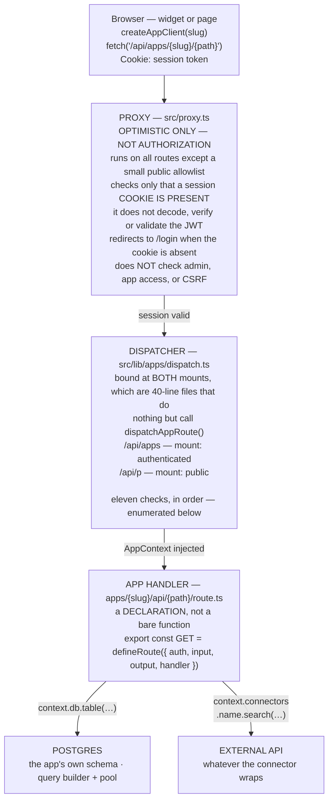
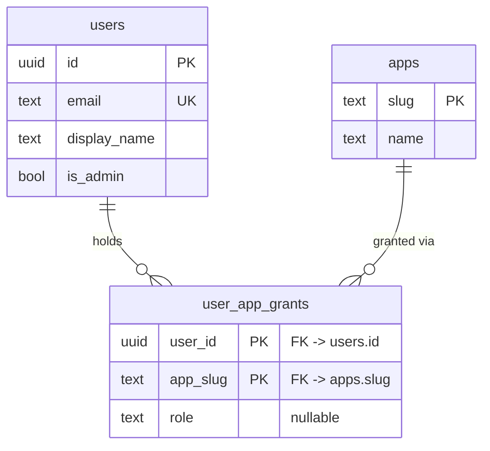
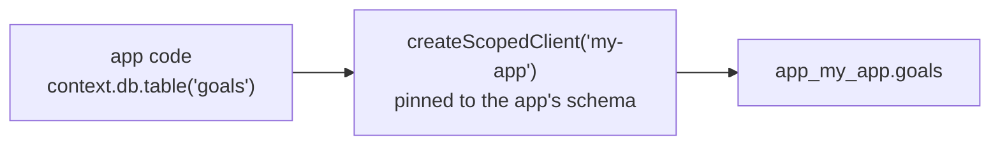
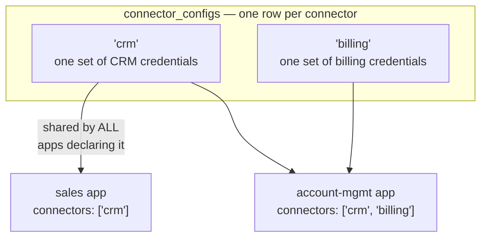
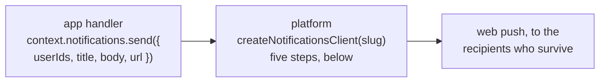

# Security Architecture: Apps & Connectors

This document describes the security model, data flow, and isolation boundaries
of the MixOS platform. It is intended for security reviewers and auditors.

**Key source files referenced throughout:**

| Component            | Path                                          |
|----------------------|-----------------------------------------------|
| Proxy (optimistic)   | `src/proxy.ts`                                |
| Auth configuration   | `src/lib/auth/config.ts`                      |
| Session helpers      | `src/lib/auth/session.ts`                     |
| Dispatcher (the pipeline) | `src/lib/apps/dispatch.ts`               |
| Mount bindings       | `src/app/api/apps/[...slug]/route.ts`, `src/app/api/p/[appSlug]/[[...slug]]/route.ts` |
| Auth tier resolution | `src/lib/apps/auth-tier.ts`                   |
| Route contract       | `src/lib/apps/route.ts` (`defineRoute`)       |
| App API keys         | `src/lib/apps/api-keys.ts`                    |
| Egress / SSRF        | `src/lib/apps/http.ts`                        |
| Access control       | `src/lib/apps/access.ts`                      |
| Context builder      | `src/lib/apps/context.ts`                     |
| Scoped DB client     | `src/lib/apps/scoped-db.ts`                   |
| App schema and role names | `src/lib/apps/app-identifiers.ts`        |
| App migrations       | `scripts/app-migrations.ts`, `scripts/app-sql-policy.ts` |
| Notifications client | `src/lib/apps/notifications.ts`               |
| Web Push sender      | `src/lib/push/server.ts`                      |
| Push subscribe API   | `src/app/api/push/*/route.ts`                 |
| Client SDK           | `src/lib/apps/sdk.ts`                         |
| Credential config    | `src/lib/connectors/config.ts`                |
| Encryption module    | `src/lib/connectors/encryption.ts`            |
| Rate limiter         | `src/lib/rate-limit.ts`                       |
| Safe error helper    | `src/lib/safe-error.ts`                       |
| Security headers     | `next.config.ts`                              |
| ESLint restrictions  | `eslint.config.mjs`                           |
| MCP endpoint         | `src/app/api/mcp/route.ts`                    |
| MCP tool broker      | `src/lib/mcp/broker.ts`                       |
| MCP tool discovery   | `src/lib/mcp/tools.ts`                        |
| OAuth AS crypto      | `src/lib/mcp/oauth.ts`                        |
| OAuth token store    | `src/lib/mcp/store.ts`                        |
| OAuth endpoints      | `src/app/api/oauth/{register,token,revoke}/route.ts` |
| MCP consent screen   | `src/app/(main)/oauth/authorize/`             |

---

## 1. Request Lifecycle

Every request from client code to an app's API traverses the same secured path.
No alternative entry points exist for app logic.



The context that handler is called with:

| Field | Is |
|---|---|
| `context.user` | The caller. `null` on non-identity tiers |
| `context.connectors` | Initialized connector instances |
| `context.db` | Scoped DB client, or `null` |
| `context.notifications` | Web Push sender, or `null` |
| `context.telemetry` | Usage tracking, or `null` |
| `context.services` | Cross-app broker, or `null` |
| `context.env` | Declared app settings |
| `context.http` | Egress-bounded fetch, or `null` |
| `context.manifest` | App metadata |
| `context.hooks` | App-scoped hook registrar |

### Security checkpoints in order

Both HTTP mounts — `/api/apps/<slug>/…` and `/api/p/<slug>/…` — are the same
pipeline (`src/lib/apps/dispatch.ts`) with a different `mount` argument. They
were parallel implementations until this was unified, which is how the public one
acquired a gate the authenticated one never had, and the authenticated one ended
up checking the wrong table.

| Step | Check                          | Failure | Where enforced                       |
|------|--------------------------------|---------|--------------------------------------|
| 0    | Session cookie present         | 302     | Proxy (`src/proxy.ts`) — presence only, never validation |
| 1    | Body under size cap            | 413     | Dispatcher (`content-length`, before any body read) |
| 2    | App slug exists                | 404     | Dispatcher (registry lookup)         |
| 3    | Rate limit (IP), pre-auth      | 429     | Dispatcher (`src/lib/rate-limit.ts`) |
| 4    | URL resolves to a route pattern| 404     | Dispatcher (`resolveRoutePath`)      |
| 5    | This mount serves the route    | 404     | Dispatcher, from the **hoisted contract** — so no app module is imported for a caller the route would refuse |
| 6    | Route module loads; method exported | 404 / 405 / 500 | Dispatcher (import and dispatch are separated, so a module that throws is not reported as missing) |
| 7    | Live declaration matches the registry | 404 | Dispatcher — a gate decided from one source and enforced from another is not a gate |
| 8    | Auth tier the caller earned    | 401 / 403 / 404 | `src/lib/apps/auth-tier.ts` |
| 9    | CSRF token, cookie-authenticated mutations only | 403 | `src/lib/apps/csrf.ts` — authenticated mount, identity tiers, mutating methods |
| 10   | Rate limit (user+app, route)   | 429     | Dispatcher, now that the caller is known |
| 11   | Context build succeeds         | 500     | Dispatcher (try-catch, generic message) |
| 12   | Required roles                 | 403     | `runRoute` — one place every caller passes through |
| 13   | Input matches the declared schema | 400  | `runRoute`                           |
| 14   | Connector-call and wall-clock budget | 429 / 504 | `runRoute`                    |
| 15   | Output matches the declared schema | 500  | `runRoute`                           |

**Authorization is `hasAppGrant`, not `hasAppAccess`.** The former reads
`user_app_grants` and short-circuits true for a `global` app; the latter reads
`user_apps`, which records that a user *installed* the app on their dashboard — a
layout preference. The gateway used the second until this was corrected, which
403'd every user of every global app.

**Tier resolution is strongest-first**: `session` > `signed-in` > `password` >
`key` > `public`, intersected with what the mount can serve. A route declaring
`["session", "public"]` therefore serves a granted user their own data and a
stranger the public view, from one handler, with `context.user` typed nullable so
the compiler forces both branches to exist.

**The `key` tier is implemented** (`src/lib/apps/api-keys.ts`), and is served on
the **public mount only**. `/api/apps` sits behind the proxy's cookie-presence
check, so a machine-to-machine caller with no cookie never reaches the dispatcher
there; `/api/p` is the non-cookie surface an integration needs.

A key is `mixk_` + 32 random bytes, shown once and stored only as an
HMAC-SHA256 digest (key derived from `CONNECTOR_ENCRYPTION_KEY` under its own
label). It is bound to one app — presenting app A's key on app B's route resolves
to nothing — and **scope-checked per method and route pattern**, so a key minted
for one endpoint does not become a key for the whole app.

This section previously stated the opposite: that the tier "has no
implementation" and was therefore unreachable. That was true when written and
false once `api-keys.ts` landed. The same stale claim still appears as a comment
at `src/lib/apps/dispatch.ts` (`servedHere`) and in the public mount's file
header — in both cases the *code* is correct and admits `key`; only the prose
is stale.

---

## 2. Credential Security

Connector credentials (API keys, tokens, secrets) are encrypted at rest
and only decrypted server-side, per-request. They never reach the browser.

### 2.1 Encryption scheme

```
Algorithm:  AES-256-GCM (authenticated encryption)
Key:        CONNECTOR_ENCRYPTION_KEY env var (32 bytes, hex-encoded)
IV:         12 random bytes, generated per encrypt() call
Output:     base64(IV) : base64(AuthTag) : base64(Ciphertext)
```

### 2.2 Credential lifecycle

```
  Admin UI (browser)
  ==================
  | Submits plaintext credentials for a connector
  | POST /api/connectors/<name>/config
  |
  v
+--------------------------------------------------+
| saveConnectorConfig()                            |
| (src/lib/connectors/config.ts)                   |
|                                                  |
|  1. JSON.stringify(credentials)                  |
|  2. encrypt(plaintext)                           |
|     - Generate random 12-byte IV                 |
|     - AES-256-GCM encrypt with CONNECTOR_        |
|       ENCRYPTION_KEY                             |
|     - Produce: IV:AuthTag:Ciphertext (base64)    |
|  3. Upsert into connector_configs table          |
|     - PK: connector_name (one row per connector) |
|     - Stores: encrypted_credentials,             |
|       configured_by (userId), updated_at         |
+--------------------------------------------------+
  |
  | Encrypted blob stored in Postgres
  v
+--------------------------------------------------+
| connector_configs table                          |
|                                                  |
|  connector_name  | encrypted_credentials | ...   |
|  "crm"           | "abc123:def456:..."   | ...   |
|  "billing"       | "xyz789:uvw012:..."   | ...   |
|                                                  |
|  Scope: org-wide (NOT per-user or per-app)       |
|  Access: trusted server code only                |
+--------------------------------------------------+

  NOTE: this is one of THREE write paths into connector
  credentials. The others are the admin-only OAuth consent
  flow (section 27), which lands a tenant grant here, and
  the per-user OAuth flow (section 3.4), which lands a
  personal grant in `user_connector_oauth` instead.
  |
  | On each app API request:
  v
+--------------------------------------------------+
| buildAppContext() --> getDecryptedConfig()        |
| (src/lib/apps/context.ts)                        |
|                                                  |
|  For each connector declared in app.json:        |
|   1. Query connector_configs for encrypted blob  |
|   2. decrypt(blob)                               |
|      - Split IV:AuthTag:Ciphertext               |
|      - AES-256-GCM decrypt with env key          |
|      - Verify authentication tag (tamper check)  |
|   3. JSON.parse --> credential object             |
|   4. new ConnectorClass()                        |
|   5. instance.initialize(credentials)            |
|      - Credentials stored as private fields      |
|   6. Inject into context.connectors              |
|                                                  |
|  Instance is STATELESS and REQUEST-SCOPED:       |
|   - Created fresh per request                    |
|   - Never cached or shared across requests       |
|   - Garbage collected after response              |
+--------------------------------------------------+
```

### 2.3 What prevents credential exposure

| Threat                         | Mitigation                                             |
|--------------------------------|--------------------------------------------------------|
| Credentials in browser JS      | ESLint bans connector imports in client code           |
| Credentials in API responses   | Connectors are server-only; SDK returns app data only  |
| Credentials leaked via caching | Connector instances are stateless, never cached        |
| Credentials at rest in DB      | AES-256-GCM with per-record random IV                  |
| Tampered ciphertext            | GCM authentication tag verified on every decrypt       |
| Key in source code             | Key loaded from env var at runtime, not committed      |

---

## 3. Tenant and App Isolation

### 3.1 User-to-app access control



The check itself, run on every request:

```text
hasAppGrant(userId, appSlug):
  if the app's manifest says `global`      --> true
  SELECT app_slug FROM user_app_grants
  WHERE user_id = $1 AND app_slug = $2

Result: boolean --> 403 if false
```

Users can only reach app API routes for apps they hold a grant for. This is
checked on **every request**, inside `resolveAuthTier`, before any app code runs.

**Do not confuse this with `user_apps`.** That table records which apps a user has
*installed* on their dashboard — a layout preference, not a permission. The
function that reads it, `hasAppAccess()`, has **no callers** and should not
acquire any; the gateway used it once, which 403'd every user of every global
app.

### 3.2 Database table isolation

Apps that declare `"database": true` in their manifest get a schema of their
own, and a scoped database client pinned to it.



The schema, and the role that owns it, are derived from the slug by one
encoding (`src/lib/apps/app-identifiers.ts`), so two apps asking for the same
table name never reach the same rows:

| App | Writes | Actually reads |
|---|---|---|
| `my-app` | `context.db.table("goals")` | `app_my_app.goals` |
| `my_app` | `context.db.table("goals")` | `app_my__app.goals` |
| `reports` | `context.db.table("renewals")` | `app_reports.renewals` |

The encoding writes `-` as `_` and `_` as `__`, and a slug may not start or end
with a separator or put two side by side, so every encoded name reads back to
exactly one slug. The build fails on a slug outside that form, and on any two
apps whose schema or role names would be the same.

**Isolation guarantees:**

```
+-----------------------------------+
| Postgres (shared database)        |
|                                   |
|  public: platform tables (25, all |
|  RLS enabled, zero policies):     |
|    users, apps                    |
|    user_apps, user_app_grants     |
|    app_passwords                  |
|    app_api_keys                   |
|    app_settings                   |
|    connector_configs              |
|    user_connector_oauth           |
|    connector_scope_status         |
|    connector_webhook_events       |
|    app_unlock_failures            |
|    dashboard_layouts/_widgets     |
|    push_subscriptions             |
|    app_scheduled_jobs             |
|    app_job_runs                   |
|    platform_settings              |
|    app_open_events                |
|    telemetry_events               |
|    oauth_clients                  |
|    oauth_authorization_codes      |
|    oauth_tokens                   |
|    rate_buckets                   |
|    _migrations                    |
|                                   |
|  app_my_app    (mixos_app_my_app) |
|    goals                          |
|    quotes                         |
|  app_reports   (mixos_app_reports)|
|    renewals                       |
|    history                        |
|  ...                              |
|                                   |
|  Each app reaches only its own    |
|  schema, via createScopedClient() |
+-----------------------------------+
```

- The `ScopedClient` only exposes a `.table(name)` method, on the query builder
  pinned to the app's schema. A name cannot carry a quote, a dot or another
  schema out of it (§8).
- App code never sees or constructs another schema's name.
- Apps without `"database": true` receive `context.db = null`, and may not ship
  `migrations/`: the build fails, and so does the release step.

**What an app's migrations can do.** The release step runs each app's
`migrations/*.sql` as the app's own role, `mixos_app_<slug>`: NOLOGIN, a member of
nothing, owner of its schema and of nothing else. Each file runs through a
`SECURITY DEFINER` function owned by that role, with the schema first on its
search path, created and dropped inside the file's own transaction
(`scripts/app-migrations.ts`). Postgres refuses `SET ROLE` and `SET SESSION
AUTHORIZATION` inside such a function, so the file cannot step back out to the
platform's role, and the app role's privileges keep it off every table but its
own. Only apps the registry accepted run any SQL.

That bounds what a migration does while it runs, not what it leaves behind. A
trigger, rule, column default, check, index expression or view on an app's table
runs later, when the platform reads or writes the table, and runs as the
platform's role. So before anything is applied, every statement is parsed with
Postgres's own parser (libpg_query) and checked against an allowlist
(`scripts/app-sql-policy.ts`). It allows tables, indexes, views, sequences and
enum types in the app's schema, and the rows in them. It refuses triggers,
rules, functions, `DO`, policies, grants, role and session statements,
extensions, any reference to anything outside the schema, and any function call,
in any expression, outside a short list of pure built-ins such as `now()` and
`gen_random_uuid()`. The build runs the same check, so a refused statement fails
the build before it can fail a deploy.

The one trigger apps asked for, an `updated_at` that keeps itself current,
belongs to the platform: an app lists the column under `updatedAt` in its
manifest, and the release step installs `public.mixos_touch_updated_at()` on it
(`supabase/migrations/0009_app_schemas.sql`). That function sets the one column
to `now()` and reads nothing else.

### 3.3 Client-server boundary enforcement

Three layers prevent client-side code from bypassing the gateway:

```
+------------------------------------------------------------------+
| LAYER 1: SDK Design (src/lib/apps/sdk.ts)                        |
|                                                                  |
|  createAppClient(slug) routes ALL requests through               |
|  /api/apps/<slug>/<path> -- no direct DB or connector access     |
|  possible from client code                                       |
+------------------------------------------------------------------+

+------------------------------------------------------------------+
| LAYER 2: ESLint Rules (eslint.config.mjs)                        |
|                                                                  |
|  Client code (widgets, pages) CANNOT import:                     |
|    - @/lib/db/*                                                  |
|    - @connectors/*                                               |
|    - @/lib/connectors/*                                          |
|                                                                  |
|  Restrictions are TIERED, and each tier RESTATES the whole set   |
|  because ESLint flat config REPLACES a rule's options rather     |
|  than merging them. An entry omitted from a later block is       |
|  permitted there — which is how pages and widgets became the     |
|  only tier able to import the context builder.                   |
|                                                                  |
|  Enforced: CI runs `npm run lint` as a BLOCKING step.            |
+------------------------------------------------------------------+

+------------------------------------------------------------------+
| LAYER 3: Runtime Context (src/lib/apps/context.ts)               |
|                                                                  |
|  AppContext (with connectors, db, user) is only constructed      |
|  inside the gateway and passed to server-side route handlers.    |
|  Widget/page components receive only: { appSlug, config, size }  |
+------------------------------------------------------------------+
```

### 3.4 Connector credential scope

There are **two** credential models. Which one applies is declared per connector.

**Tenant-scoped (the default).** One credential set in `connector_configs`,
configured once by an admin, shared by every app and every user:



Access control is therefore at the **external service** level: the CRM's token
scopes, the billing key's permissions, and so on. MixOS decides *which apps may
use a connector*, never what that connector's credentials are allowed to do.

The property this buys is worth naming: because there is exactly one credential
set, **any response the connector returns is the same response any user would
have received**. That is what makes caching, logging and sharing safe to reason
about without thinking about identity.

**User-scoped (`userScoped: true`).** For connectors where one shared account is
the wrong answer — a person's own mailbox cannot be a single inbox the whole
deployment reads. The client id and secret still live in `connector_configs`; an
admin registers the application once. Only the **grant** is personal, stored
encrypted in `user_connector_oauth` keyed `(user_id, connector_name)`.

```
  connector_configs           user_connector_oauth
  (client id + secret,        (per-user OAuth grant,
   admin-registered)           encrypted, ON DELETE CASCADE)
         \                        /
          \                      /
           v                    v
      context.connectors.gmail resolves against
      the CALLING user's grant — or is OMITTED
```

Constraints, all build-enforced:

- **Only three-legged OAuth may be user-scoped.** An API-key connector has one key
  an admin pastes; a "user-scoped" API key would be the tenant key wearing a
  different label.
- **A user-scoped connector cannot be used by a scheduled job.** A job runs with
  no user, so there is no grant to resolve — the connector would be silently
  absent at 3am and present in a page request.
- **Absent, not broken.** No user in context, a user who has never connected, or
  a grant the provider will no longer renew omits the connector rather than
  handing over an unusable one. That is the same shape an app already handles
  for a connector an admin has not configured.

**What this model costs.** Once a connector answers differently per user, every
place a response is cached, logged, or shared becomes a place it can reach the
wrong person. **Cache keys must include the user.** The platform enforces this
where it owns the key; an app that caches a user-scoped response itself owns that
correctness.

A departing user's tokens cascade-delete with their row: they are not history
worth keeping, they are live access to a third-party account.

### 3.5 Notification (Web Push) scope

Apps that declare `"notifications": true` receive a `context.notifications`
client (gated exactly like `context.db`; `null` otherwise). It exposes a single
method — `send({ userIds, title, body, url, tag, icon })` — and is the only way
app code can dispatch a push.



What the platform does between those two boxes, in order:

1. **Dedupe** `userIds`.
2. **Filter to recipients who actually have THIS app** — `hasAppGrant`: a
   `global` app resolves to everyone, otherwise an explicit `user_app_grants`
   row is required. **This step is the security boundary.**
3. **Load** each surviving recipient's subscriptions.
4. **Send** via `web-push.sendNotification`, VAPID-signed.
5. **Prune** dead endpoints (404/410).

**Isolation guarantees:**

- **Recipient gating.** `send()` drops any `userId` that lacks access to the
  calling app, so one app cannot push to users of another even if it guesses
  their ids. Enforced in `src/lib/apps/notifications.ts` via `hasAppGrant`.
- **Server-only dispatch.** `context.notifications` is built in the gateway and
  injected into route handlers only. The public surface sets it to `null`
  (`PublicAppContext.notifications: null`), so unauthenticated routes cannot send.
- **Subscriptions are platform-owned.** `push_subscriptions` is a `public.*`
  table written only by the session-gated subscribe/unsubscribe routes
  (`src/app/api/push/*`), each pinning `user_id` from `requireReadOnlySession()`.
  App code never reads or writes it, and the `ScopedClient` cannot reach it:
  it is in `public`, not the app's schema.
- **Endpoints are push services only.** The server POSTs to every stored
  endpoint, so one is accepted only on a browser vendor's push service (§13),
  at subscribe time and again before each send.
- **No client-side push API.** Widgets/pages opt in only through the SDK helper
  `enablePushNotifications()` (`src/lib/apps/sdk.ts`), which posts the browser
  subscription to the platform route. The VAPID **private** key never leaves the
  server; only the public key is handed to the client to subscribe.
- **Payload exposure.** A push payload reaches a recipient's device, so apps
  must treat `title`/`body` as user-visible and must not include another user's
  private data beyond what the recipient is entitled to see.

---

## 4. Security Boundaries Summary

| Layer               | What it protects              | Mechanism                                    | Enforced at                  |
|---------------------|-------------------------------|----------------------------------------------|------------------------------|
| Proxy (optimistic)   | Unauthenticated browsing      | Cookie-PRESENCE check, redirect to /login    | `src/proxy.ts`               |
| Authoritative auth   | Forged / stale session        | JWT verified per request in route handlers   | `requireReadOnlySession()`   |
| CSRF protection      | Cross-site request forgery    | `SameSite=Lax` cookie, plus double-submit token on cookie-authenticated mutations | `csrf.ts`, Auth.js, Next.js (see §7) |
| Admin authorization  | Admin-only pages and actions  | `requireAdmin()` re-reads `is_admin` per call | `access.ts` (see §9)         |
| Server-side admin    | Admin action bypass           | `requireAdmin()` in pages + server actions   | `access.ts`, admin pages     |
| Rate limiting        | Abuse / DoS                   | Postgres token-bucket, memory pre-filter     | `rate-limit.ts`, gateway     |
| Tier resolution      | Per-request auth decision     | `resolveAuthTier()`, strongest-first, fails closed | `auth-tier.ts`          |
| App access control   | Unauthorized app access       | `hasAppGrant()` checks `user_app_grants`     | `auth-tier.ts` via `access.ts` |
| Email domain gate    | Unauthorized user provisioning| `ALLOWED_EMAIL_DOMAINS` env var check        | `access.ts` (`ensureUser`)   |
| Encryption at rest   | Credential exposure in DB     | AES-256-GCM with random IV per record        | `encryption.ts`              |
| Per-request decrypt  | Credential caching/leakage   | Stateless connectors, fresh per request      | `context.ts`                 |
| Per-app schemas      | Cross-app data access         | A schema and role per app; `ScopedClient` pinned to it | `scoped-db.ts`, `app-identifiers.ts` |
| App migration checks | App SQL reaching past its app | Parsed against an allowlist, run as the app's role | `app-sql-policy.ts`, `app-migrations.ts` |
| Notification scope   | Cross-app push spam           | `send()` filters recipients to users with the app | `notifications.ts` (`hasAppGrant`) |
| ESLint import rules  | Client importing server code  | Build-time import restrictions               | `eslint.config.mjs`          |
| App containment scan | Secrets, egress, injection    | Syntax-tree scan; a finding skips the app    | `app-containment.ts` (see §24) |
| SDK routing          | Direct DB/connector access    | All client calls go through `/api/apps/...`  | `sdk.ts`                     |
| Safe error responses | Internal detail leakage       | `safeErrorMessage()` strips details in prod  | `safe-error.ts`, all routes  |
| Request body limit   | Memory-exhaustion DoS         | 27 MB cap, `content-length` checked first    | `dispatch.ts` (`MAX_BODY_BYTES`) |
| Timing-safe queries  | User/app enumeration          | `.maybeSingle()` on all access checks        | `access.ts`                  |
| Security headers     | Clickjacking, MIME sniffing   | CSP `frame-ancestors 'self'`, `nosniff`, etc | `next.config.ts`             |
| Session cookies      | Session hijacking / forgery   | Auth.js JWT, httpOnly, secure, sameSite=lax  | `next-auth` (Auth.js v5)     |

---

## 5. Environment Secrets

| Variable                    | Purpose                              | Exposure risk if leaked                          |
|-----------------------------|--------------------------------------|--------------------------------------------------|
| `AUTH_SECRET`               | Signs/encrypts Auth.js session JWTs  | Attacker can forge a session for any user        |
| `DATABASE_URL`              | Postgres connection; owns every table, so RLS does not apply | Full read/write to every table |
| `CONNECTOR_ENCRYPTION_KEY`  | AES-256-GCM for **tenant** connector credentials and the connector OAuth flow-state cookie | Exposes every shared third-party API key |
| `USER_OAUTH_ENCRYPTION_KEY` | AES-256-GCM for **per-user** OAuth grants (`user_connector_oauth`) | Exposes every person's third-party account tokens |
| `MCP_TOKEN_KEY`             | HMAC digests for MCP tokens and authorization codes | Lets an attacker mint MCP tokens |
| `APP_API_KEY_SECRET`        | HMAC digests for app API keys (the `key` tier) | Lets an attacker mint app API keys |
| `APP_SETTINGS_ENCRYPTION_KEY` | AES-256-GCM for `password`-typed app settings (`context.env`) | Exposes every app-scoped secret an admin entered |
| `APP_UNLOCK_SECRET`         | Signs app password-unlock cookies    | Bypass of every app password |
| `CRON_SECRET`               | Authenticates Vercel Cron -> /api/cron | Attacker can trigger every app background job  |
| `VAPID_PRIVATE_KEY`         | Signs Web Push messages              | Attacker could send push to existing subscribers; no data read access |
| `VAPID_PUBLIC_KEY` / `VAPID_SUBJECT` | Client subscribe key / contact URL | Not secret; public key is handed to the browser to subscribe |
| `ALLOWED_EMAIL_DOMAINS`     | Restricts user provisioning          | Not secret, but removing it lets any email domain sign in |

Everything above except `ALLOWED_EMAIL_DOMAINS` and the VAPID public/subject
values must be kept out of client bundles, source control, and logs. Note that
none of them carry a `NEXT_PUBLIC_` prefix, which is what stops Next.js inlining
them into browser bundles — do not add one.

### The key inventory, and why there are six

Five of those six used to be one secret, or derived from it: `MCP_TOKEN_KEY`,
`APP_API_KEY_SECRET`, `APP_SETTINGS_ENCRYPTION_KEY` and `APP_UNLOCK_SECRET` were
all `HMAC(CONNECTOR_ENCRYPTION_KEY, label)`, and per-user OAuth grants were
encrypted with the base key directly.

The PRF separation was sound — leaking a derivative could not recover the base
key — but it made the base key **un-rotatable in practice**. Changing it
simultaneously made every stored connector credential undecryptable, invalidated
every MCP token, every app API key and every unlock cookie. A key that cannot be
rotated is a key whose compromise is unrecoverable, so "no new environment
secret" was buying the wrong thing.

Each key is now independent, declared in
[`src/lib/env/keys.ts`](../src/lib/env/keys.ts) with its purpose and its
**rotation blast radius** stated next to it. There is **no derivation fallback**:
a missing key fails closed naming the variable, because a fallback would mean
nobody sets the others and the single point of failure quietly survives.

```
npm run keys:generate     # all six, plus AUTH_SECRET and CRON_SECRET, paste-ready, with rotation notes
npm run keys:check        # exits non-zero naming anything missing or malformed
```

The generator enumerates the inventory rather than listing names, so a key added
there is generated without anyone remembering to update it — that drift is
exactly what produced the RLS gap in §8.

**Do not point two keys at the same value, and do not derive one from another.**

In production these are Vercel project environment variables.

---

## 6. Rate Limiting

The API gateway applies a per-IP token-bucket rate limiter before
authentication checks. This protects against brute-force and DoS attacks.

```
Algorithm:  Token bucket
Authority:  public.rate_buckets (Postgres), one atomic upsert per charge
Pre-filter: a per-instance in-memory bucket (see below)
Key:        <limiter name>::<identity>, scoped to one of
            ip | user_app | route | api_key
Burst:      60 requests      (the app gateway; other limiters differ)
Refill:     10 tokens/second
Response:   429 Too Many Requests + Retry-After header
```

### Why it is not in-memory

It used to be, with a comment saying that was "suitable for single-process
deployments". The deployment is serverless: every function instance held its own
Map, so the documented burst was **per instance** and, across a fleet that scales
with the very traffic being limited, close to no limit at all. A control that
reads as enforced and is not is worse than an absent one.

The authority is now a Postgres table. The refill arithmetic lives inside the
`ON CONFLICT DO UPDATE SET` expression, which Postgres evaluates against the
locked current row — a CTE or an `UPDATE ... FROM (SELECT ...)` reads the
statement snapshot instead and is silently racy under concurrency.

### The two tiers

The in-memory bucket survives as a pre-filter, and the asymmetry is what makes
that sound. A per-instance bucket sees only a fraction of the traffic, so it
drains more slowly than the global one and is therefore strictly **more
permissive**:

- memory says DENY → the global bucket is at least as empty. Short-circuit.
- memory says ALLOW → proves nothing. Consult Postgres.

A cold instance starts full, so it can only ever be too generous. It can never
lock anyone out on its own.

### Failing open, deliberately

If Postgres is unreachable the limiter logs a warning and falls back to the
in-memory result. This is a security control failing open, which is worth stating
plainly. The alternative is a database blip taking the product down, and the
fallback degrades to exactly the behaviour this module had before — a rarer
exposure, not a new one.

### Garbage collection

The cron tick deletes buckets untouched for an hour. The invariant: that TTL must
exceed `maxTokens / refillRatePerSecond` for **every** configured limiter, or GC
forgives an abuser mid-penalty. The slowest limiter today is OAuth dynamic
registration at 10 tokens / 0.05 per second = 200 seconds, leaving ~18x headroom.
A slower limiter than that needs a longer TTL or per-row budget columns.

### IP extraction hardening

The gateway extracts the client IP from the **rightmost** entry in the
`x-forwarded-for` header (the one appended by the trusted reverse proxy),
falling back to `x-real-ip`. This resists client-side header spoofing where
an attacker prepends fake IPs to bypass rate limiting.

```
x-forwarded-for: <attacker-spoofed>, <real-client-ip>
                                      ^^^^^^^^^^^^^^^^ used
```

The pre-filter's in-memory store (`src/lib/rate-limit.ts`) evicts stale entries
automatically; the Postgres authority is pruned from the cron tick.

---

## 7. CSRF Protection

CSRF is handled in two distinct places, and neither is the proxy — `src/proxy.ts`
performs no CSRF validation at all.

**Auth.js routes.** `next-auth` protects its own sign-in/sign-out endpoints with
the standard double-submit cookie: a CSRF token is stored in the
`authjs.csrf-token` cookie and must be echoed in the request body.

**Everything else.** App API routes and server actions rely on the session
cookie being `SameSite=Lax`, which stops a cross-site form or `fetch` from
attaching it to a state-changing request. Next.js server actions additionally
verify the `Origin` header against the `Host` on every invocation.

The practical consequence for app authors: do not lower `sameSite` on the
session cookie, and do not accept state-changing requests on `GET` — `Lax`
permits cross-site `GET` navigation, so a mutating `GET` handler is reachable
cross-site.

**App API routes: double-submit token.** `src/lib/apps/sdk.ts` fetches a token
from `/api/auth/csrf` and attaches it as `X-CSRF-Token` on every
POST/PUT/PATCH/DELETE, retrying once on a 403 with a refreshed token. The
dispatcher verifies it in `src/lib/apps/csrf.ts` (step 9 of §1).

Auth.js sets the cookie `authjs.csrf-token` (`__Host-` prefixed over HTTPS) to
`"<token>|<sha256(token + AUTH_SECRET)>"`. Verification is two steps, and the
first is the one that matters:

1. **Recompute the hash.** This proves the pair was minted by this server. An
   attacker who can write cookies otherwise chooses *both* halves, and a
   double-submit that only checks "header equals cookie" accepts them.
2. **Compare the header to the token half**, constant-time. This is the half a
   cross-origin attacker cannot read.

It fails closed on a missing header, missing or malformed cookie, or an unset
`AUTH_SECRET`, and returns `403 { code: "CSRF_FAILED" }`.

**Where it deliberately does not apply.** The public mount (`/api/p/`), the
`password` / `key` / `public` tiers, and `callAppRoute`. None of those carry an
ambient cookie a cross-site request could borrow, so requiring a token would
break API-key integrations and server-component calls to defend against nothing.

**This is defence in depth, not the primary control.** `SameSite=Lax` is still
what stops the request being made with credentials at all. The token exists
because Lax is browser-enforced — it does nothing on a client that ignores it,
and its exemption for top-level navigations is exactly why a mutating `GET`
handler stays reachable cross-site.

---

## 8. Database Access Model

The platform reaches Postgres two ways, both server-side only and both over
the one pool configured from `DATABASE_URL`:

| Client | Module | Used for |
|--------|--------|----------|
| The query builder (`createServiceClient()`) | [`src/lib/db/query.ts`](../src/lib/db/query.ts), from [`src/lib/db/server.ts`](../src/lib/db/server.ts) | Essentially everything, including the app-facing `context.db` |
| Raw `postgres.js` pool (`sql`) | [`src/lib/db/client.ts`](../src/lib/db/client.ts), options in [`src/lib/db/pg-options.ts`](../src/lib/db/pg-options.ts) | The few queries the builder cannot express: analytics aggregates, telemetry rollups, the scheduler's atomic job claim, and the schema's own functions |

**Both connect as the role that owns every platform table and is a member of
every app's role, and Row-Level Security does not apply to a table's owner or to
a member of the role that owns it.** That is the single most important fact in
this section, and everything below follows from it. (On Supabase this role is
`postgres`; until the builder replaced supabase-js the app also went through
the `service_role`, which bypasses RLS outright. The consequence is the same.)

The builder is also where SQL injection would live if it lived anywhere, so it
is built not to have any: every schema, table, column, alias and conflict target
must be a plain identifier and is quoted, and every value is a bind parameter. A
name that is not a plain identifier is refused before any SQL is written. That
rule is what keeps `context.db` inside the app's schema: an app's table name
cannot carry a quote, a dot or another schema out of it.

### What RLS does and does not do here

RLS is **enabled on every table, with zero policies** (see the header of
[`supabase/migrations/0001_initial.sql`](../supabase/migrations/0001_initial.sql)).
That combination is deny-all for the `anon` and `authenticated` roles while the
owning role — the one MixOS connects as — passes straight through.

**How that is enforced matters, because it failed once already.** It used to be a
hand-maintained `foreach t in array array['users', 'apps', ...]` list. A list has
to be edited every time a table is added, and it was not: `connector_webhook_events`
shipped without RLS, and after that was fixed three more tables were added
without being transcribed into it — `user_connector_oauth` (which holds per-user
OAuth grants), `connector_scope_docs`, and `connector_scope_status`. All were
readable through PostgREST by anyone holding the publishable anon key.

The list is now a **catalog sweep**: the migration enables RLS on every ordinary
table in `public` that lacks it, skipping extension-owned tables. A rule that
says "every table in `public`" is enforced by asking for every table in `public`.
Adding a table cannot miss it, and there is nothing to remember.

**App tables are swept too.** Each app's tables are in its own schema, which
PostgREST does not publish unless someone configures it to, and belong to the
app's role. The release step (`scripts/app-migrations.ts`) runs the same sweep
over every app schema as well as `public`, after applying app migrations, so an
app's tables are hardened by the run that creates them.

This is load-bearing on Supabase and would not be on a plain Postgres instance.
Every Supabase project publishes the `public` schema through PostgREST,
reachable with the project's publishable (anon) key — whether or not MixOS uses
that API, and it no longer does. A table with RLS switched off is therefore
readable by anyone who has that key, which is not a secret. Enabling RLS with no
policies is what closes that door. Off Supabase there is no such API, the lock
costs nothing, and it is kept so that moving a database onto Supabase never
opens one.

The flip side is a deployment rule: **migrations must run as the role the
application connects as.** A table owned by some other role is invisible to the
app — RLS with no policies denies everyone but the owner. App tables are the one
deliberate exception, and they follow the same rule one step removed: each
belongs to its app's role, and the release step makes the role it runs as, the
one the application connects as, a member of it.

What it is **not**:

- It is **not** an isolation boundary between users. The application connects as
  one role for every request; the database cannot tell one signed-in user from
  another.
- It is **not** an isolation boundary between apps. See below.
- It is **not** defence-in-depth behind the application's own checks. A bug that
  makes the platform query the wrong row will be served, because the owning role
  is permitted to read every row.

**A table added in a future migration is covered automatically** by the sweep at
the bottom of `0001_initial.sql` — but only if that migration runs after it. A
migration that *adds* a table (as `0002` does) should enable RLS on it directly,
because the earlier sweep has already run. Adding a *policy* is what would open a
table up; there are none, and there should stay none.

### Where authorization actually happens

Entirely at the application layer:

- Sensitive tables (`connector_configs`, `dashboard_widgets`,
  `dashboard_layouts`, `user_apps`, `user_app_grants`, `push_subscriptions`,
  `app_passwords`, `oauth_tokens`, …) are read and written only by trusted
  server code, never from a browser bundle.
- Helpers in [`src/lib/connectors/config.ts`](../src/lib/connectors/config.ts),
  [`src/lib/apps/access.ts`](../src/lib/apps/access.ts), and the dashboard
  `actions.ts` files require a `userId` derived from `requireServerSession()`
  (or `requireAdmin()` on admin paths) before issuing a query. The session pins
  the userId, so a caller cannot read or write another user's row.
- App tables live in a schema per app, `app_<slug>`, owned by a role per app
  (§3.2). At runtime the boundary is the `ScopedClient`
  ([`src/lib/apps/scoped-db.ts`](../src/lib/apps/scoped-db.ts)), the query
  builder pinned to the app's schema: an app cannot name another app's table,
  and cannot name a platform table. It connects as the platform's role, like
  every other query, so at runtime the boundary is held in application code.
  The other half is settled before anything runs: an app's migrations run as
  the app's own role, and what they may leave behind for the platform's role
  to run is checked first (§3.2).

  **The schema bounds the table name, not the app.** `createScopedClient(slug)`
  accepts *any* slug and builds its own full-access client for that app's
  schema, so the guarantee rests entirely on app code never calling it —
  `context.db` is the client the dispatcher pins to the calling app. That
  factory used to be importable from every app tier, including widgets, with no
  lint error; an app could have written
  `createScopedClient("other-app").table("secrets")` and read or written another
  app's data. It is now a restricted import in all three tiers, by **name**
  (`createScopedClient`, `createReadOnlyScopedClient`) so that
  `import type { ScopedClient }` — how a handler types the client it is given —
  still works.
- The ESLint rules in [`eslint.config.mjs`](../eslint.config.mjs) stop app code
  importing the raw client at all, so an app cannot hand-write SQL at runtime
  that would sidestep its schema.

### Reachability of the database credential

`DATABASE_URL` carries no `NEXT_PUBLIC_` prefix, which is what prevents Next.js
inlining it into a client bundle. The pool connects lazily and only inside
server modules. Adding a `NEXT_PUBLIC_` prefix to it, or importing `@/lib/db/*`
from a `"use client"` component, would be a full database compromise.

---

## 9. Admin Authorization

Admin pages and server actions enforce authorization at two layers:

```
  THERE IS NO PROXY-LEVEL ADMIN GATE.
  src/proxy.ts only checks that a session cookie exists. It does not
  know whether the user is an admin, and /admin/* is not special to it.

  THE ONLY CHECK: src/lib/apps/access.ts
  - requireAdmin(session) re-reads the user from the database and
    verifies the `is_admin` column
  - Applied in every admin page component and every admin server action
  - Throws "Admin access required" if the user is not an admin
```

This is a single layer by design, not by omission: an admin flag carried in the
session JWT could go stale after a demotion, so `requireAdmin()` reads
`is_admin` from the database on every call rather than trusting the token.

Because server actions are directly invocable POST endpoints, each admin action
(`configureConnector`, `toggleUserGrant`, `toggleAppRegistration`,
`getAppSchema`, `revokeUserSessionsAction`, …) calls `requireAdmin()` itself.
Nothing upstream does it for them, so an action that forgets the call is fully
exposed to any signed-in user.

**The review checklist item for any new admin action is now two lines**, not one:
call `requireAdmin()` (the gate, §9) *and* `recordAdminAction()` (the record,
§28). Nothing upstream does either for you.

---

## 10. User Provisioning Controls

The `ensureUser()` function (`src/lib/apps/access.ts`) creates a database record
the first time a user signs in. An optional email domain allowlist prevents
unauthorized users from being provisioned:

```
Env var:       ALLOWED_EMAIL_DOMAINS
Format:        Comma-separated (e.g. "mix.mysite.com,example.com")
Behaviour:
  - When set:   Only users whose email domain matches may sign in
  - When unset: Any email domain is accepted
  - Enforced in: src/lib/auth/config.ts (emailAllowed), applied in the
                 credentials provider — the only sign-in path
```

The allowlist is a provisioning control, not an authentication control. It
decides who may become a user; it says nothing about what an existing user may
then access — that is the grant model in section 3.

---

## 11. Error Response Sanitization

App API route handlers use `safeErrorMessage()` (`src/lib/safe-error.ts`)
to prevent internal details from leaking to clients:

```
Development:  Returns the original error message for debugging
Production:   Returns only a generic fallback (e.g. "Failed to fetch deals")
```

This prevents database error messages (which may contain table names, column
names, or constraint details) and connector errors (which may contain API
URLs or credential hints) from reaching the browser.

---

## 12. Session Cookie Security

Session cookies are left at Auth.js v5 defaults. Nothing embeds MixOS from
another origin, so there is no reason to loosen them below `SameSite=Lax`.

| Flag          | Value                       | Purpose                            |
|---------------|-----------------------------|------------------------------------|
| `httpOnly`    | `true`                      | Prevents JavaScript access (XSS)   |
| `secure`      | `true` over HTTPS           | HTTPS-only transmission            |
| `sameSite`    | `lax`                       | Blocks cross-site POST requests     |
| `__Secure-`   | prefix over HTTPS           | Cookie may only be set over TLS    |
| Contents      | Signed/encrypted JWT (JWE)  | `session: { strategy: "jwt" }` — no server-side session table |

Because the strategy is `jwt` there is no session row to delete — but sessions
**are** revocable, per user, through `users.session_version`.

The counter is minted into the token at sign-in and compared against the row on
**every** session resolution (`jwt` callback, `src/lib/auth/config.ts`). Bumping
it invalidates every token issued before that moment, for that user alone; the
callback returns `null` and the next request lands on `/login`.

| Lever | Scope | Use for |
|---|---|---|
| `revokeUserSessions(userId)` | one user | offboarding, a lost laptop, a password change |
| Rotate `AUTH_SECRET` | everyone | a suspected secret leak |

Bumped automatically on a **password change** — the credential the outstanding
tokens were minted from is gone — and on demand via the admin action
`revokeUserSessionsAction`, which is audited (§28). Granting or revoking an app
grant does *not* bump it: those are re-read live on every request (§3.1) and need
no session teardown.

The increment is a `security invoker` RPC (`bump_session_version`) doing
`set session_version = session_version + 1` against the locked row, so two
concurrent revocations cannot both read the same value and collapse into one.
`EXECUTE` is revoked from `anon` and `authenticated` and granted only to
`service_role` where those Supabase roles exist; MixOS itself calls it as the
function's owner.

**The cost, stated plainly.** This is one indexed read per session resolution
where the token was previously trusted for its whole lifetime. The same read
re-checks `is_admin`, so a demotion now takes effect everywhere rather than only
inside `requireAdmin()`. The dispatcher already reads the same row via
`getUserById` on identity tiers, so an authenticated API call reads it twice —
worth merging, but correctness came first. It fails **closed** on a missing row
(a deleted user's token stops working) and **open** on a query error, so a
database blip does not sign out the entire platform.

---

## 13. Server-Side Request Forgery (SSRF)

**Platform-level SSRF containment exists** and is exposed to app code as
`context.http` (`src/lib/apps/http.ts`). This section previously said the
opposite — that there was no defence because no platform code fetched a
user-supplied URL. That was wrong in both halves: app routes could already call
`fetch` on anything, and the containment below was built to close it.

`context.http` is non-null only when the app declares `egress` in `app.json`. It
implements **both** halves, and the second is the one people skip:

```
1. Check scheme and hostname
   - http: and https: only
   - hostname must match the manifest's `egress` allowlist
     (bare hostnames, or `*.example.com` for one level of subdomain)
   - IP literals are rejected by the manifest schema — an IP would bypass
     the resolve-and-recheck the allowlist depends on

2. Resolve, then re-check the ANSWER, then connect to it
   - Validating the string alone is defeated by DNS rebinding: an attacker
     registers a name that resolves public at validation time and private
     at fetch time.
   - Every returned address is checked against 0/8, 10/8, 127/8,
     172.16-31, 192.168/16, 169.254/16 (metadata), 100.64/10 (CGNAT),
     198.18-19, multicast, ::/96 (incl. ::1), fc00::/7, fe80::/10,
     fec0::/10, ff00::/8, Teredo, and any v6 form that carries an IPv4
     address (mapped, NAT64, 6to4), which is judged as that address.
   - The connection is PINNED to the addresses checked. The request goes
     out over node:http(s) with a `lookup` that answers with them, so the
     name is never resolved a second time; the URL's hostname still sets
     the Host header, the TLS server name and the certificate check.
     (`fetch` cannot be handed an address, which is why it is not used.)
   - Redirects are followed MANUALLY (max 3 hops) so every hop repeats
     both checks. A 302 to 169.254.169.254 would otherwise walk straight
     past them.
```

**Raw network access fails the build in `apps/**`**, which is what makes this the
only door: `fetch`, `WebSocket`, `EventSource`, `XMLHttpRequest`, the
`http`/`https`/`http2`/`net`/`tls`/`dgram` modules, and the common HTTP client
packages. Lint flags them in the editor, and the registry generator's containment
scan refuses the app on every build and every install (§24). Anything with a
fixed, admin-configured upstream belongs in a connector instead.

**There is no escape hatch.** The `raw-fetch` escape was removed: if
`context.http` cannot do something an app needs, that is a platform gap to fix,
not a rule for the app to disclaim.

**Platform code** fetches URLs it did not author in three places, and none goes
through `context.http`:

- **The connector OAuth token exchange** (§18). The token endpoint comes from the
  connector manifest — code, not user input — and the admin-supplied half is only
  the authorization code.
- **The repository install path** (§31). The tarball URL is chosen by
  mixos.org, which makes it the sharper of the two. It is confined by a fixed
  host allowlist rather than by resolve-and-recheck, for the reason given there.
- **Web Push delivery** (§3.5). Each notification is a POST to the endpoint a
  browser handed `/api/push/subscribe`, which any signed-in user can call. It is
  confined to the browser vendors' push services by a fixed host allowlist
  (`src/lib/push/endpoint.ts`), checked when a subscription is saved and again
  before each send — for the same reason as §31: the legitimate destinations
  are a handful of names, and an allowlist also refuses public hosts that
  resolve-and-recheck would let through.

## 14. Security Response Headers

Split across two files, and the split matters: **the CSP carries a per-request
nonce, so it cannot be static header config.**

Set per request in [`src/proxy.ts`](../src/proxy.ts):

| Header | Value |
|---|---|
| `Content-Security-Policy` | see below |

Set statically in [`next.config.ts`](../next.config.ts):

| Header | Value | Purpose |
|---|---|---|
| `X-Content-Type-Options` | `nosniff` | No MIME sniffing |
| `Referrer-Policy` | `strict-origin-when-cross-origin` | Limits referrer leakage |
| `Permissions-Policy` | `camera=(), microphone=(), geolocation=(self)` | Restricts browser APIs |
| `Strict-Transport-Security` | `max-age=31536000; includeSubDomains` | HTTPS-only for a year |

**Never set the CSP in both places.** Two `Content-Security-Policy` headers are
**intersected** by the browser, not merged, so a leftover static one alongside the
per-request one silently produces a policy stricter than either and fails in ways
neither file explains.

### The policy

```
default-src 'self';
script-src  'self' 'nonce-<per-request>' 'strict-dynamic' [ 'unsafe-eval' in dev ];
style-src   'self' 'unsafe-inline';
img-src     'self' blob: data: https:;
font-src    'self' data:;
connect-src 'self';
worker-src  'self';
manifest-src 'self';
object-src  'none';
base-uri    'self';
form-action 'self';
frame-ancestors 'self';
upgrade-insecure-requests   [ production only ]
```

- **`script-src` is the point.** A fresh nonce per request, plus
  `'strict-dynamic'` so a nonced script may load further scripts and nothing else
  may. An injected `<script>` does not run, because the attacker cannot guess the
  nonce. Next reads the nonce out of the header during SSR and stamps it onto its
  own framework scripts and bundles, so no tag needs hand-annotating.
- **`frame-ancestors 'self'`** is the only clickjacking control here.
  `X-Frame-Options` is deliberately not set — `frame-ancestors` supersedes it.
- **`style-src` keeps `'unsafe-inline'`**, considered rather than overlooked.
  React writes `style={{…}}` attributes throughout the dashboard, a style
  attribute cannot execute script, and the XSS protection comes from `script-src`.
- **`connect-src 'self'`** reinforces the egress boundary (§13) from the browser
  side: app client code talks to its own routes and nowhere else.
- **`'unsafe-eval'` in development only** — React uses `eval` there to
  reconstruct server error stacks. It is absent in production.

### What a nonce costs

**Every page becomes dynamically rendered**, because the nonce only exists once a
request does. Static optimization, ISR and PPR are off. For a signed-in dashboard
that already reads a session cookie on every page this changes almost nothing;
the one surface that could have been cached is the public `/p/<slug>` view.

## 15. Request Body Size Limit

The API gateway caps request bodies to blunt memory-exhaustion denial of
service. It is an explicit check in `src/lib/apps/dispatch.ts` — step 1 of the
pipeline, before anything else — not route segment config:

```
Limit:     27 MB  (MAX_BODY_BYTES)
Mechanism: the `content-length` request header is compared BEFORE the body
           is read, so an oversized upload is rejected without buffering it
Scope:     All app API routes, both mounts (the check is in the dispatcher)
Response:  413 { "error": "Request body too large" }

Caveat:    a request that omits `content-length` (chunked transfer encoding)
           skips this check. Routes accepting uploads must enforce their own
           limit while streaming rather than relying on this one alone.
```

The rate limiter runs before body parsing (in the App Router, the request
body is not read until the handler calls `request.json()`), so rate limiting
applies even to oversized requests.

---

## 16. Connector Initialization Safety

When the gateway builds the `AppContext`, each declared connector is loaded
and initialized with decrypted credentials. If `initialize()` throws:

- The connector is **excluded** from `context.connectors` (not added in a
  half-initialized state)
- The error is **not propagated** to the app handler — the handler simply
  sees `connector.configured === false` or the connector missing from context
- Nothing reaches the client: the failure is invisible except as an absent or
  unconfigured connector

This is enforced by a nested try-catch in `src/lib/apps/context.ts` that
catches initialization failures separately from module-loading failures, and
separately again for the per-user grant lookup on a `userScoped` connector.

**Caveat on logs.** The caught error is written to `console.error` in full. The
platform never *constructs* a log line containing a credential, but it does not
scrub the thrown object either — a connector whose `initialize()` throws an error
carrying the credential it just rejected will put that value in the server log.
Connector authors own this: invariant 16 in
[`connectors/AGENTS.md`](../connectors/AGENTS.md) is "never log or echo
credentials", and dropping the upstream error body is the base class's job.


---

## 17. MCP Server and OAuth Authorization Server

MixOS exposes a single MCP server at `POST /api/mcp` so an MCP client (claude.ai,
Claude Desktop, Claude Code) can read app data on a user's behalf. This is the
only inbound surface authenticated by a **bearer token** rather than a session
cookie, and the only place MixOS acts as an OAuth **authorization server** rather
than an OAuth client.

### Authorization chain

A tool call succeeds only where three independent gates overlap. Each is checked
on **every** request; none is cached on the token.

| Gate | Source of truth | Effect of revoking |
| --- | --- | --- |
| App declares the tool | `mcp` in `app.json`, build-validated | Tool disappears at next deploy |
| User consented to the app for this client | `oauth_tokens.granted_apps` | User disconnects at `/account/mcp` |
| User still holds a grant for the app | `hasAppGrant()` — live DB read | Admin revokes; effective immediately |

Consent is a **ceiling**, the live grant is a **floor**. A refresh copies
`granted_apps` forward verbatim, so consent can never silently widen. `hasAppGrant`
(not `hasAppAccess`) is used deliberately — it is the authorization fact, and it
matches what the App Services broker already enforces for the same question.

The tool runs with the app's own `AppContext`, narrowed: same connectors, same
resolved app roles, same scoped data the user's own API-route requests get. There
is no second, subtly-different authorization surface to keep in step, and no
privilege escalation — a tool can never surface something the user couldn't
already reach in that app.

### Read-only enforcement

Layered, because a model-driven caller with a leaked token writing to app
tables is the worst outcome this feature could have:

1. **Type** — `McpToolContext.db` is a `ReadOnlyScopedClient` with no
   `insert`/`update`/`upsert`/`delete`.
2. **Runtime** — the client is a `Proxy` that throws on those verbs and re-wraps
   itself across chained calls, so `as any` doesn't defeat it.
3. **ESLint** — `apps/**/mcp/**` cannot import `@/lib/db*`, the App Services
   broker, or the context builder.

4. **Connector declaration** — a connector marks each method `mutates: true` in
   its `telemetry` list, and the MCP context wraps `ctx.connectors` in a proxy
   (`src/lib/apps/read-only.ts`) through which a tool can call only the methods
   declared as reads. A `mutates` method throws, and so does anything the
   manifest does not declare — the base class's `request()` included, which is
   protected to the compiler but reachable with `as any`, and sends whatever
   verb it is handed. This used to be the acknowledged hole: the platform could
   not know which connector methods write, so it was reviewer-enforced.

   Two details make the declaration trustworthy rather than decorative. The
   generator parses the connector class **from the AST** and fails the build if
   any public method is missing from `telemetry` — a method written as an
   arrow-function property counts — because under-reporting is the one failure
   a permissions view cannot have. And the proxy does not *guess*: it refuses
   whatever is undeclared rather than reading intent from a method's name. What
   it does trust is the declaration itself — a method that writes but is not
   marked `mutates` runs.

5. **App Services** — a tool's `ctx.services` is a client that runs the
   provider's handler read-only: the provider gets the read-only scoped client
   and connectors narrowed as in (4), and `caller.readOnly` tells it so. Without
   this a tool could write by asking another app to.

### Token handling

- Tokens and authorization codes are **opaque** high-entropy random strings,
  never JWTs. Revocation must take effect on the next request, and that is worth
  one indexed lookup per call.
- Only `HMAC-SHA256(value, key)` digests are stored. The key is derived from
  `CONNECTOR_ENCRYPTION_KEY` via HMAC with a fixed label — the same PRF-separation
  pattern as `src/lib/apps/unlock-secret.ts` — so a database leak alone yields
  nothing replayable, and this key cannot be used to recover the base key or
  decrypt connector credentials. **No new environment secret.**
- HMAC rather than bcrypt: these are 256-bit random values with nothing to
  brute-force, and lookup must be by exact digest. (App *passwords* use bcrypt
  because those are low-entropy and human-chosen.)
- Access tokens live 1 hour; refresh tokens 30 days and **rotate** — the presented
  token is revoked in the same statement that reads it, so a replay fails.

### Authorization-code flow

- **PKCE S256 is mandatory.** `plain` is not accepted. Clients are public and no
  `client_secret` is ever issued; PKCE is the client authentication.
- Codes are **single-use with a 60-second TTL**, consumed by an `UPDATE ... WHERE
  consumed_at IS NULL` so two concurrent exchanges cannot both succeed. Rows are
  marked rather than deleted, so a replay is visible rather than looking unknown.
- Every code-exchange failure — unknown, expired, consumed, wrong client, wrong
  `redirect_uri`, bad verifier — returns an identical `invalid_grant`. A caller
  cannot probe which codes exist.
- `redirect_uri` is matched **exactly** against the set registered for that
  client. No prefix matching, no wildcards. A mismatch renders an error **on MixOS**
  and never redirects — redirecting an unvalidated URI is precisely the
  open-redirect an attacker is fishing for. A valid request the user *denies* does
  redirect, with `access_denied`.
- The origin for all issued URLs comes from `getAppOrigin()` (`NEXTAUTH_URL`),
  never the `Host` header, so host injection cannot steer a redirect target.
- The consent server action re-validates everything the page validated — client,
  redirect URI, PKCE, and every ticked app slug against both "declares MCP tools"
  and `hasAppGrant`. A server action is a public endpoint; "the page already
  checked" is not a security property.

### Open dynamic client registration

`POST /api/oauth/register` (RFC 7591) accepts registrations with no initial
access token. This is deliberate — it is what makes claude.ai's zero-config
connector flow work — and is safe because **registration grants nothing**. A
registered client can do exactly one thing: send a user to the consent screen. No
data moves until a logged-in MixOS user ticks specific apps there. Registration is
rate-limited per IP, redirect URIs must be `https`, `http` on loopback (RFC 8252),
or a native custom scheme, and only public clients are accepted.

### Transport and exposure

- `POST` only. `GET` (which would open a server→client SSE stream) and `DELETE`
  (session teardown) return 405 — MixOS is stateless and sends no server-initiated
  messages, so a single JSON response per request is the whole transport.
- Every 401 carries `WWW-Authenticate: Bearer ... resource_metadata="..."`. This
  is required for client bootstrap and is the single easiest header to omit and
  the hardest to debug from the client side.
- Rate limiting is **per token**, not per IP: claude.ai egresses from shared
  addresses, so an IP bucket would let one caller starve another.
- `Access-Control-Allow-Origin: *` is set on the two `.well-known` discovery
  documents **only**. They are public endpoint metadata with no user data. The
  token, authorize, and MCP endpoints get no CORS relaxation.
- `/api/mcp`, `/api/oauth`, `/.well-known` and `/api/well-known` are in
  `PUBLIC_ROUTE_PREFIXES` (`src/proxy.ts`) because "no session cookie" is the
  expected state. They are **not the whole list** — see §18 for the full
  unauthenticated surface. The consent screen at `/oauth/authorize` is
  deliberately **not** listed: it must require a session, and the redirect to
  `/login` is the intended behavior.

### Auditability

Every tool call writes a `telemetry_events` row with `source_type = 'mcp'`,
`source_slug` = the app, `event_name` = the tool, `caller_app_slug` = the OAuth
client id, and the acting user. Unlike app telemetry this is recorded whether or
not the app declares any events: the app didn't choose to be called, and an
operator needs to be able to see what a model has been reading.

---

## 18. The Unauthenticated Surface

`src/proxy.ts` redirects to `/login` when no session cookie is present, except on
`PUBLIC_ROUTE_PREFIXES`. That list is **fourteen entries**, and each one is a
place where "no cookie" is the expected state and the route's own gate is the
real control. Listing them here because the proxy is the wrong place to look for
that control, and a reader who assumes a cookie check happened will misread every
one of these.

| Prefix | Real gate |
|---|---|
| `/login`, `/api/auth` | the sign-in flow itself |
| `/api/health` | none — see below |
| `/manifest.webmanifest` | none; static |
| `/p` | the public page route (`src/lib/apps/public-page.ts`): the page's own `pageVisibility`, the app being active, and the unlock cookie for a `password` page |
| `/api/p` | the dispatcher's `password` / `key` / `public` tiers (§1) |
| `/api/mcp` | OAuth 2.1 bearer token (§17) |
| `/api/oauth`, `/.well-known`, `/api/well-known` | the OAuth endpoints' own validation (§17) |
| `/api/webhooks` | HMAC signature over the raw body (§19) |
| `/api/cron` | timing-safe `CRON_SECRET` bearer compare (§20) |

The matcher additionally exempts `themes/`, `favicon.ico` and the `icon*` /
`apple-icon*` file-convention paths from middleware entirely.

**Why removing an entry does not harden it.** For `/api/cron` and `/api/webhooks`
the proxy would answer `307 → /login`, which is a perfectly successful HTTP
exchange. The cron sidecar's `curl` has no `-L`, so it records the status and
keeps ticking; a webhook provider records the delivery as accepted and drops the
event. Nothing throws, nothing retries, and the scheduler simply stops. The
route's own 401 is what an operator needs to see.

**Health endpoints.** `/api/health/live` returns a static `{ status: "ok" }` with
no database touch. `/api/health/ready` returns `ok` or `unavailable` with a 503;
the caught error goes to `console.error` and never into the response body.
Neither leaks version, commit, environment, or stack. Neither is rate-limited.
The MixOS version and commit appear on the admin pages, to admins, and nowhere
else.

---

## 19. Inbound Connector Webhooks

`POST /api/webhooks/<name>` accepts third-party deliveries. The caller is another
server, so there is no session — the gate is an HMAC signature, in
`src/lib/connectors/webhook.ts`.

Both halves are required, and the second is the one that gets skipped:

1. **Signature** — HMAC over the **raw bytes**, never a re-serialized object.
   `JSON.parse` → `JSON.stringify` does not round-trip key order or whitespace,
   and the signature is over bytes. The algorithm comes from the connector
   manifest (`hmac-sha1` → sha1, otherwise sha256); hex and base64 digests are
   both accepted, as is a `t=...,v1=...` style header where the value follows an
   `=`. Compared with `timingSafeEqual`.
2. **Timestamp** — a signature is valid forever, so without a freshness window an
   attacker who captured one delivery can replay it indefinitely. When the policy
   declares a timestamp header the signed payload is `${timestamp}.${rawBody}`
   and deliveries outside the tolerance are rejected as `stale`.

**Replay protection** is a separate table, `connector_webhook_events`, keyed by a
**digest of the MAC that verified** rather than the MAC itself — the row is a
dedupe marker that outlives the request, and there is no reason for a live
credential-adjacent value to sit in it. The key is never taken from the header
as sent: one MAC has several accepted spellings (hex or base64, bare or behind
any `prefix=`), and a key per spelling would let a captured delivery replay
under a new one.

Rows of a connector whose policy declares a timestamp header are pruned by the
cron sweep after a day, since beyond the freshness window the timestamp check
already rejects the replay. A policy without one has no window — the signature
is valid for as long as the secret is — so its rows are kept for **90 days**,
and that is the limit of the protection: for a connector that signs no
timestamp, a delivery captured more than 90 days ago could be accepted once.
Declaring the provider's timestamp header, where it signs one, removes that.

**Do not swallow errors in `handleWebhook()`.** Throw. A swallowed error loses the
delivery for good; a thrown one makes the provider retry.

---

## 20. Scheduled Jobs

`GET /api/cron` drives the scheduler — Vercel Cron in production, a compose
sidecar locally.

- **Auth** is a bearer comparison against `CRON_SECRET`, length-checked first then
  `timingSafeEqual` (the function throws on length mismatch). It **fails closed**
  when `CRON_SECRET` is unset: the route refuses to run rather than defaulting
  open.
- **Job context** is `buildSystemAppContext(slug, signal)` — `user: null`, but
  unlike the public surface it is a trusted server context, so it keeps a real
  `notifications` client. A **user-scoped connector is unavailable here** and
  declaring one on a job is a build error (§3.4).
- **Claim atomicity**: a single `UPDATE ... SET running_since = now() WHERE ...
  RETURNING id` row-locks the match, so two overlapping ticks cannot both run the
  same job. A lease older than `STALE_LEASE_MINUTES` is reclaimable, so a job
  whose process died does not stay claimed forever.
- The tick also performs GC: `rate_buckets` older than an hour, route telemetry,
  expired webhook replay markers, and `app_unlock_failures` older than twice the
  lockout window (§21).

---

## 21. App Passwords and the Public Unlock Flow

The `password` tier (§1) gates a public app behind a shared password.

- **Storage**: bcrypt, cost 12, minimum 8 characters, one row per app in
  `app_passwords`. Absence of a row is **fail-closed** — no password configured
  means no unlock, not open access.
- **Cookie**: not a JWT. `b64url(JSON{s,iat,exp}) + "." + b64url(HMAC-SHA256)`,
  verified with `timingSafeEqual`, signed with a key derived from
  `APP_UNLOCK_SECRET`. The app slug is bound **inside** the signed payload as well
  as in the cookie path, so one app's cookie cannot unlock another.
- **Path scoping**: two cookies, scoped to `/p/<slug>` and `/api/p/<slug>`. This
  is also why the `password` tier is not served on `/api/apps` — a browser would
  never send the cookie there, so a password route declared on the authenticated
  mount would silently never match.
- **Brute force**: 5 wrong passwords within 15 minutes locks that IP+app pair for
  an hour, checked **before** bcrypt is invoked — so a locked-out attacker cannot
  pin CPU on cost-12 hashing or read timing signal off the comparison. Only
  *failures* count; a correct password clears the row.

**Storage is `public.app_unlock_failures`, not memory.** This counter used to be
an in-process `Map`, which is the control §6 argues is close to worthless on a
serverless deployment: every instance holds its own, so the real allowance was
five failures *per instance* across a fleet that scales with the attack.

It is deliberately **not** a `rate_buckets` limiter. A token bucket charges every
call and refills continuously; this charges only failures, resets on success, and
ends in a cliff rather than a slope.

The two-tier shape is the same as §6, and sound for the same reason: the
in-process map survives as a pre-filter, and a cold instance knows nothing, so it
can only ever be too permissive.

- memory says LOCKED → this instance alone saw the threshold, so the shared
  count is at least that. Short-circuit, no round trip.
- memory says OK → proves nothing; consult Postgres.

The window arithmetic lives inside the `on conflict do update set` expressions,
which Postgres evaluates against the locked current row — the same constraint
§6's limiter documents. Its three branches (already locked / window rolled /
counting) hold a live lockout steady, so hammering can neither extend a lockout
nor inflate the counter past the threshold.

**Failing open**, as in §6: if Postgres is unreachable the check falls back to the
in-memory result, which is the behaviour this control had *entirely* until now —
a rarer exposure, not a new one. And bcrypt at cost 12 still costs the attacker
~250ms per guess regardless.

GC runs on the cron tick and keeps rows for twice the lockout duration, so the
retention exceeds the penalty with a full lockout of headroom.

---

## 22. App API Keys

The `key` tier (§1), for machine-to-machine callers. Public mount only.

- Format `mixk_` + 32 random bytes, base64url. Shown **once** at mint time.
- Stored as `HMAC-SHA256(key, k)` in `app_api_keys`, where `k` derives from
  `CONNECTOR_ENCRYPTION_KEY` under its own label. HMAC rather than bcrypt because
  these are high-entropy random values with nothing to brute-force, and lookup
  must be by exact digest.
- **Bound to one app.** A valid key for app A presented on app B's route resolves
  to nothing.
- **Scoped per method and route pattern.** A key minted for one endpoint does not
  become a key for the whole app.
- Deliberately **not** derived from `APP_UNLOCK_SECRET`, so rotating app passwords
  does not silently invalidate every integration.

---

## 23. App Services (Cross-App Data Requests)

`context.services` (`src/lib/apps/services.ts`) is a governed app-to-app call
path — a second cross-app channel that per-app schemas do **not** describe, and
therefore the one place "apps cannot reach each other's data" needs qualifying.

Non-null only when the app declares `consumes`. Authorization is four-sided and
default-deny:

| Check | Failure |
|---|---|
| Provider app exists | `NOT_FOUND` |
| Provider declares this service in `provides` | `NOT_EXPOSED` |
| Consumer declared this dependency in `consumes` | `NOT_DECLARED` |
| Provider's `consumers` allowlist admits the caller | `FORBIDDEN` |
| For `audience: "user"`, an acting user exists | `NO_USER` |
| That user holds a grant for the **provider** app | `FORBIDDEN_USER` |

The provider's handler runs with the **provider's own scoped context**, and the
user is re-authorized in the provider's terms rather than inheriting the
consumer's decision. Calls are **depth-1**: a provider handler cannot chain to
another provider, so there are no cycles and no impersonation.

On the public surface there is no user, so only `audience: "app"` services are
reachable — a public consumer route must do its own authorization first.

A request from an MCP tool runs the provider read-only, as the tool itself is
(§17).

---

## 24. Environment Containment

Apps do not read `process.env`, for the obvious reason: the raw environment
holds `CONNECTOR_ENCRYPTION_KEY`, `DATABASE_URL`, and `AUTH_SECRET`, and apps
run in the platform's own process.

`context.env` (`src/lib/apps/env.ts`) is what apps get instead. Only the keys the
manifest declared under `env` are resolved, from `app_settings` keyed
`(app_slug, key)` and filled in by an admin. `password`-typed values are
encrypted at rest and decrypted here and nowhere else.

### Enforced by the build

Lint flags the environment in the editor, but lint runs on pull requests to this
repository and nowhere else, so for an extension installed from the Registry it
would be advice. The rule that holds is in the registry generator, which runs on
every build and as step 9 of every install (§31). Before it loads any of an
app's code, it reads the syntax tree of every source file under `apps/<slug>/`
(`scripts/app-containment.ts`) and skips the app — on the install path, rejects
it and rolls it back — if the code references:

- `process` in any form: `process.env`, `globalThis.process`, an import of
  `process` or `node:process`;
- the network outside `context.http` (§13): `fetch`, `WebSocket`, `EventSource`,
  `XMLHttpRequest`, the `http`/`https`/`http2`/`net`/`tls`/`dgram` modules, or
  an HTTP client package;
- an HTML sink: `dangerouslySetInnerHTML`, assigning `innerHTML` or
  `outerHTML`, `insertAdjacentHTML`, `document.write`. Formatted text goes
  through the `Markdown` primitive (`src/components/ui/markdown.tsx`), which
  drops raw HTML;
- `eval` or `Function`, which is how every rule above would otherwise be routed
  around.

A name read off `globalThis`, `window`, `self` or `global` counts the same as
the bare identifier. A name built at runtime is refused outright, whether it
indexes one of those objects or names the module in a `require()` or `import()`
(a relative template path such as `./locales/${lang}` excepted). A local
variable that happens to be called `fetch` is not a finding: the scan resolves
each name, and only one that resolves to nothing in the app is a global.

**This is not a sandbox.** The scan reads syntax. Code determined to evade it
can assemble a name at runtime or reach the same object through another module.
What it does is make accidental and naive use impossible to ship, and evasion
conspicuous in review.

**There is no escape hatch.** `process-env`, `raw-fetch` and `raw-html` used to
be declarable; they were removed in
[`plans/20261005_2150-app-escapes.md`](plans/20261005_2150-app-escapes.md),
because `env` and `context.http` cover every legitimate need, and a reviewer
told "this app declares `process-env`" was being asked to approve an app that
could read the keys to the whole instance. The one remaining escape,
`raw-response`, lets a route return its own Response and loosens nothing in this
section.

---

## 25. In-Process Route Calls

`callAppRoute(slug, "GET /items", input)` (`src/lib/apps/call.ts`) is the second
entry point into an app route handler, used by app server components. §1's claim
that no alternative entry points exist is about *client* code; this one is
server-side and platform-owned.

It is **not** an authorization bypass: it re-runs `resolveAuthTier` against the
page's own session, the role gate, and input/output validation, and it records
the same telemetry row.

It **deliberately skips all three rate limiters**, because the page render is
already bounded by the request that triggered it and charging a user's API budget
twice for one page view would make a dashboard throttle itself. Worth knowing when
reasoning about abuse budgets: a page that fans out to twenty routes is twenty
unmetered invocations.

---

## 26. Telemetry and Analytics Ingestion

Two client-submitted ingestion routes, both session-gated:

- `POST /api/analytics/track` and `POST /api/analytics/app-open`. Both pin
  `user_id` **server-side from the session**, so a client cannot forge another
  user's event. `appSlug` is validated against the compile-time registry, and an
  event name the app did not declare in its manifest is rejected.
- Server-side, a `telemetry_events` row is written for app route calls and for
  every MCP tool call (§17). MCP calls are recorded whether or not the app
  declares telemetry: the app did not choose to be called, and an operator needs
  to see what a model has been reading.

The forgeable field is **which** declared event fired, not who fired it or for
which app.

---

## 27. Connector OAuth (MixOS as an OAuth Client)

Distinct from §17, where MixOS is an authorization *server*. Here it is a client,
obtaining a grant from a third party.

`/api/connectors/<name>/oauth/start` and `/callback` are **admin-only**
(`requireReadOnlySession()` + `requireAdmin()`) and are deliberately **not** on
the proxy's public prefix list — `/api/connectors` stays session-gated, which is
why the webhook route lives under `/api/webhooks` instead.

- The PKCE verifier is carried in an **encrypted, short-lived cookie**, not in a
  server-side table.
- The token endpoint comes from the **connector manifest** — code that ships in a
  diff, not user input. This is what keeps §13's SSRF surface closed here.
- The result lands in `connector_configs` (tenant) or `user_connector_oauth`
  (user-scoped, §3.4), encrypted either way.
- At the token exchange the granted scopes are snapshotted into
  `connector_scope_status`, which is how the registry can later report "a scope
  was added to the manifest and this install is still running on the older,
  narrower grant" — a case that otherwise surfaces only as calls quietly starting
  to fail.

---

## 28. Admin Audit Trail

Every admin action re-checks `requireAdmin()` (§9), which answers *may this
person do it*. Nothing answered *who did it* — on a platform whose admins hold
every third-party credential in the deployment. `telemetry_events` covered app
routes, connector calls, services and MCP tool calls; the privileged paths wrote
no trace at all.

`public.admin_audit_log` is that record.
[`src/lib/apps/admin-audit.ts`](../src/lib/apps/admin-audit.ts) writes it.

| Column | Notes |
|---|---|
| `actor_id` | FK to `users`, `on delete set null` |
| `actor_email` | **Denormalised text.** Survives the actor's deletion |
| `action` | Dotted verb — `connector.configure`, `user.grant.add`, `app.password.set` |
| `target_type` / `target_id` | Plain text: targets span connectors, apps, users and themes |
| `details` | Non-secret context only |

Two rules govern it, and both are load-bearing:

1. **Never put a secret in `details`.** Several audited actions exist precisely
   to carry credentials. `redactedKeys()` returns the *names* of the fields that
   were supplied and never their values, so a reader learns that `apiKey` and
   `region` were set on Tuesday and cannot read them back out of the log.
2. **Auditing never fails the action.** A failed audit write is logged loudly and
   swallowed. A connector saved but unaudited beats a connector the admin
   believes failed and saves twice. The consequence is that **this is a record,
   not a gate** — it must never be the only control on a path.

**Why a separate table rather than `telemetry_events`.** That table's `user_id`
is `on delete set null`. An audit trail that forgets who acted the moment that
person is offboarded is not an audit trail — and offboarding is exactly when the
log matters. Its prune is also scoped to `source_type = 'route'`, so audit rows
would in fact survive, but retention that depends on a `WHERE` clause in another
module is not a retention policy.

Currently recorded: `connector.configure`, `connector.test`,
`app.password.set`, `app.password.clear`, `user.grant.add`,
`user.grant.revoke`, `user.role.set`.

**The review checklist item for any new admin action**: call `recordAdminAction`
alongside `requireAdmin`. Nothing upstream does either for you.

---

## 29. Per-User Response Caching

A tenant connector returns the same response to everyone, which is what made
caching safe to reason about without thinking about identity. A `userScoped`
connector (§3.4) breaks that, and every cache then becomes a place one person's
data can reach another.

[`swr-cache.ts`](../src/lib/apps/swr-cache.ts) therefore requires
`userScoped: boolean` — **not optional**, so the decision is made in writing at
every call site rather than defaulted into a leak.

- `false` — one entry serves everyone.
- `true` — every call must pass a `userId`, which is folded into the stored key
  **and** the in-process coalescing key. Omitting it throws.

The in-flight map is the sharper of the two. A missing user in the persisted key
leaks through a database row someone might notice; a missing user in the
coalescing key hands a concurrent caller another person's build directly, with no
row written at all.

An app that caches a user-scoped response through its own table rather than this
helper owns that correctness itself. The rule is the same: **the user belongs in
the key.**

---

## 30. Dependency Supply Chain

Nothing checked this. A first `npm audit` returned **11 advisories — 2 critical,
6 high** — with both criticals in the authentication library itself:

| Advisory | Package |
|---|---|
| Configuration errors can cause existence-based auth checks to fail open | `next-auth` / `@auth/core` |
| Email normalizer validates before Unicode normalization, allowing a homoglyph `@` bypass | `next-auth` |
| `getToken()` throws an uncaught exception on malformed `Bearer` headers | `next-auth` |
| OAuth state/nonce/PKCE cookies not bound to the provider that created them | `next-auth` |

**Exposure to the fail-open one was limited by luck, not design.** MixOS has a
single `auth()` call site, and it guards on `session?.user?.id` — a nested field —
rather than the truthiness of the session object. An auth object populated with
an error would not have carried a `user.id`. That is a stronger check than the
advisory's worst case, but nothing required it to be written that way.

Resolved by upgrading `next-auth` beta.31 → beta.32, `next` 16.2.3 → 16.3.3 and
`sharp` 0.34.5 → 0.35.4, plus `npm audit fix` for transitives (`nanoid`,
`js-yaml`, `brace-expansion`, `qs`, `postcss`). **11 → 1**, and the remainder is
`esbuild` under `tsx`: dev tooling, never shipped.

**Make this recurring.** A one-off audit dates immediately; the finding here was
not that a particular version was vulnerable but that nobody was looking. `npm
audit` belongs in CI beside the blocking lint and typecheck steps, with a
severity threshold rather than a clean-slate requirement so a low advisory in a
dev dependency cannot block a release.

---

## 31. Installing From the Repository

`/admin/{apps,connectors,themes}/browse` lets an admin search mixos.org and copy
an extension into this instance's own source tree. It is the only path by which
code an admin did not write reaches `apps/`, `connectors/` or `themes/`, so the
whole of it is worth stating in one place.

**The trust model is that mixos.org is an index, not a package host.** It stores
metadata and identity; GitHub stores code. This instance asks mixos.org *what* to
fetch and *how to verify it*, then fetches from GitHub itself. Two consequences
follow, and the second is the one that matters: mixos.org never handles the
bytes, and mixos.org is therefore not a party this pipeline has to trust with
them.

### The order of operations is the control

```
1. GET /api/v1/<kind>/<slug>/install     the commit, the URL, the hash
2. Refuse a yanked release unless the admin was shown why and insisted
3. Download from GitHub, PINNED TO THE COMMIT, through the host allowlist
4. Read the archive IN MEMORY — reject symlinks, traversal, oversize trees
5. VERIFY THE CONTENT HASH — a mismatch ends it here, nothing written
6. Pre-flight the manifest: it exists, it parses, it is for this slug
7. Write to `.installing-<slug>` beside the target, never to the target
8. Rename into place — the first moment the tree is live
9. Run scripts/generate-project-registry.ts — the authoritative validation,
   containment scan included (§24)
10. If it was rejected, remove the directory and regenerate, so a failed
    registration leaves the instance exactly as it was
```

**Nothing untrusted touches the filesystem before step 5.** That is why the tar
reader (`src/lib/repository/tar.ts`) exists instead of shelling out to `tar`: an
extract-then-verify pipeline has a window where a tampered tree is on disk, and
then depends on its cleanup being correct for that not to matter. It also means
the path rules are ours rather than differing between GNU tar and bsdtar, which
is what this project runs on in Docker and in development respectively.

### Why a host allowlist and not resolve-and-recheck

`tarballUrl` is a URL chosen by a remote service that this server then requests —
the SSRF shape of §13, and "it came from mixos.org" is not a control, since
mixos.org is exactly the party the content hash exists because we do not fully
trust. It is confined by three checks rather than by §13's resolver:

1. **Host allowlist** — `codeload.github.com`, `api.github.com`, `github.com`,
   exact matches, no suffix rule (a suffix match on `github.com` admits
   `github.com.attacker.net`). https only, no embedded credentials.
2. **Pinned to the commit** — the path must contain the full 40-character SHA
   from the manifest. A URL naming a branch or a tag resolves to whatever that
   pointer says *today*, which is the mutability the release model exists to
   remove.
3. **Every redirect hop re-checked** — `api.github.com` legitimately redirects to
   `codeload.github.com`, so redirects cannot simply be refused. They are
   followed manually, max 3 hops, re-running check 1 and 2 on each.

An allowlist is the stronger control here precisely because the set of legitimate
destinations is three names that will not change. §13's resolver exists for app
`egress`, where the destination is whatever the app author declared.

### What the content hash actually covers

`sha256-<base64>` over a canonical serialisation defined in
`src/lib/repository/content-hash.ts`: a domain prefix, then each regular file in
byte-sorted path order as `<mode> <path>\0<length>\0<bytes>`. Paths and lengths
are both in the hash — without paths, a tree with two files renamed past each
other hashes the same; without lengths, the boundary between one file's bytes and
the next path is ambiguous and two different trees can be made to collide.

**mixos.org's spec names the format but not the serialisation.** Two ends that
agree on `sha256-<base64>` and disagree on how a tree becomes bytes produce a
mismatch on every honest package, which is indistinguishable from an attack and
is how a check gets disabled. So the serialisation is written down, versioned by
its domain prefix (`mixos-tree-v1`), and mixos.org's publish path must implement
the same one. **Until it does, the check has nothing real to compare against —
see the note on the upstream below.**

The algorithm is pinned to sha256 by the schema's regex rather than parsed out of
an `<alg>-<digest>` field. A server that can name the algorithm can name a weak
one; adding a second should be a deliberate code change with a floor.

### Authorization and audit

Every entry point is a server action that calls `requireAdmin()` itself (§9) —
the browse page's own gate guards the render only, and the actions are reachable
without ever loading it. Both outcomes are audited (§28): `app.register` records
the version, commit, verified hash and file count; `app.register.rejected`
records the reason. A rejection is the more interesting row —
`reason: "checksum"` says someone was served bytes that did not match what the
catalogue published.

### Turning it off

`INSTALL_APPS`, `INSTALL_CONNECTORS` and `INSTALL_THEMES` decide, per kind,
whether this path exists at all ([`src/lib/repository/policy.ts`](../src/lib/repository/policy.ts)).
All three default to `true`. Set to `false`, a kind's catalogue is gone, not
merely hidden:

| Layer | With the kind turned off |
| --- | --- |
| The admin page | No Browse button |
| `/admin/<kind>/browse` | A 404, after the admin gate |
| `searchRepositoryAction`, `resolveInstallAction` | Refused, before the repository is contacted |
| `registerExtensionAction` → `installExtension()` | Refused before the platform lock is taken, and audited as `<kind>.register.rejected` with `reason: "disabled"` — a row no page can produce |
| `checkInstallable()` | Reports the kind as not installable |

Every layer checks for itself, for the reason the admin gate does (§9): the
actions are directly invocable, so a check on the page alone would leave them
open. The flag is read per request, so changing it takes a restart, not a
rebuild.

**The parser fails closed.** Unset or empty is on; `true`/`1`/`yes`/`on` and
`false`/`0`/`no`/`off` mean what they say, in any case; **anything else is off**,
with a warning in the log and in the release step's report. Whoever sets the
variable is restricting something, and `INSTALL_APPS=flase` must not leave
installs quietly open. A `kind` that is not one of the three is refused outright
rather than looked up as a flag that does not exist.

What the flags do **not** do: remove or deactivate anything already installed,
or affect activating, configuring and applying what is there. Nor do they stop
someone with write access to the repository adding code and deploying it. That
is the change-control path, and it belongs to code review. The flags close the
in-product path, the one an admin account can reach.

A built deployment — the Docker image, Vercel — cannot install in any case (see
below), so on those the flags decide only whether the catalogue can be browsed.

### What it deliberately will not do

- **Overwrite.** An existing directory is refused rather than replaced. Upgrading
  in place is a different operation with a different question attached — what
  happens to the data and grants the installed one already has.
- **Run from a built artifact.** `checkInstallable()` refuses up front when
  `VERCEL` is set or a `server.js` sits at `process.cwd()` — the root of a Next
  `output: "standalone"` tree, which its server `chdir`s to before listening
  (`isBuiltDeployment()`, `src/lib/platform/build.ts`).

  This check has to be a marker rather than a capability probe, because the
  capability probe passes and the capability is absent.
  `outputFileTracingIncludes` copies `apps/` into the standalone build, and the
  tracer follows the literal paths in `install.ts` and pulls `scripts/` and
  `node_modules/tsx` in with them — so "the directory is writable" and "the
  generator file exists" are both **true** in a shipped image. What is missing is
  `esbuild`, `typescript` and `zod`, so the generator is present and cannot run.

  The failure that produced was `rejected-by-registry`: verified, written,
  spawned, died, rolled back, and the admin told the extension "did not pass this
  instance's registry checks" — an accusation against a publisher for a property
  of the deployment. And a deployment that *could* run the generator would gain
  nothing: the registries are compiled into `.next` at build time, so rewriting
  `src/generated/*.ts` under a running server changes nothing until the next
  build. Registering is an operation on a source checkout; no arrangement of a
  shipped artifact makes it work.

  Relatedly, `RegistryOutcome.brokenToolchain` now separates the two failures
  everywhere. A non-zero exit from the generator is never its verdict on one
  extension — per-item problems are `Skipping <dir>/ — ...` warnings and the run
  still exits 0, because one bad app must not break everyone else's build.
- **Carry the archive's file modes.** Everything is written `0644`. Nothing here
  execs a source file, and an archive that can set the mode of a file it places
  in the checkout can set the setuid bit.

### A built deployment searches mixos.org

`MIXOS_REPOSITORY_URL` decides where an instance gets the checksums it verifies
every download against. **Whoever chooses the catalogue chooses what "verified"
means on that deployment** — which makes it the highest-leverage variable in the
project, and the one most likely to be set to something local and left there.

It legitimately points at a laptop: `http://localhost:4321` for a host checkout
of the mixos.org site, `http://host.docker.internal:4321` from inside the Docker
stack. Both are right there and wrong on a deployment, so the value is gated on
the way out by four layers:

| Layer | Where | Catches |
| --- | --- | --- |
| Pre-commit review | `dangerfile.ts` (`fail`) | A PR that pins it in a committed file |
| CI | `npm run verify:repository-url`, blocking in `ci.yml` | The same, on every push |
| Runtime lock | `repositoryBaseUrl()` | A built deployment with it set anyway, in a committed file or in its own environment |
| Default | `DEFAULT_REPOSITORY_URL` | Everything else |

Only the scanned files matter, and the list is explicit rather than a glob:
`.env.docker`, `docker-compose.yml` and the two Dockerfiles. `.env.local` is
git-ignored and `.env.docker.local` is regenerated on every boot, so neither can
travel. A **commented** example is not flagged — both env files carry one showing
the localhost form on purpose, and a check whose fix is "delete the
documentation" is a check people learn to bypass.

**The runtime lock covers every built deployment**, by the marker
`checkInstallable()` refuses on (`isBuiltDeployment()`,
`src/lib/platform/build.ts`): `VERCEL` set, or a standalone `server.js` at the
working directory, which is the Docker image on every host. There it ignores the
override unless the value names the deployment's own machine, one of the four
hosts in [the transport rule](#the-transport-carrying-the-checksum). That
exception is what lets `npm run docker:prod`, the production image run locally,
browse a local copy of the site. Keying the lock on `NODE_ENV` would take that
profile away to catch a case `NODE_ENV` does not identify.

An ignored override is **logged, not refused**. A deployment that fails to boot
over a stray environment variable is a worse outcome than one that quietly uses
the right catalogue, and there is no branch here where refusing to start is
safer: the correct value is known.

A source checkout honours the override, because developing the platform against
another catalogue is what it is for. That is the intended end state: **every
deployment searches mixos.org, and the override is a development affordance.**

### The transport carrying the checksum

`MIXOS_REPOSITORY_URL` must be https, with one exception: plaintext is accepted
on `localhost`, `127.0.0.1`, `[::1]` and `host.docker.internal`. The same shape
RFC 8252 gives OAuth redirect URIs (§17) — https everywhere, http where the
traffic cannot leave the machine.

The rule matters more than it looks. This URL is where the `contentHash` comes
from, so plaintext on a real network lets anyone on the path choose which hash
this instance verifies against — and a hash the attacker picked verifies
whatever the attacker sent. The transport carrying the checksum has to be
authenticated even though the download it describes does not.

`host.docker.internal` is on the list because the Docker stack is this project's
default local path and, inside a container, `localhost` is the container — so
without it the documented way to exercise this feature does not work under the
documented way to run the project. It is safe for a reason specific to it rather
than by analogy with loopback: Docker writes the name into the container's hosts
file from the `extra_hosts: ["host.docker.internal:host-gateway"]` that every
service in docker-compose.yml declares. It is never resolved over DNS, so there
is no resolver for an attacker to answer, and Docker Desktop proxies it to host
loopback. It is deliberately **not** gated on `NODE_ENV`: `npm run docker:prod`
runs with `NODE_ENV=production` and is one of the profiles the entry exists to
serve. In a real deployment the name does not resolve and the request simply
fails to connect.

### State of the upstream

The endpoints are live: `/api/v1/search`, `/api/v1/<kind>/<slug>` and
`/api/v1/<kind>/<slug>/install`. Two things about them shape the client.

**Search returns summaries, not listings.** `/search` answers with
`ExtensionSummary` — no `sourceRepo`, no `releases`, no `description` — which is
what keeps a page of 24 small. The browse grid is built entirely from that, and
`RegisterDialog` makes a second call to the detail endpoint for the facts an
admin is actually being asked to weigh. Building the client against the spec's
full `Extension` instead is a mistake that fails as "every search response is
malformed", which reads like the repository being broken.

**Nothing on it is installable yet.** Every release in the seeded catalogue
publishes `sha256-PLACEHOLDER-<slug>` where the checksum goes, so
`isVerifiableHash` refuses all of them with `unverifiable-checksum`. That is the
pipeline working, not failing — and it is why the hash format is a *semantic*
check rather than a parse rule: a placeholder is a well-formed answer whose
content is "this cannot be verified", and rejecting the whole payload as
malformed would take browsing down over a fact that only matters at the moment
of installing.

There is deliberately **no override** for it. `yanked` has one, because a
withdrawn release is a risk an admin can read a reason for and knowingly accept;
an unverifiable download is not something anyone is in a position to weigh.

**What has to land on the mixos.org side** before this is a real control: a
publish path that computes `contentHash` with the serialisation above and stores
it in place of the placeholder.
