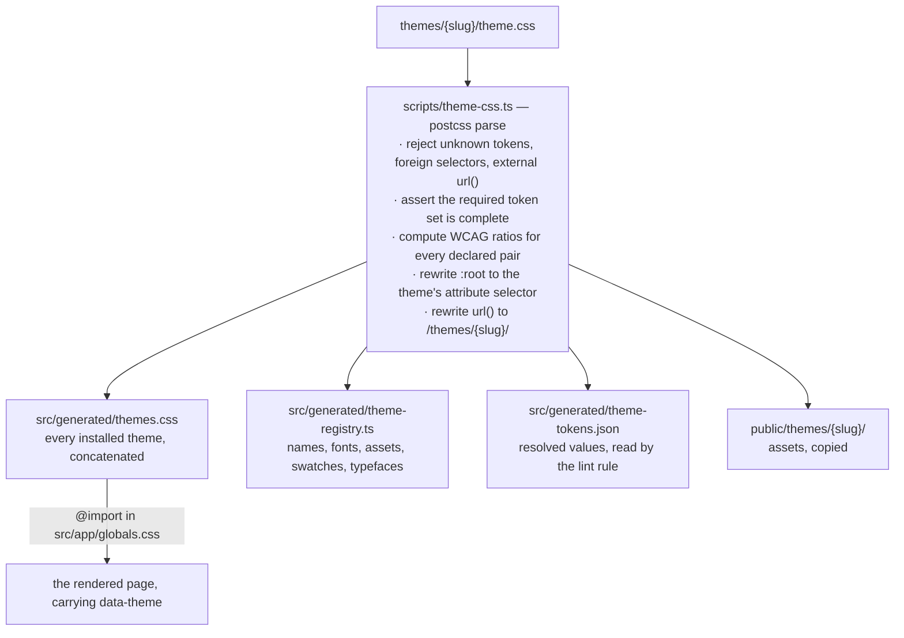

# Theme architecture

A theme is the third first-class abstraction in this repo, alongside apps and connectors, and it follows their conventions deliberately: folder-name-is-slug, one schema-validated manifest, `_`-prefixed templates skipped, `lastUpdated` stamped by the pre-commit hook, a generated registry nobody hand-edits.

## Directory layout

```
themes/
  AGENTS.md                  the authoritative guide
  _template/                 scaffold; skipped by the registry
  mixos/
    theme.json               manifest — schema-validated at build time
    README.md                optional — long-form description for the catalogue listing
    release-notes.json       optional — one line per change, for everyone it paints
    theme.css                tokens + allowlisted .mix-* surfaces
    assets/
      fonts/*.woff2
      logo.svg               optional — or .png, .jpg, .webp
      favicon.svg            optional
      preview.png            optional
```

## Manifest (theme.json)

| Field | Required | Description | Example |
| --- | --- | --- | --- |
| `$schema` | ✅ | Which shape the manifest is, and so which MixOS reads it: `https://mixos.org/schemas/theme/v1.json`, written first. The build refuses a manifest without it, or with a version this MixOS doesn't read. See [`$schema`](../apps/architecture.md#schema-which-shape-a-file-is). | `"$schema": "https://mixos.org/schemas/theme/v1.json"` |
| `name` | ✅ | Display name. The folder name is the slug; this is what a person reads. | `"name": "MixOS Dark"` |
| `description` | ✅ | What the theme looks like and who it is for. | `"description": "Slate and cyan on a dark ground."` |
| `tagline` |  | One line for a listing card on mixos.org — the version that fits beside the icon in a grid. Max 100 characters, single line. Where it is absent, `description` is used instead; setting only one of the two is the normal case. | `"tagline": "Slate and cyan on a dark ground"` |
| `keywords` |  | Search and browse terms for the catalogue. Lowercase words, separated by single spaces or hyphens; max 10, no duplicates. Lowercase is enforced because a facet list dedupes on the exact string — `Gmail` next to `gmail` renders as two filters for one idea and splits the results between them. | `"keywords": ["dark", "brand"]` |
| `license` |  | SPDX identifier or expression for the theme's licence, or `UNLICENSED` for something not redistributable. Validated as a shape, not against the full SPDX list — which still rejects the mistake worth rejecting: prose. `"MIT License"` fails the build; `"MIT"` passes. | `"license": "MPL-2.0"` |
| `themeUrl` |  | Where the theme lives for someone who wants to read about it — a homepage, a docs site, a repository directory. Absolute `https://` only: these render as links on pages served over https, and an author never sees the downgrade because their own dev server is http. | `"themeUrl": "https://example.com/x"` |
| `themeSupportUrl` |  | Where a user takes a problem with the theme — an issue tracker, a support page. Same `https://` rule. Kept separate from `themeUrl` because "read about it" and "something is broken" are different destinations, and collapsing them sends bug reports to a marketing page. | `"themeSupportUrl": "https://example.com/x/issues"` |
| `authors` |  | Array of `{ name, email }`, both required. Only the name is published on mixos.org. | `"authors": [{ "name": "Jane Doe", "email": "jane@example.com" }]` |
| `fonts` |  | Font faces the theme ships, each `{ family, file, weight, style, display }`. See [Assets](assets.md). | |
| `assets` |  | `{ logo?, favicon?, appIcon192?, appIcon512?, preview? }` — paths inside `assets/`. `logo` is the default mark, which apps may replace; `preview` is the admin picker's thumbnail. See [Assets](assets.md#logo-and-wordmark). | |
| `branding` |  | `{ name?, menuBarLogo?, loginLogo? }` — the brand slots this theme **claims**. A claimed slot is final: no app's brand filter runs for it. Logos are paths inside `assets/`; `name` is one line, up to 40 characters. See [Assets](assets.md#claiming-the-brand). | `"branding": { "name": "Acme Workspace" }` |
| `screenshots` |  | Images for the theme's catalogue listing, `[{ file, alt?, caption? }]`, with files under `themes/<slug>/screenshots/`. Not a replacement for `assets.preview`. The build verifies each one and fills in its URL and measured size. See [Assets](assets.md#screenshots). | `"screenshots": [{ "file": "screenshots/dashboard.png" }]` |
| `surfaces` |  | Allowlisted `.mix-*` surfaces this theme styles. Cross-checked against `theme.css` in both directions, so it can neither under-report a theme's reach nor carry a stale entry. | |
| `escapes` |  | Declared exceptions to platform guarantees. | |
| `lastUpdated` |  | Tool-written by the pre-commit stamp. Never hand-edited. | |

## Release notes

`release-notes.json` beside `theme.json` says what changed in the theme's
look, one line at a time. While the theme is the install's active one, MixOS
shows its notes from the last 14 days behind the gift icon in the menu bar,
and App Manager's Release Notes page keeps all of them. The file is optional.

```json
{
  "$schema": "https://mixos.org/schemas/release-notes/v1.json",
  "notes": [
    { "date": "2026-10-20", "note": "Muted text is a shade darker, so captions and dates are easier to read." },
    { "date": "2026-08-28", "note": "First release: white panels under a dark slate menu bar, with cyan accents." }
  ]
}
```

The file is `{ "$schema", "notes" }`, and each note is `{ "date", "version"?, "note" }`: the day the change shipped as
`YYYY-MM-DD`, no later than tomorrow, an optional release version, and one line
of plain text, 300 characters or fewer. Newest first, and no note twice on one
day. The build checks the file, and so does a Registry install before the theme
lands. Write for the people looking at it: what looks different, not which
token moved. The rules are an app's, in full:
[Release notes](../apps/architecture.md#release-notes-release-notesjson).

## What a theme controls, and what it cannot

| | Owned by |
|---|---|
| Token **values** — colour, radius, type stacks | the theme |
| Styling of the ten `.mix-*` surfaces | the theme |
| Fonts, favicon | the theme |
| Product name and marks | the theme where it claims them under `branding`, otherwise active apps' brand filters, otherwise `assets.logo` and "MixOS" |
| The utility → variable mapping (`@theme inline`) | the platform |
| Which token a component uses | the platform |
| Layout, spacing scale, component structure | the platform |

The asymmetry in the first and fourth rows is the load-bearing design decision. A theme supplies values; it can never add or remove a Tailwind utility. That is what makes `bg-card` mean the same thing under every theme, and it is why an app written once against the token names survives a rebrand without being touched.

## How a theme reaches the browser



Every installed theme is bundled. Switching the active one is a row in `platform_settings` and an attribute on `<html>` — not a rebuild, not a redeploy.

## Selection

One theme is active for the entire install, chosen by an admin at `/admin/themes`. There is no per-user override, and that is a deliberate simplification rather than a missing feature: the sign-in page, the public `/p/` app pages, and the favicon all have to render correctly with no current user to read a preference from.

**There is no mode axis.** A theme declares exactly one palette, so the theme slug is the whole appearance decision — `mixos` is light, `mixos-dark` is dark, and an admin picks one.

One axis keeps a class of bug out. There is one answer to "which colours am I looking at", so two can't disagree; every palette is one an admin selected and someone has looked at, rather than a block nobody chose; and the active theme is a server value, so `data-theme` is correct in the first byte of HTML with nothing to resolve on the client before first paint. See [`docs/plans/20260826_2041-single-palette-themes.md`](../plans/20260826_2041-single-palette-themes.md).

**Known gap:** because nothing tells the browser a render is dark, native UI the CSS does not paint — scrollbars, `<select>` popups, autofill, date pickers — renders light chrome under a dark theme. The fix is an `appearance` field on the manifest that the generator turns into `color-scheme`; it is deferred, not overlooked.

`getActiveTheme()` ([`src/lib/themes/active.ts`](../../src/lib/themes/active.ts)) is wrapped in React `cache()`, so a page with a layout, a header and a dozen server components makes one query. It degrades in two directions on purpose: an unreachable database falls back to the bundled default rather than 500-ing the sign-in page, and a slug naming an uninstalled theme resolves to the fallback rather than to nothing.

## No environment-conditional colour

Every colour the UI renders comes from the active theme, in every environment. A local tab and a production tab are visually identical; the menu bar carried an off-brand band on localhost until that was deliberately dropped in favour of one consistent look.

`FORBIDDEN_TOKENS` in [`src/lib/themes/tokens.ts`](../../src/lib/themes/tokens.ts) is empty but retained: it is where a value that must survive a theme change would go.

## Related

- [Authoring](authoring.md) · [Tokens](tokens.md) · [Contrast](contrast.md) · [Assets](assets.md)
- [`themes/AGENTS.md`](../../themes/AGENTS.md) — the invariants
- [`docs/apps/ux.md`](../apps/ux.md) — how an app is expected to consume tokens
